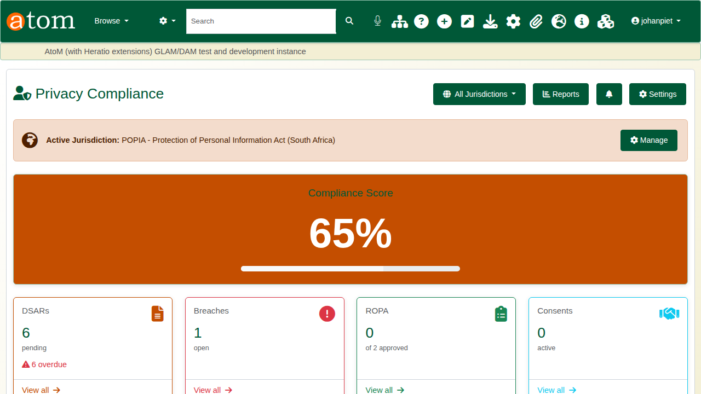
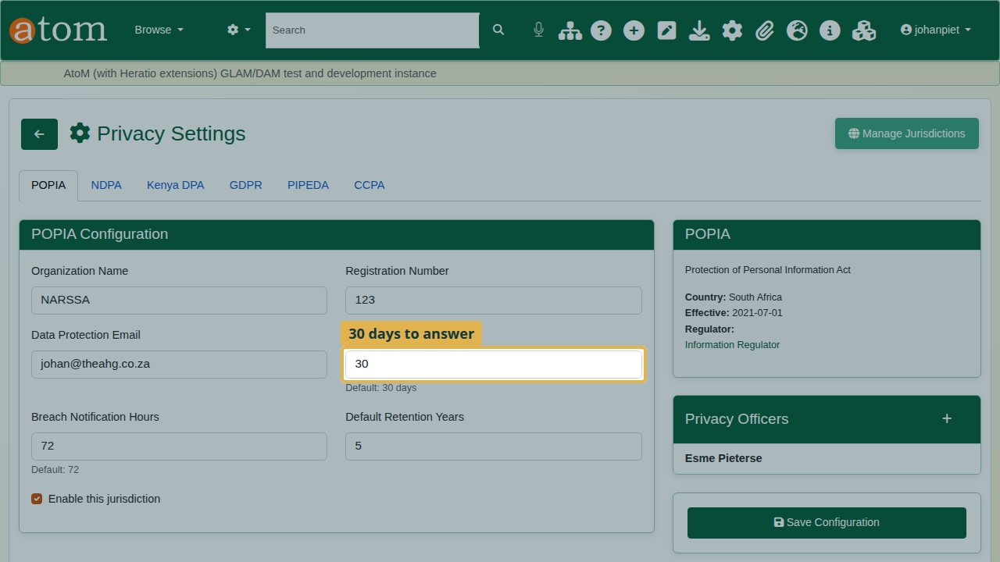
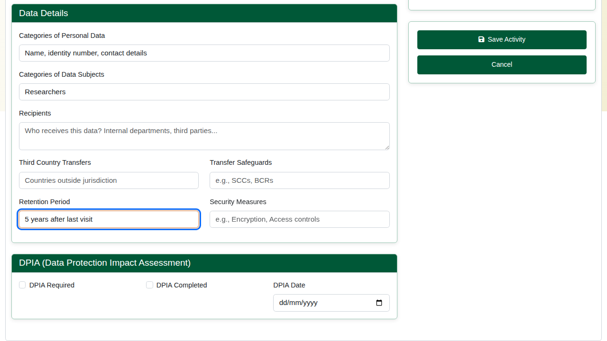
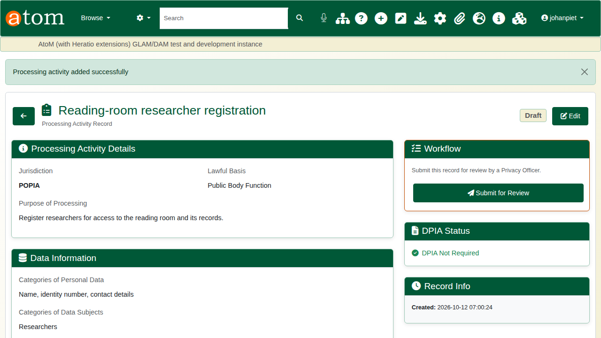
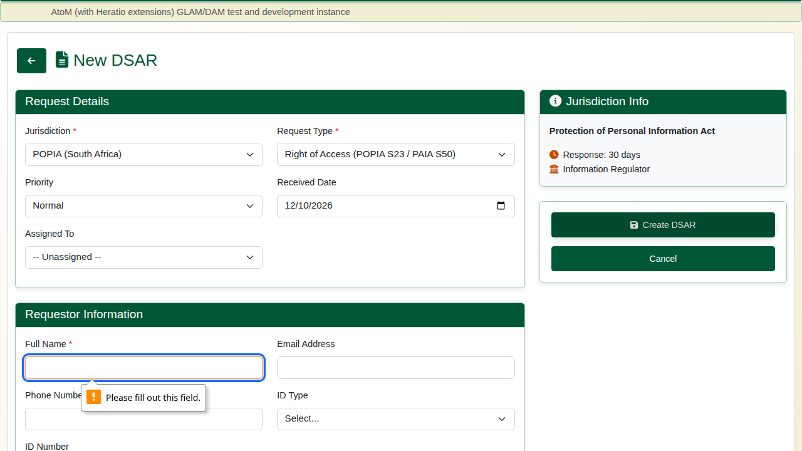
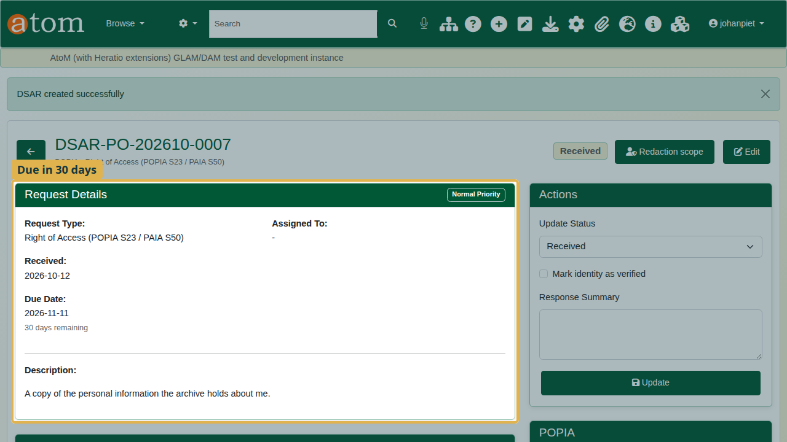
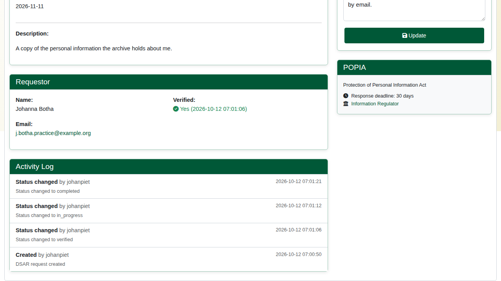
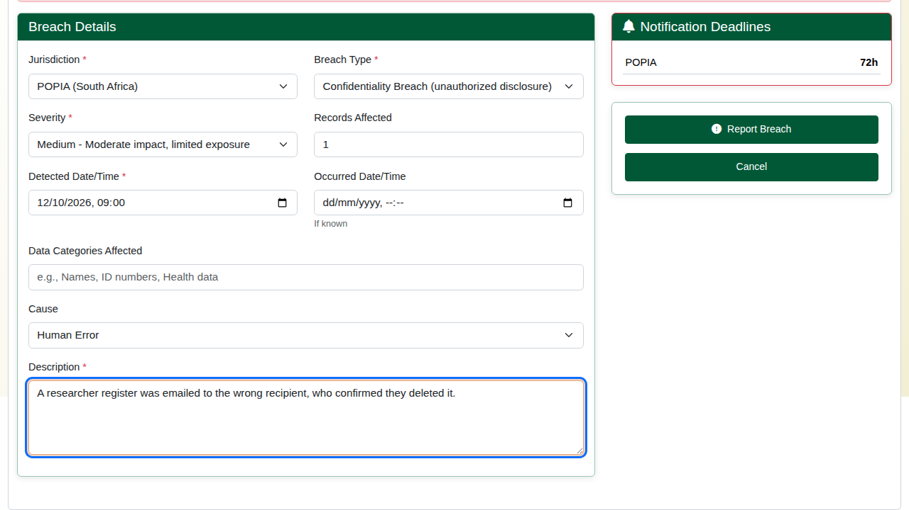
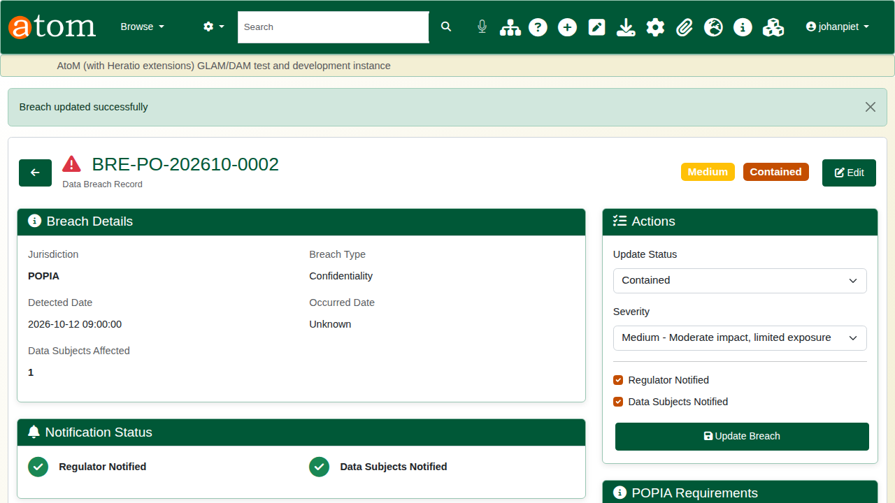

| Field | Value |
|---|---|
| Document title | Training: Compliance, Part 1 - Running a POPIA Programme |
| Author | Dr Johan Pieterse |
| Owner | The Archive and Heritage Group (Pty) Ltd |
| Version | 1.0 |
| Status | Released |
| Date | 12 October 2026 |
| Prepared for | Information officers and administrators using the AHG extensions |
| Classification | Public |
| Reference | AHG-TRN-CMP-01 |

: Document control

This guide goes with part 1 of the compliance training videos. It walks through a POPIA programme in Access to Memory: setting the privacy settings, recording a processing activity, taking a data subject's request from receipt to completion, and reporting a breach. Allow about 15 minutes.

## Before you start

| What | Notes |
|---|---|
| An administrator account | The privacy module sits under **Admin > Privacy**. |
| A jurisdiction | Six laws are supported: POPIA, NDPA, the Kenya DPA, the GDPR, PIPEDA and the CCPA. This guide uses POPIA. |

: What you need before you start

## 1. The compliance dashboard

Open **Admin > Privacy** (`/admin/privacy`). The dashboard shows the programme at a glance: open requests, breaches, processing activities and a compliance score.

## 2. Settings and the legal clocks

Click **Settings**. Each jurisdiction has its own tab. On **POPIA**, record the organisation name, registration number and data protection email, and set the clocks: the days allowed to answer a data subject (30 by default) and the hours within which a breach must be reported (72 by default). The default retention period sits here too. Add the information officer under **Privacy Officers**, then **Save Configuration**.

## 3. The processing register

POPIA expects a record of every processing activity. Click **Add Activity** and describe what is processed, why, and on what lawful basis. The example is registering researchers for the reading room, by a public body.

Under **Data Details**, add the categories of personal data and of data subjects, the recipients, any transfers outside the jurisdiction, and the retention period. Tick **DPIA Required** if the activity needs an impact assessment. Click **Save Activity**. The activity can then be submitted to the information officer for review.

## 4. A data subject request

A former researcher asks for a copy of her personal information. Click **New DSAR**.

The deliberate mistake: create it without the requester's name. The form refuses it and keeps everything typed. Add the name, choose the request type (here, Right of Access) and describe the request, then create it.

The request gets a reference (for example `DSAR-PO-202610-0007`) and a due date 30 days after receipt, with the days remaining counted down.

Work it through under **Actions**: tick **Mark identity as verified**, set the status to **In progress**, and once the information has been sent, set it to **Completed** with a summary of the response. Click **Update** after each step. Every step is written to the **Activity Log** with who did it and when. On a completed request the countdown is no longer shown.

## 5. Reporting a breach

A researcher register was emailed to the wrong person. Click **Report Breach** and record the jurisdiction, the breach type (a confidentiality breach), the severity, the records affected, when it was detected, the cause and what happened. **Notification Deadlines** shows how long you have to report it.

The breach is recorded with a reference. As it is handled, use **Update Breach** to record when the regulator and the people affected were notified.

## Recap

1. Set the privacy settings and the legal clocks.
2. Keep the processing register.
3. Log every data subject request and answer it within the deadline.
4. Record and report breaches.

Part 2 covers personal information inside records: scanning, review and redaction.
