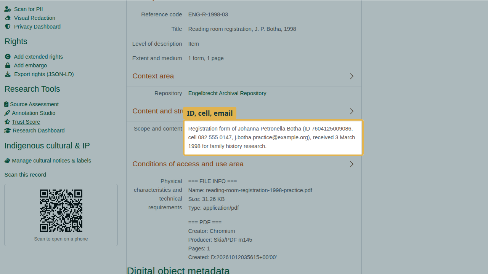
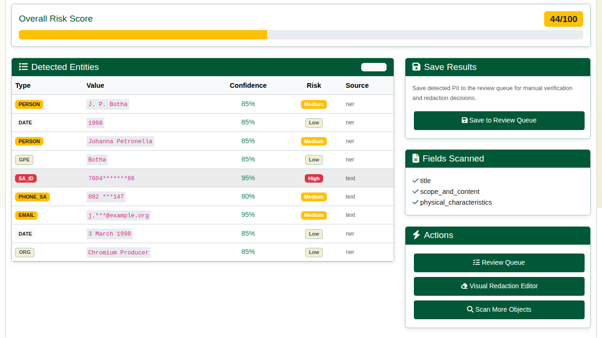
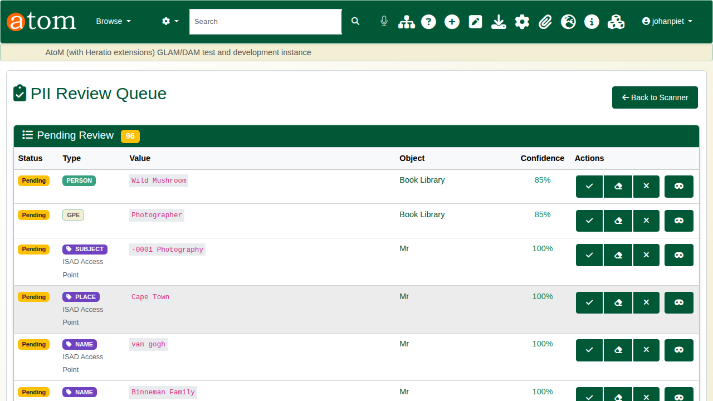
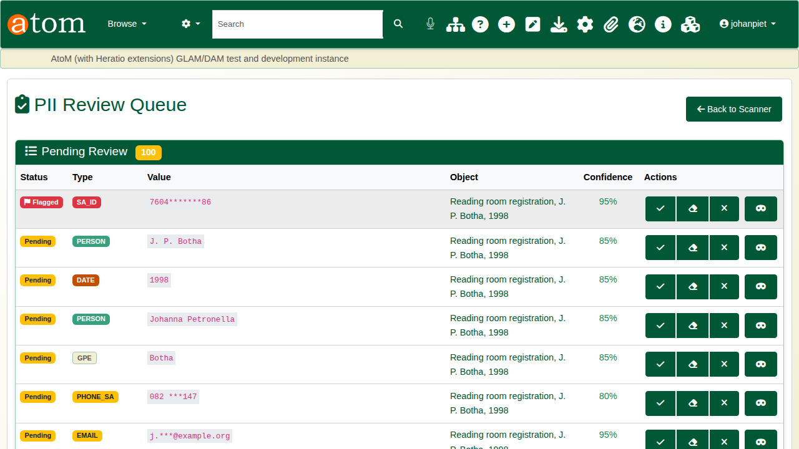
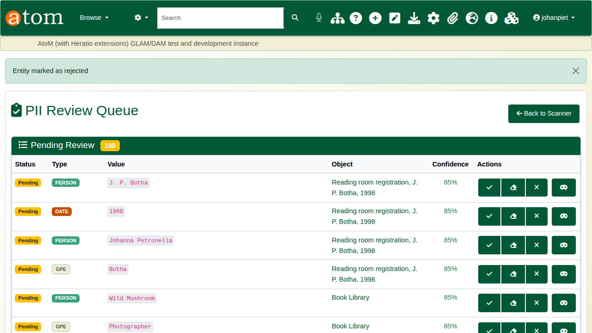
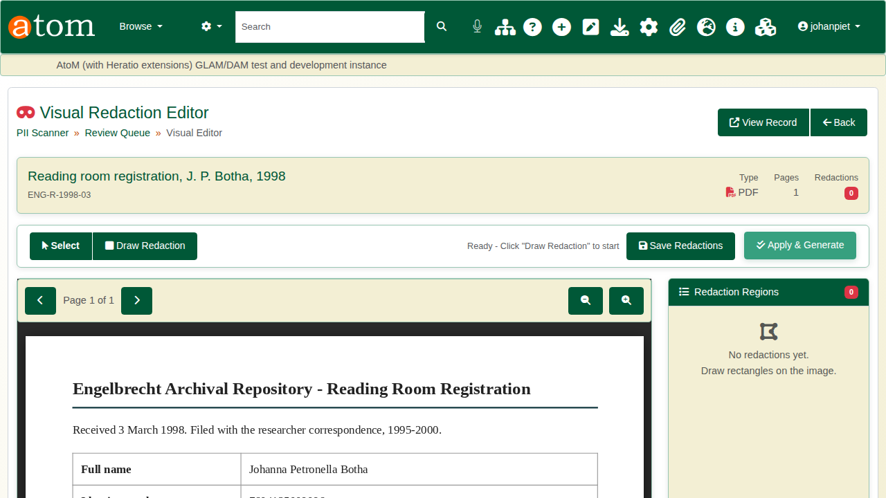
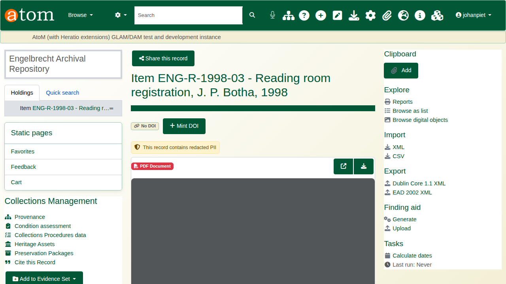
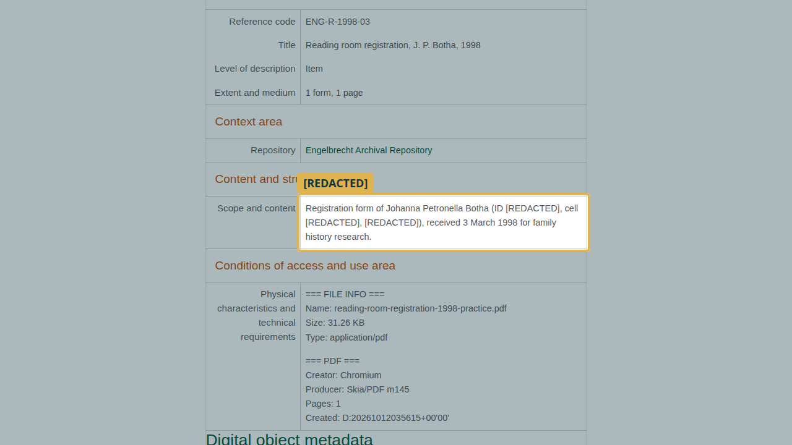

| Field | Value |
|---|---|
| Document title | Training: Compliance, Part 2 - Personal Information in Records |
| Author | Dr Johan Pieterse |
| Owner | The Archive and Heritage Group (Pty) Ltd |
| Version | 1.0 |
| Status | Released |
| Date | 12 October 2026 |
| Prepared for | Archivists and information officers using the AHG extensions |
| Classification | Public |
| Reference | AHG-TRN-CMP-02 |

: Document control

This guide goes with part 2 of the compliance training videos. A cataloguer typed a researcher's details into a description, and the scanned form attached to the record shows them too. You find them, decide what each one is, and redact them so visitors cannot see them. Allow about 15 minutes.

## Before you start

| What | Notes |
|---|---|
| An administrator account | Scanning, review and redaction are staff tasks. |
| The practice file | `reading-room-registration-1998-practice.pdf` in `docs/training-files/` of the AHG extensions catalogue: a reading room registration form from 1998. Every detail on it is fictitious. |
| A practice record | Create a record whose scope and content repeat the form's identity number, cell number and email, and attach the PDF. |

: What you need before you start

## 1. The problem

On the record, the scope and content gives the researcher's identity number, cell number and email address. Anyone visiting the catalogue can read them.

## 2. Scan the record

Open the PII scanner for the record (`/privacyAdmin/piiScanObject/id/<id>`). It reads the description fields and the text inside an attached PDF. It finds the South African identity number (rated high risk), the cell number and the email, as well as names and dates found by the named-entity service. Values are shown masked, so the scan result does not itself spread the data.

The deliberate mistake: open the **Review Queue** straight away. This record's findings are not there, because a scan only reaches the queue once it is saved. Go back to the scan and click **Save to Review Queue**.

## 3. Review each finding

The **PII Review Queue** (`/privacyAdmin/piiReview`) lists each finding with its type, masked value, record and confidence. Flagged findings are listed first.

Each finding takes one of three decisions:

| Decision | Meaning |
|---|---|
| Approve | It may stay visible. |
| Redact | It is personal information and is hidden from visitors. |
| Reject | It is not personal information at all (a false positive). |

: The three review decisions

In the example the identity number, cell number and email are redacted, and the date is approved. "Chromium Producer" is rejected: it comes from the PDF's own file details, not from the record. Every decision is recorded with who made it.

Redacted values are replaced with `[REDACTED]` wherever visitors see the description. The fields themselves are not changed, so staff still see the full text.

## 4. Redact the scanned document

Open **Visual Redaction** for the record (`/admin/privacy/redaction/<id>`). It shows the scanned form, where the identity number is still readable.

Click **Draw Redaction** and drag a box over the identity number. Click **Save Redactions**, then **Apply & Generate**. The original file is kept. Visitors get a redacted copy of the PDF, and the record's reference image and thumbnail are re-rendered from it.

## 5. Check what visitors see

Sign out and open the record. In the description, the identity number, cell number and email read `[REDACTED]`, and the record shows the note "This record contains redacted PII".

The visitor's copy of the form has the identity number blacked out by the drawn box, and the redacted values from the review are blacked out as well.

## Field redaction

The privacy module can also redact a whole field for visitors rather than individual values. A full redaction shows `[REDACTED - personal data removed]` in place of the field. A partial redaction such as **last four digits** masks the field except its last four characters. As with value redaction, staff still see the original.

## Recap

1. Scan the record.
2. Save the scan to the review queue.
3. Review each finding: approve, redact or reject.
4. Draw redactions on scanned documents and apply them.
5. Check the record as a visitor would see it.

Part 3 covers security classification and access requests.
