| Field | Value |
|---|---|
| Document title | Training: Compliance, Part 3 - Security Classification and Access Requests |
| Author | Dr Johan Pieterse |
| Owner | The Archive and Heritage Group (Pty) Ltd |
| Version | 1.0 |
| Status | Released |
| Date | 12 October 2026 |
| Prepared for | Archivists, information officers and administrators using the AHG extensions |
| Classification | Public |
| Reference | AHG-TRN-CMP-03 |

: Document control

This guide goes with part 3 of the compliance training videos. You classify a record as Confidential, see what a researcher without clearance gets, and take her request for access from submission to approval. Allow about 15 minutes.

## Before you start

| What | Notes |
|---|---|
| An administrator account | Classifying records and approving requests are administrator tasks. |
| A researcher account | The guide uses Anna, a researcher with no clearance. |
| A practice record | The video uses "Staff disciplinary file, K. Mokoena, 1987". Every name and detail in it is fictitious. |

: What you need before you start

## 1. Clearance levels

Every user has a clearance level. A record classified above a user's level is closed to them.

| Level | Classification |
|---|---|
| 0 | Public |
| 1 | Internal |
| 2 | Restricted |
| 3 | Confidential |
| 4 | Secret |
| 5 | Top Secret |

: Classification levels

A user's clearance is set on their clearance page (`/security/clearance/user/<username>`): the level, an optional expiry date and notes. Give staff the clearance their work needs. A user with no clearance sees only public material. Researchers usually need one record rather than a standing clearance, and section 3 covers that.

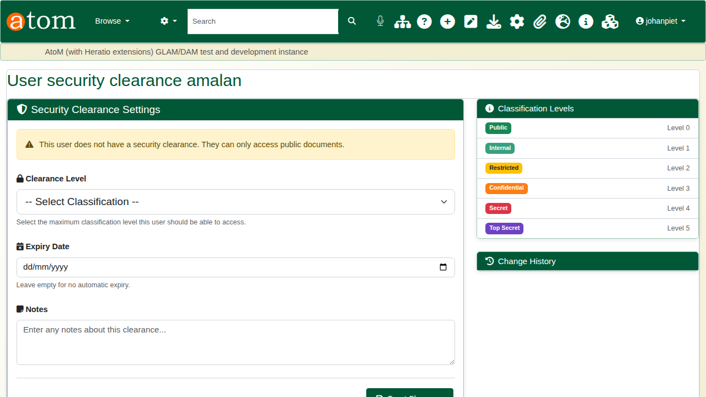

## 2. Classify a record

Edit the record and open **Security Classification**. Choose the level (here **Confidential**), give the reason, and set a review date. **Apply to child records** passes the classification down the hierarchy. Save.

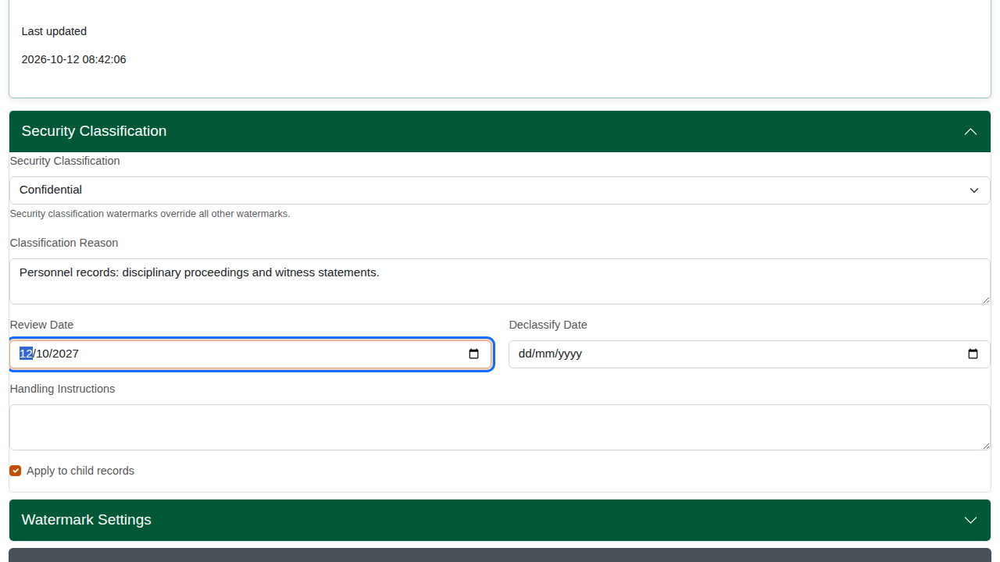

The record now shows its classification. Staff with enough clearance see it as before.

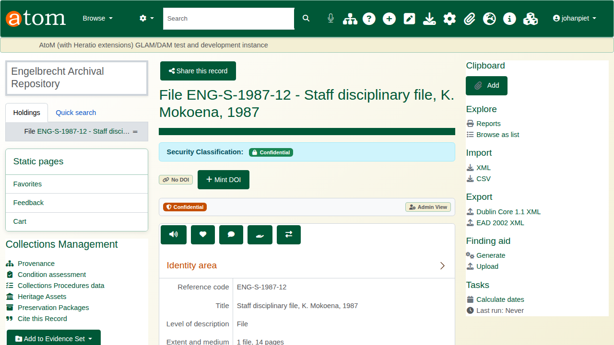

To remove a classification, choose **Public (No Classification)** and save. A child record cannot be classified lower than its parent; if the classification cannot be saved, the edit page says so.

## 3. The researcher's view

Signed in as Anna, the record is closed. The page says the material is classified Confidential and that her clearance does not permit access. It does not show the title, which can itself be sensitive.

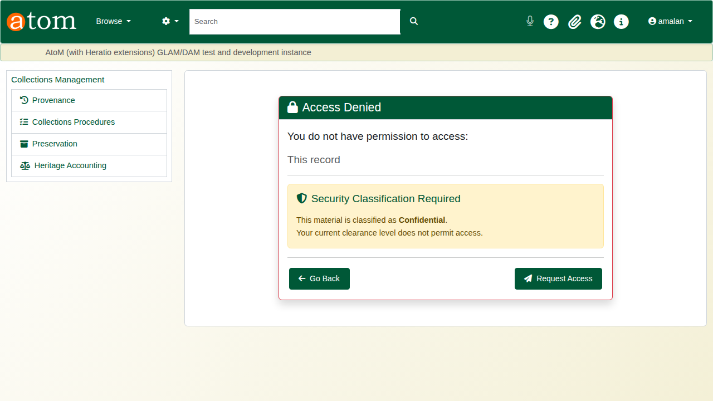

**Request Access** opens a request for this one record. Choose the access level (view only here), the urgency, and give a reason, which is required. Additional justification is optional. Click **Submit Request**.

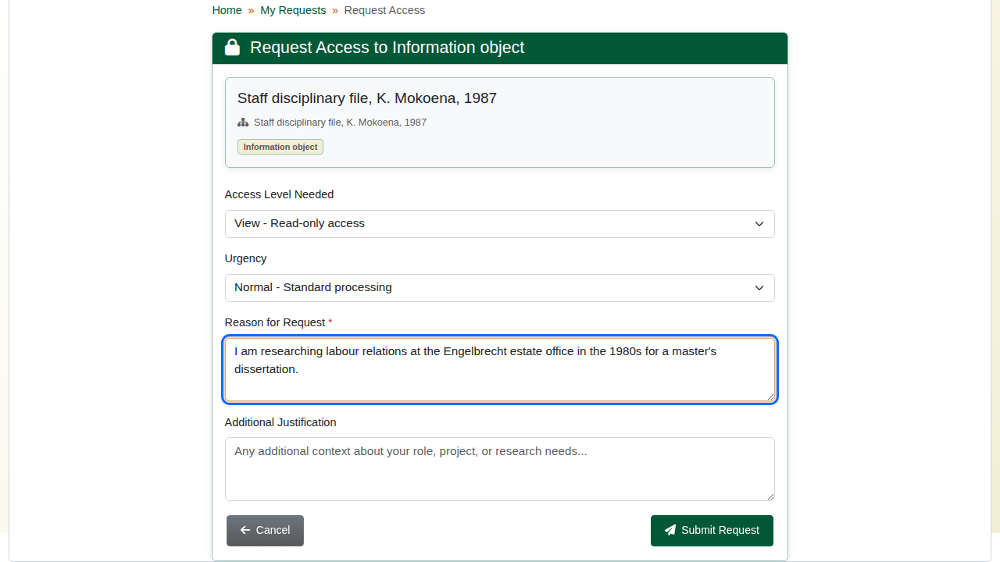

The request appears in **My Access Requests** (`/security/my-requests`) as **Pending**. A pending request can be cancelled from there.

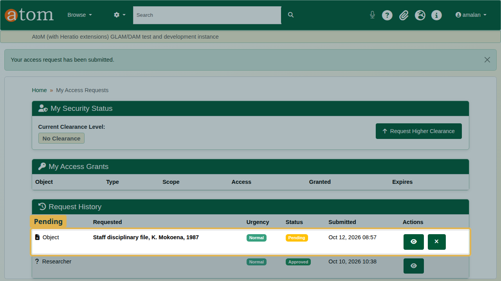

## 4. Review and approve

The **Security Dashboard** (`/security/dashboard`) lists pending access requests. The full queue is at **Access Requests** (`/security/access-requests`).

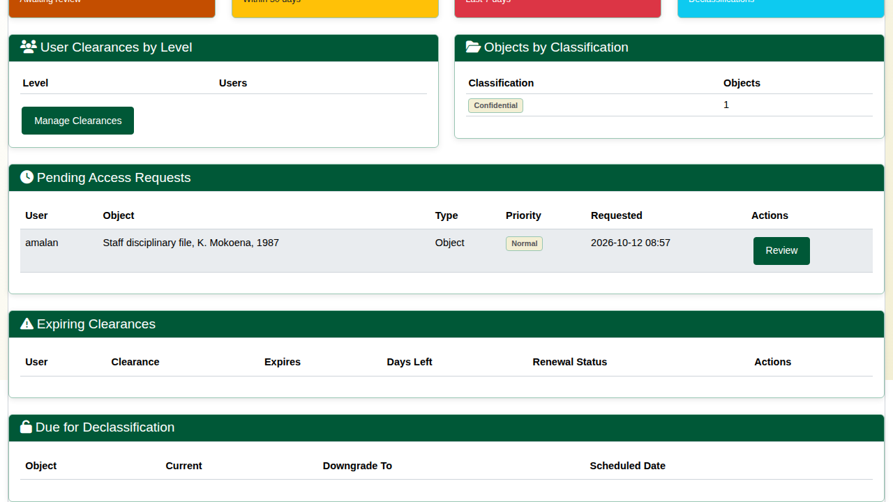

**Review** opens the request: who is asking, for which record, how urgently, and why.

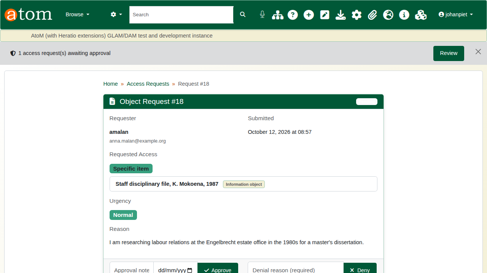

To approve, add a note and an end date, then click **Approve**. The access lapses by itself on that date. To deny, give a reason and click **Deny**.

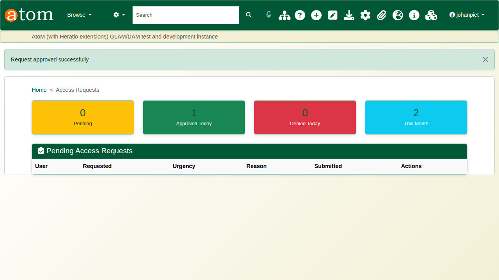

## 5. Access granted

Anna can now open the record, and only this record: her clearance has not changed.

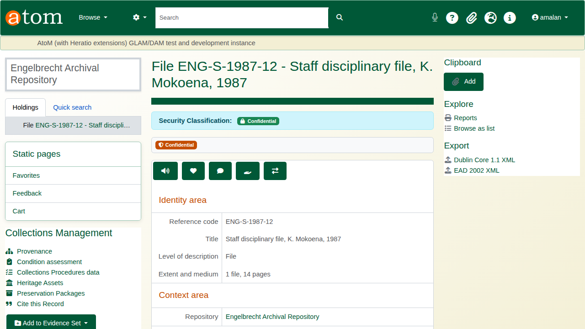

**My Access Grants** lists the grant with its scope, access level and expiry date.

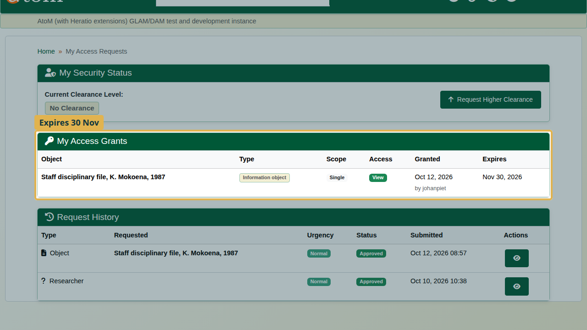

An approved request lifts only the security classification. A donor closure or an embargo on the same record still applies.

## Recap

1. Give staff the clearance their work needs.
2. Classify sensitive records, with a reason and a review date.
3. Researchers request access to a single record, with a reason.
4. Approve with an end date, and the grant lapses by itself.

Part 4 covers rights, embargoes and traditional knowledge labels.
