| Field | Value |
|---|---|
| Document title | Training: Compliance, Part 4 - Rights, TK Labels and Embargoes |
| Author | Dr Johan Pieterse |
| Owner | The Archive and Heritage Group (Pty) Ltd |
| Version | 1.0 |
| Status | Released |
| Date | 12 October 2026 |
| Prepared for | Archivists and rights officers using the AHG extensions |
| Classification | Public |
| Reference | AHG-TRN-CMP-04 |

: Document control

This guide goes with part 4 of the compliance training videos. It covers four tasks on an oral history recording: recording its copyright status and licence, attaching the community's traditional knowledge (TK) label and cultural notice, embargoing it while the community is consulted, and lifting the embargo. Allow about 15 minutes.

## Before you start

| What | Notes |
|---|---|
| An editor or administrator account | Rights, ICIP and embargoes are staff tasks; visitors cannot open these pages. |
| A practice record | The video uses "Oral history: harvest songs of the Lekgalong community, 1998". The community and everyone in it are fictitious. |

: What you need before you start

## 1. Rights statement and licence

On the record, click **Add extended rights** (or **Edit extended rights** once set). Choose the **Rights Statement** from the RightsStatements.org list and, where the material is openly licensed, the **Creative Commons License**. A rights holder can be chosen from the donors. Click **Save Rights**.

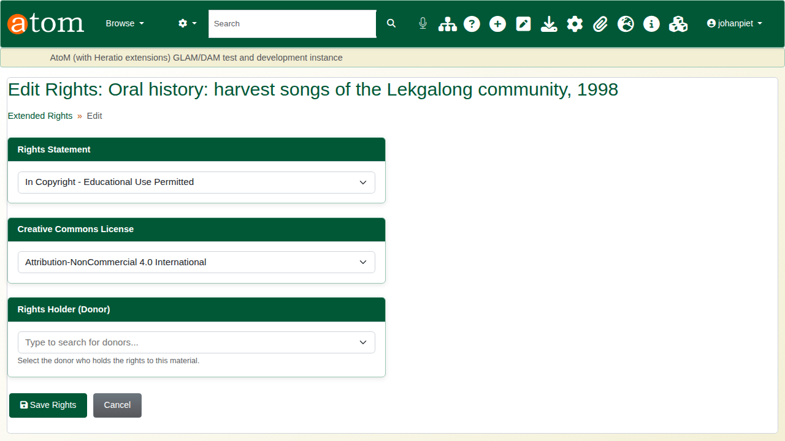

The record shows the statement and licence, each linked to its published definition.

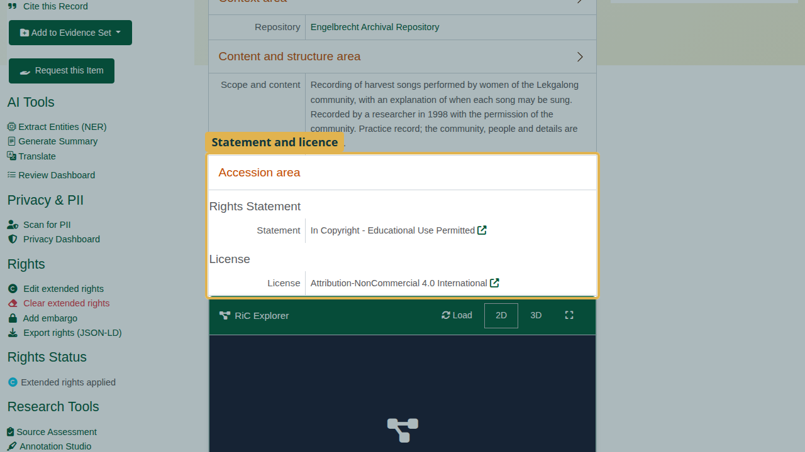

## 2. The community

TK labels and cultural notices belong to a community, so record the community first: **Indigenous cultural & IP > Communities > Add Community** (`/icip/community/add`). Give its name and where it is. The State/Territory list is Australian; for a community elsewhere choose **Other / outside Australia** and use **Region**. Click **Create Community**.

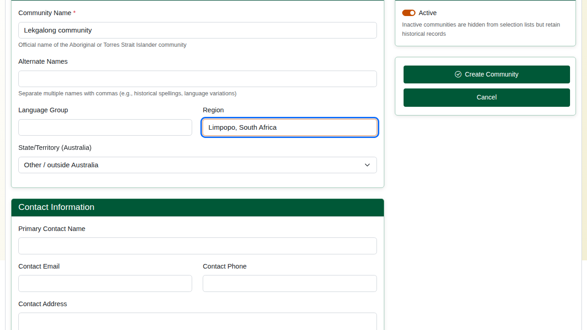

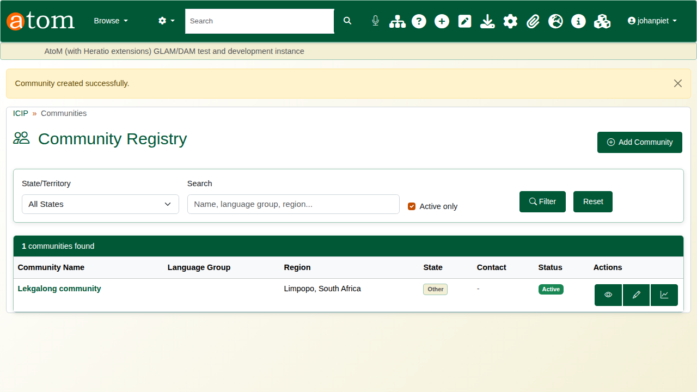

## 3. TK label and cultural notice

From the record, open **Manage cultural notices & labels**. Under **TK Labels**, choose the label (here **TK Community Voice**), the community, and who applied it: the community itself or the institution. Click **Add Label**.

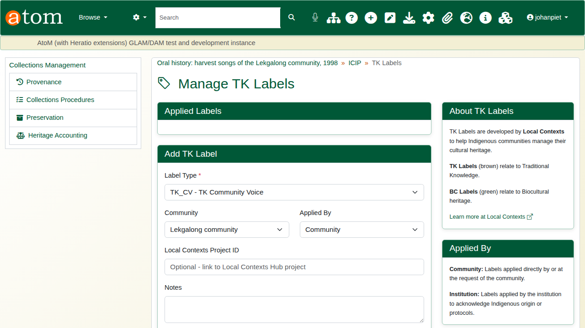

Under **Notices**, choose the notice type (here **Seasonal Restriction**), the community and, if the default wording does not fit, the community's own text. Start and end dates are optional, and **Apply to child records** passes the notice down the hierarchy. Click **Add Notice**.

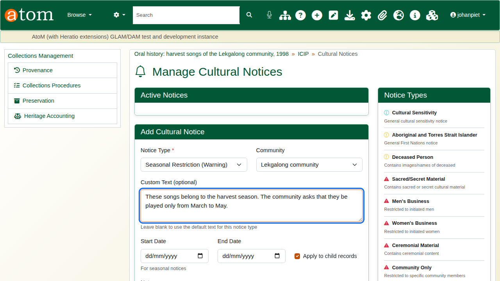

The notice appears at the top of the record.

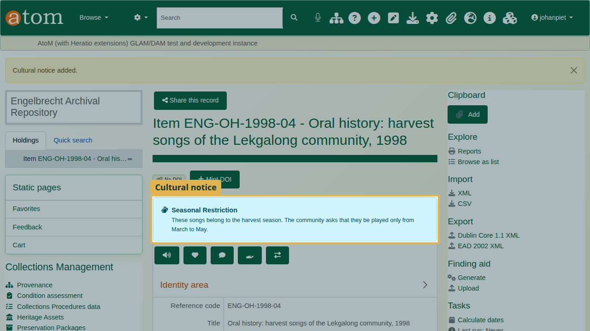

## 4. What visitors see

Signed out, a visitor sees the cultural notice first, then the TK label under Indigenous cultural & IP, the rights statement and the licence.

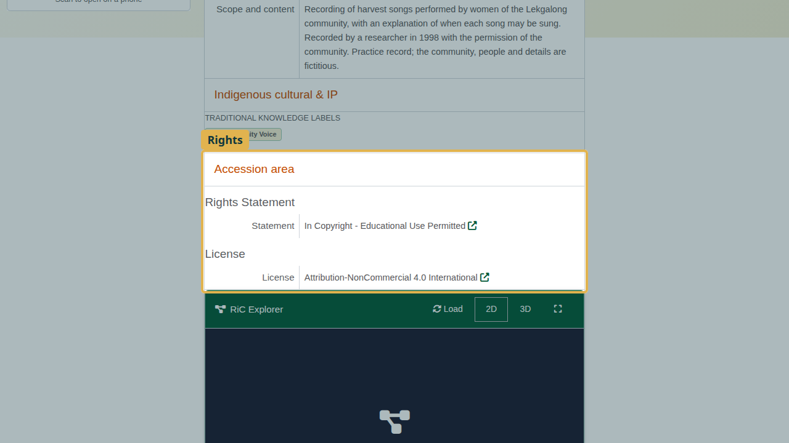

## 5. Embargo

On the record, click **Add embargo**.

| Embargo type | Effect |
|---|---|
| Full | Hides the record completely from visitors, including search |
| Metadata Only | Hides the digital objects; the description stays visible |
| Digital Object | Restricts downloads |
| Custom | As configured for your site |

: Embargo types

Set the start and end dates, or tick **Perpetual** for no end date. The **Reason** is shown to visitors who are turned away; **Internal Notes** are for staff only.

The deliberate mistake: an end date before the start date. The embargo is refused with "The end date is before the start date", and everything typed is kept.

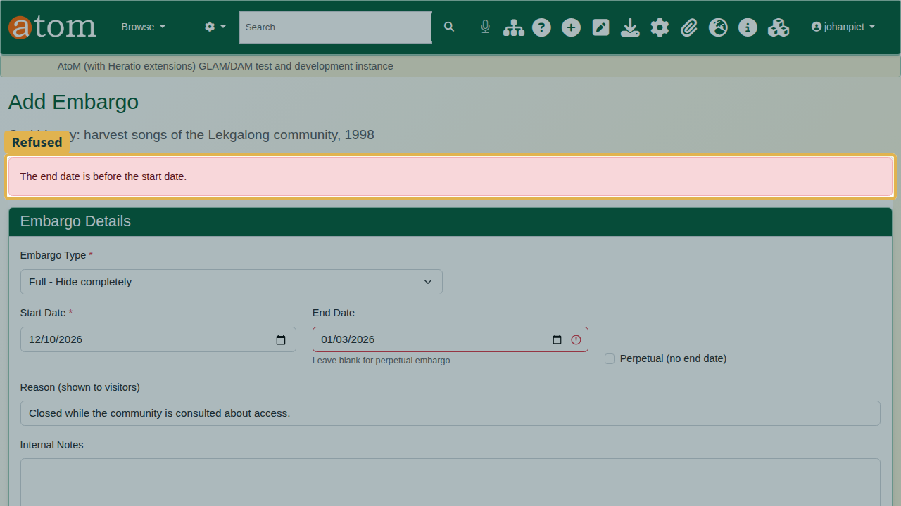

Correct the end date and click **Create Embargo**. The record shows that it is embargoed.

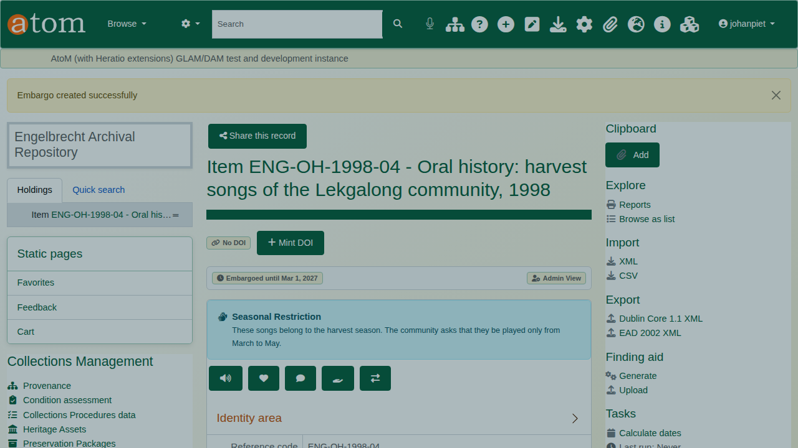

Signed out, the record is closed. The visitor is told it is under embargo, until when, and why. The title is withheld, and the record no longer appears in search results.

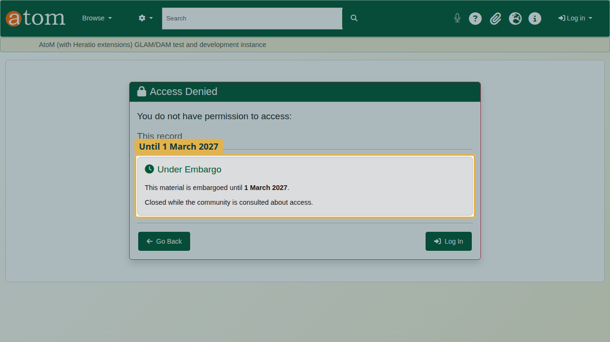

## 6. Lift the embargo

**Embargo Management** (`/extendedRights/embargoes`) lists every active embargo, those with an end date first.

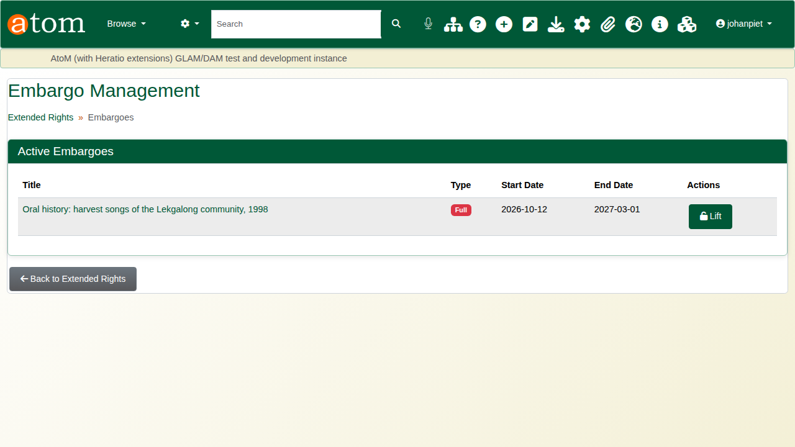

Click **Lift**, give the reason, and click **Lift Embargo**. The record opens again, and the lift is recorded with who did it and why. An embargo with an end date is also released by the scheduled `embargo:process` task once that date passes.

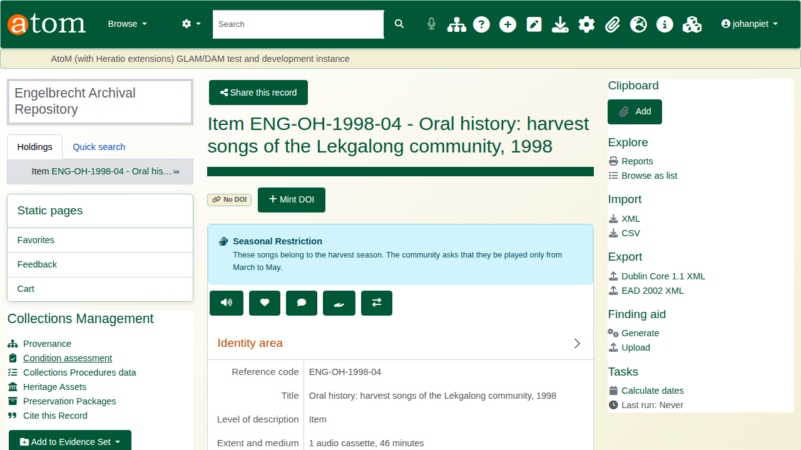

## Recap

1. Record the rights statement and licence.
2. Record the community, then its TK labels and cultural notices.
3. Check what visitors see.
4. Embargo with an end date and a reason; lift it when the time comes.

Part 5 covers the audit trail.
