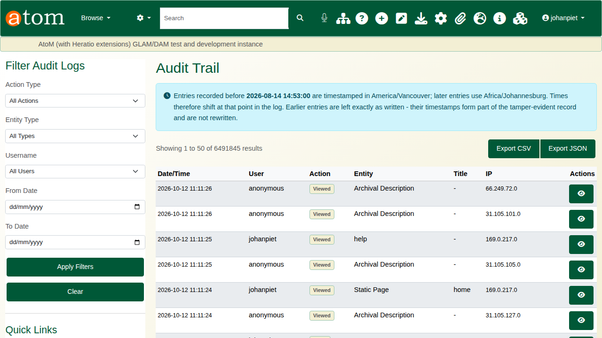
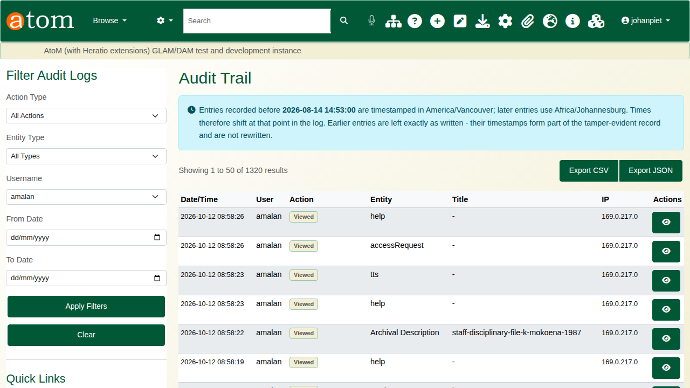
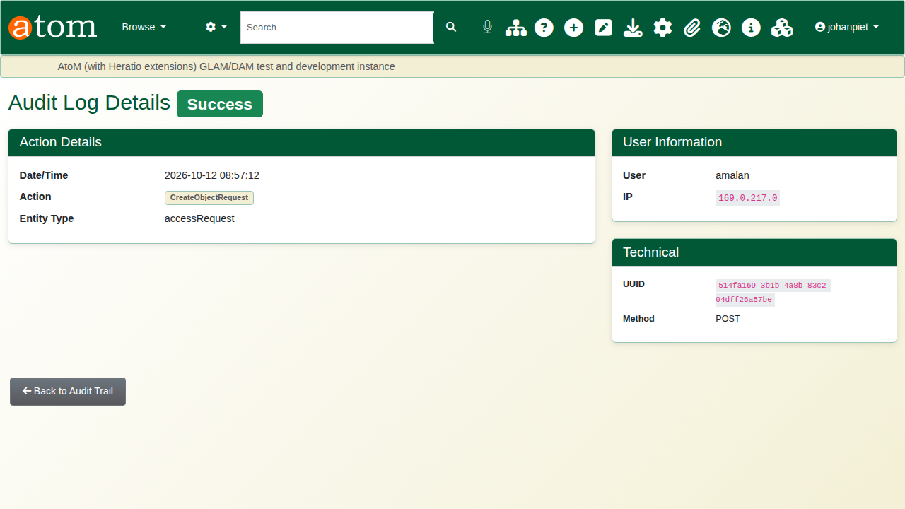
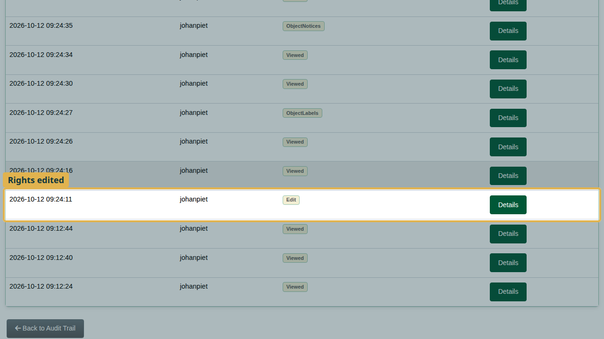
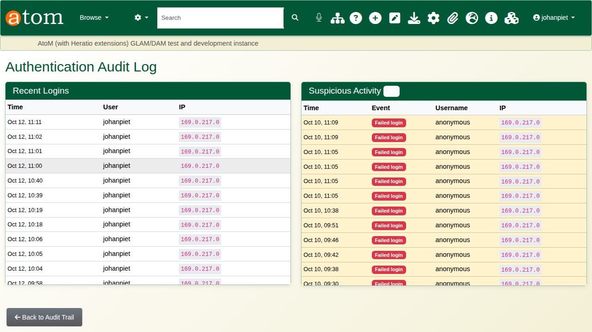
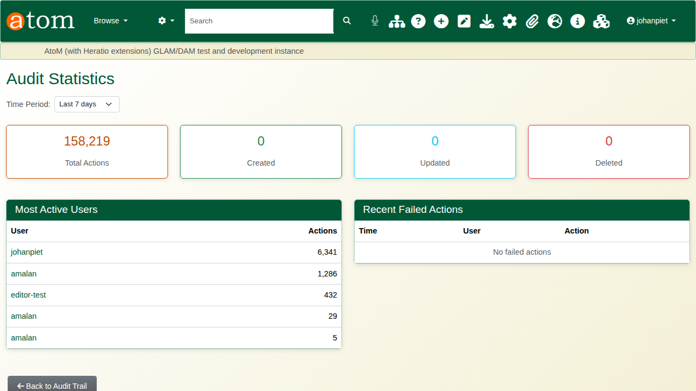
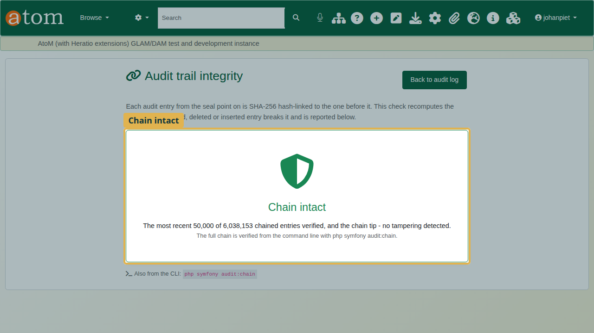
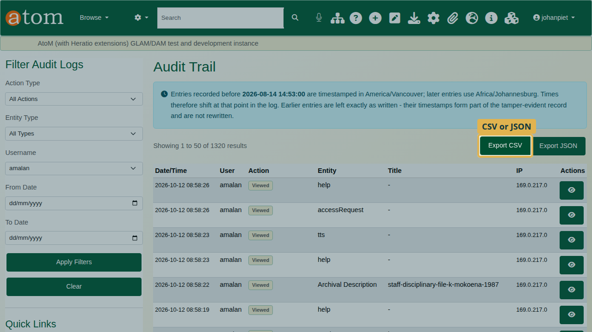
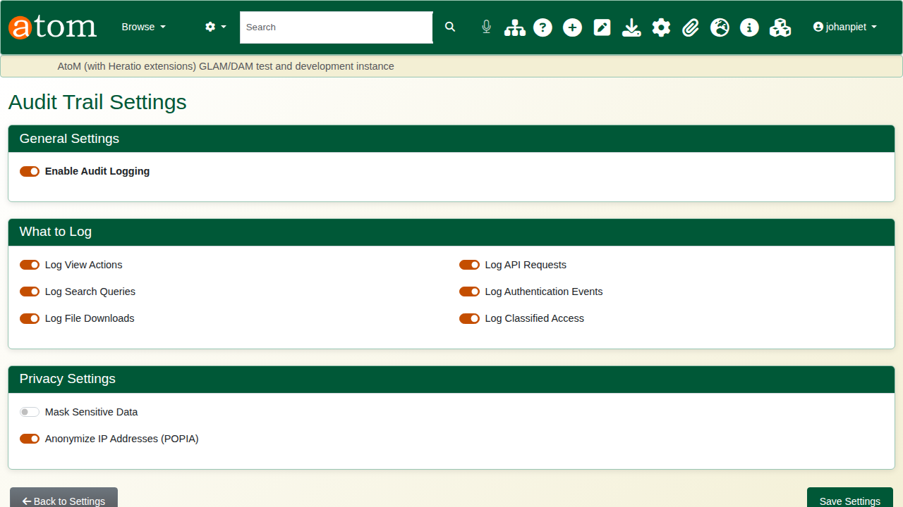

| Field | Value |
|---|---|
| Document title | Training: Compliance, Part 5 - The Audit Trail |
| Author | Dr Johan Pieterse |
| Owner | The Archive and Heritage Group (Pty) Ltd |
| Version | 1.0 |
| Status | Released |
| Date | 12 October 2026 |
| Prepared for | Administrators, information officers and auditors using the AHG extensions |
| Classification | Public |
| Reference | AHG-TRN-CMP-05 |

: Document control

This guide goes with part 5, the last of the compliance training videos. It shows how to find who did what and when, read a single entry, see a record's history, check logins and activity, prove that the log has not been altered, and export it for an auditor. Allow about 15 minutes.

## Before you start

| What | Notes |
|---|---|
| An administrator account | The audit trail is administrator-only, at **Admin > Audit trail** (`/admin/audit`). |
| Entries to look at | The video uses entries recorded while making parts 1 to 4. |

: What you need before you start

## 1. The audit log

Every action is logged: the user, the action, the record, the time and the address it came from. Filter by **Action Type**, **Entity Type**, **Username** or a date range, then **Apply Filters**.



Filtered to one user, the log shows everything that person did.



## 2. A single entry

The eye button opens an entry: date and time, action, record type and id, the user, the address, the request method and the entry's unique identifier. Addresses are stored with their last part removed.



## 3. A record's history

`/admin/audit/entity/QubitInformationObject/<id>` gathers everything done to one archival description: edits, rights, TK labels and cultural notices added from the record's own pages, and views, each with who did it and when. **Details** opens the entry.



Embargoes are logged against the embargo rather than the record, so search for them under the action type **Add** or **Lift** with entity type **Embargo**.

## 4. Logins and statistics

**Authentication Log** lists sign-ins and sign-outs, and **Suspicious Activity** lists failed logins: the first sign of someone guessing passwords.



**Statistics Dashboard** shows the volume of activity and the most active users over the last 7, 30 or 90 days. It opens on 7 days; longer periods take longer on a large log.



## 5. Proving nothing was changed

Each entry is linked to the one before it by a SHA-256 hash. Changing, deleting or inserting an entry breaks the chain at that point. **Integrity check** (`/admin/audit/integrity`) recomputes the most recent 50,000 entries and the end of the chain in a few seconds, and reports either **Chain intact** or where the chain breaks and why.



The full chain is verified from the command line, and can be scheduled nightly:

```
cd /usr/share/nginx/archive && sudo -u www-data php symfony audit:chain
```

Entries cannot be edited or deleted through the database either: the log is append-only.

## 6. Export

**Export CSV** and **Export JSON** download the log with the current filters applied, for an auditor or a POPIA request. An export holds at most the 10,000 most recent matching entries, so narrow the dates or the user for longer periods.



## 7. Settings

**Settings** decide whether auditing is on, what is logged (views, searches, downloads, API requests, authentication events, classified access) and how personal details in the log are protected (masking sensitive data, anonymising addresses).



Logging views records every page a visitor opens. On a busy public site that is most of the log; turn it off if views are not needed for compliance.

## Recap

1. Filter the log to find who did what.
2. Open an entry for the detail.
3. Use a record's history and the authentication log.
4. Check the chain's integrity, and schedule the full check.
5. Export what an auditor needs.

This completes the compliance series.
