| Field | Value |
|---|---|
| Document title | Training: Discovery, Part 1 - IIIF Images |
| Author | Dr Johan Pieterse |
| Owner | The Archive and Heritage Group (Pty) Ltd |
| Version | 1.0 |
| Status | Released |
| Date | 15 October 2026 |
| Prepared for | Archivists, curators and web staff using the AHG extensions |
| Classification | Public |
| Reference | AHG-TRN-DIS-01 |

: Document control

This guide goes with part 1 of the discovery training videos. It covers how images are shown and shared through IIIF, the International Image Interoperability Framework: the viewers on a record, shared views of a detail, the IIIF manifest, comparing images, IIIF collections, the viewer settings and the validation dashboard. Allow about 20 minutes.

## Before you start

| What | Notes |
|---|---|
| Viewing | Anyone: the viewers, shared views and manifests are public for published records. |
| Administration | Collections, settings, shared views and validation need an administrator account. |
| Example records | Photographs from the Engelbrecht family fonds. |

: What you need before you start

## 1. The viewer

A record with an image shows it in a IIIF viewer below the description. **Mirador** (the full IIIF viewer) is the default; the image is served in tiles by the IIIF image server, so large scans open quickly and zoom smoothly. Use the zoom buttons or the mouse wheel.

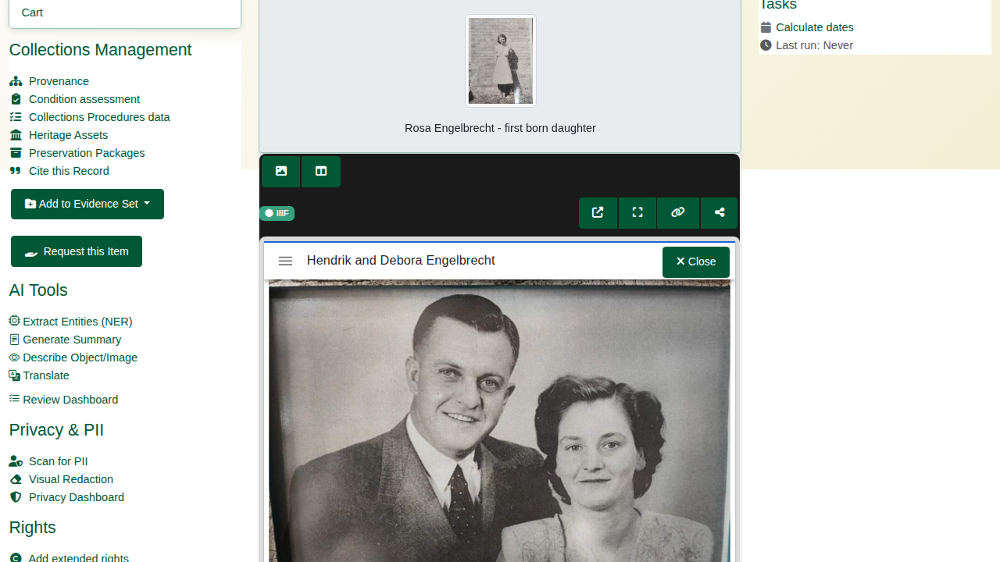

The toolbar above the viewer switches to the lighter **image viewer** (OpenSeadragon) and back, and offers:

| Button | Does |
|---|---|
| New window | Opens the viewer on a page of its own |
| Full screen | Fills the screen with the image |
| Manifest link | Copies the record's IIIF manifest URL, for use in any IIIF viewer |
| Share this view | Copies a link to the current page and zoomed region (see 2) |

: Viewer toolbar

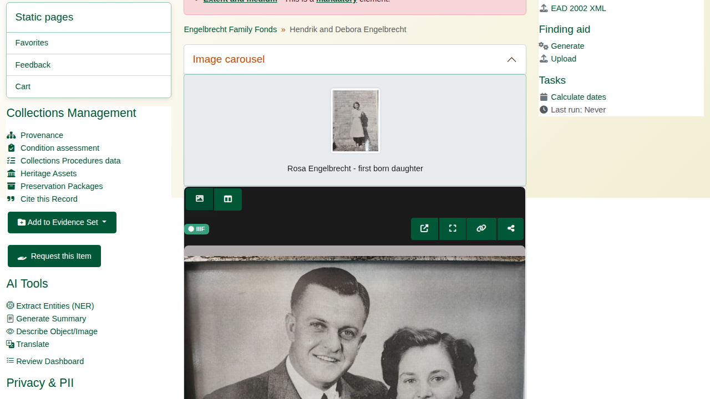

## 2. Sharing a view

In the image viewer, zoom to a detail and press **Share this view**. The archive saves the view (IIIF Content State) and gives a short link, copied to the clipboard and shown under the toolbar. Opening the link shows the same record, zoomed to the same detail, also for visitors who are not signed in. Links are valid for 90 days.

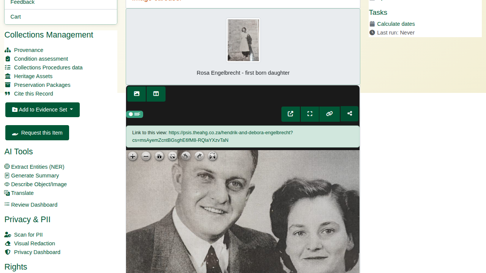

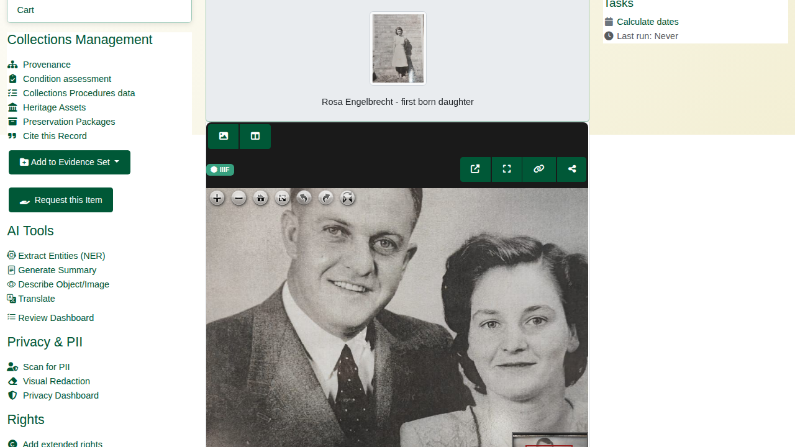

## 3. The manifest

Every record with images has a IIIF Presentation 3 manifest at `/iiif/v3/manifest/<slug>` (also at `/iiif/manifest/<slug>`): its title, metadata, images and image services. External IIIF viewers and aggregators use it; visitors get the reference image, never the master.

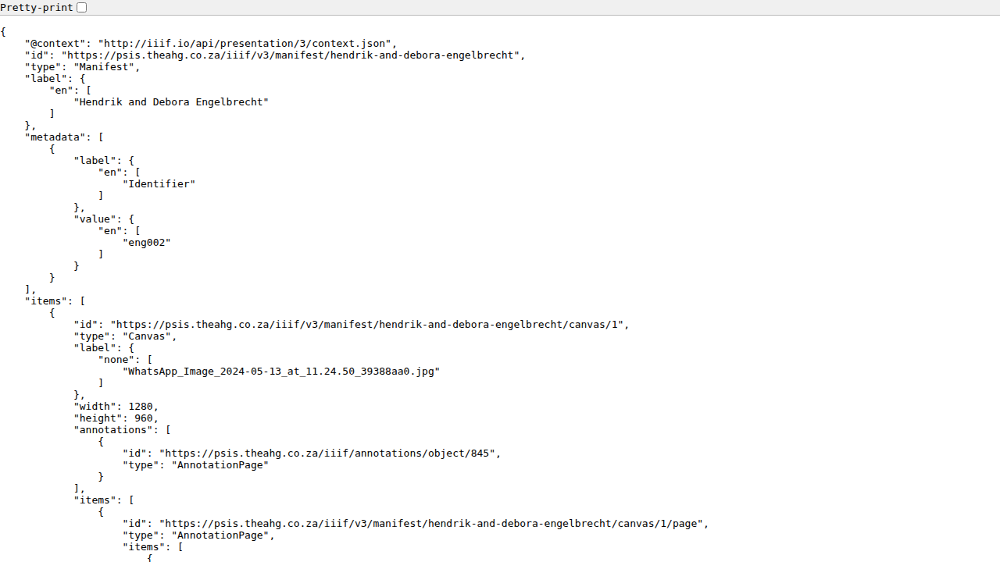

## 4. Comparing images

**Compare** opens two or more records side by side in Mirador, each zooming independently: `/iiif/compare?slugs=<slug>,<slug>`.

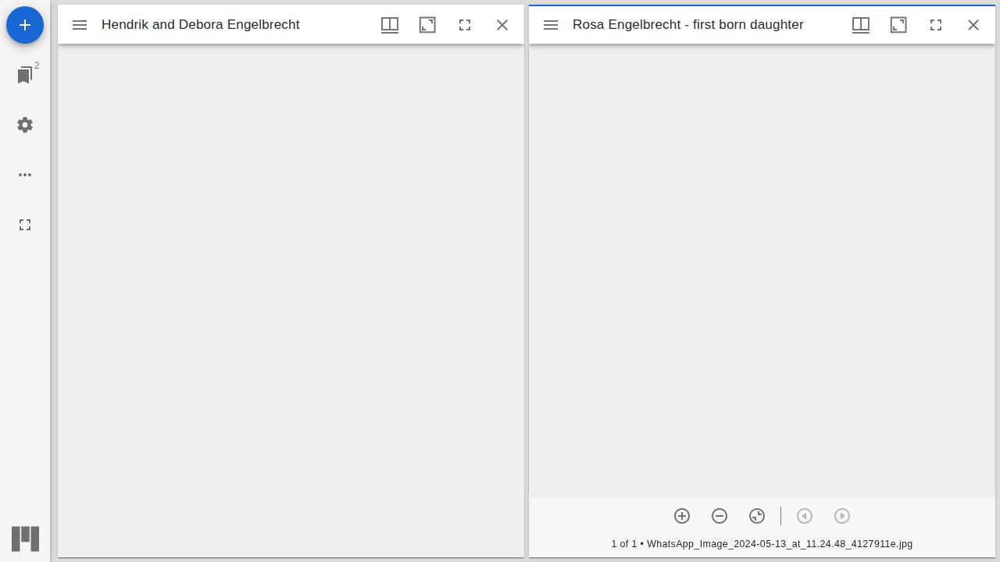

## 5. Collections

**IIIF Collections** (`/manifest-collections`) group records from across the catalogue. Each collection has its items (drag the handles to reorder them), subcollections, visibility, a viewing hint and a public IIIF address (**View IIIF JSON**). **Add Items** searches the catalogue.

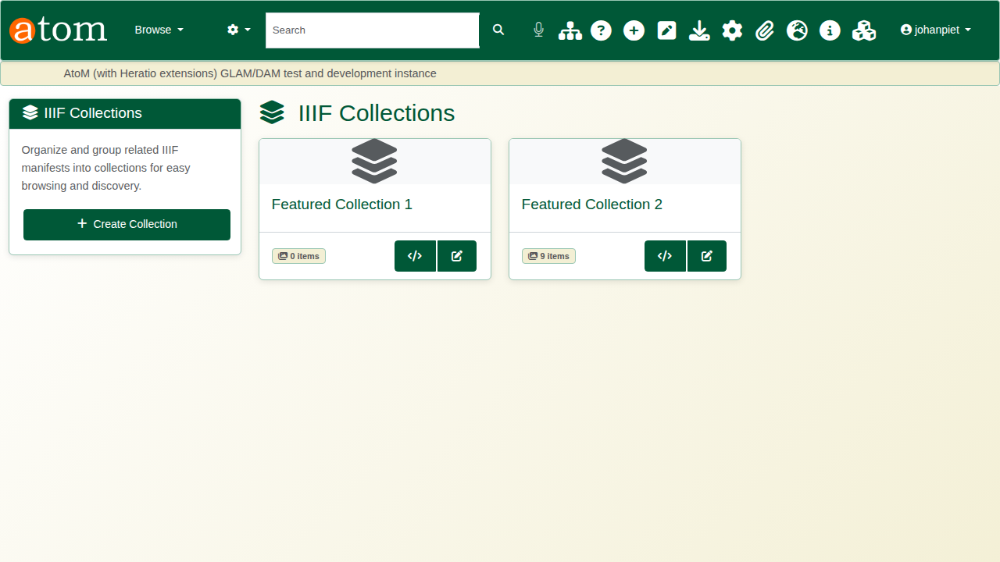

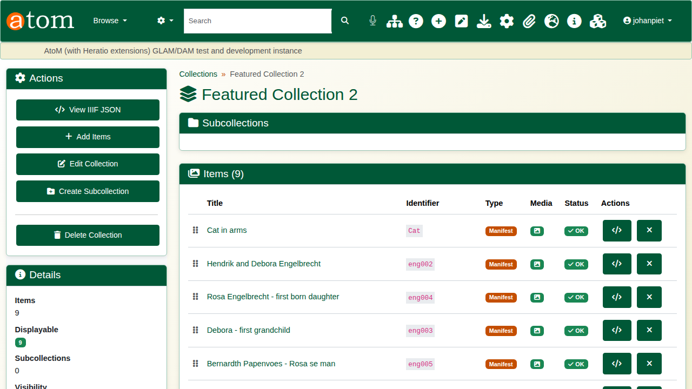

## 6. Viewer settings

**IIIF Viewer Settings** (`/admin/iiif-settings`) set:

| Section | Settings |
|---|---|
| Homepage featured collection | Carousel on or off, which collection, height, number of items, auto-rotation, captions, speed |
| Record page viewer | Mirador or the image viewer, and the viewer height |
| Description page carousel | The strip of images from records below a description |
| Appearance and display locations | Background, full-screen and zoom controls; record pages and browse cards |

: Viewer settings

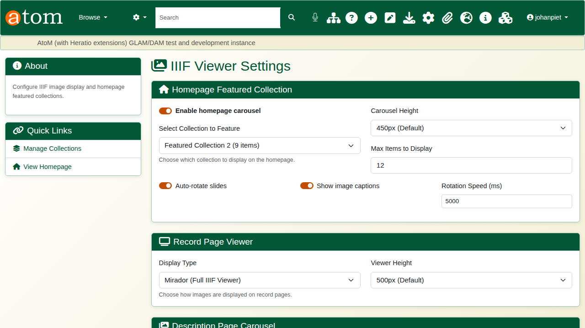

## 7. Shared views and validation

**IIIF Shared Views** (`/admin/iiif-content-state`) lists the shared views with the record, the link, how often it was opened, and when it expires.

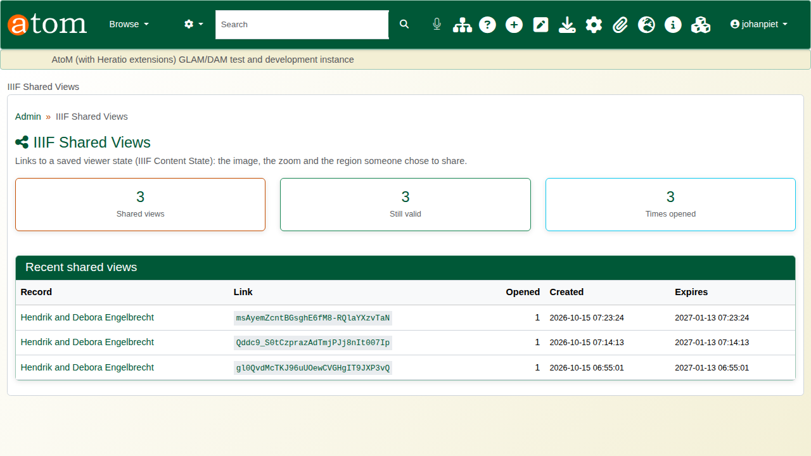

The **IIIF Compliance Dashboard** (`/admin/iiif-validation`) checks records' manifests against the IIIF rules (label, canvases, thumbnail, rights, required statement, image service and more). **Validate** on a row shows the passes and warnings; failures are listed at the top.

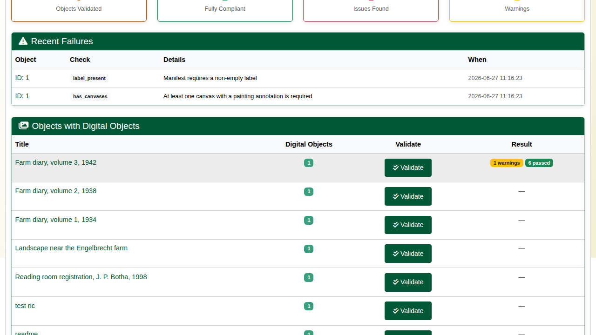

## Recap

1. Every image opens in a deep-zoom IIIF viewer.
2. A view of any detail can be shared as a link.
3. Images can be compared side by side and grouped into collections.
4. The IIIF the archive publishes is checked against the standard.

Part 2 covers 3D models.
