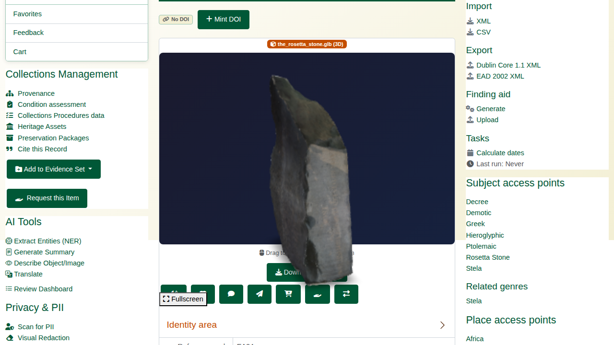
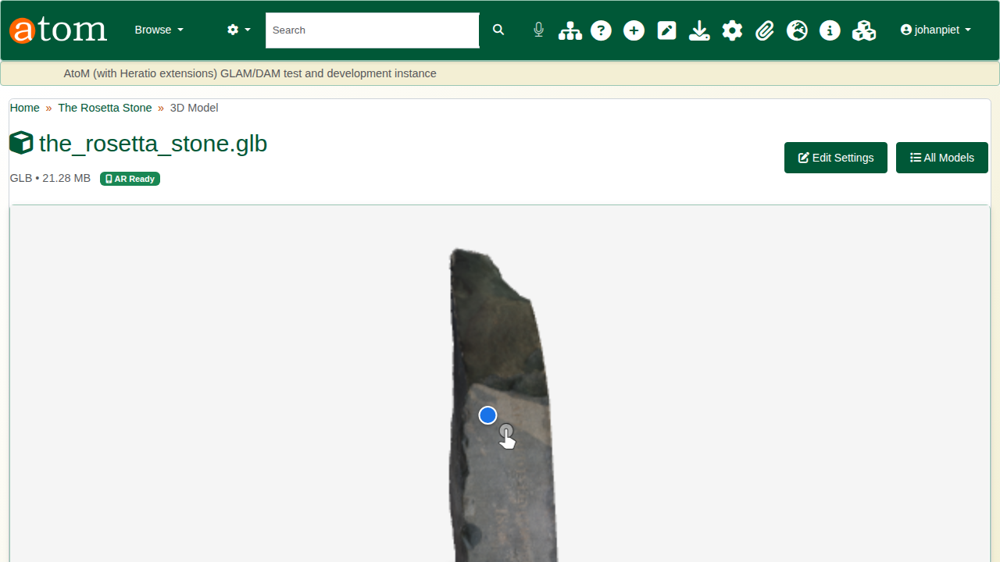
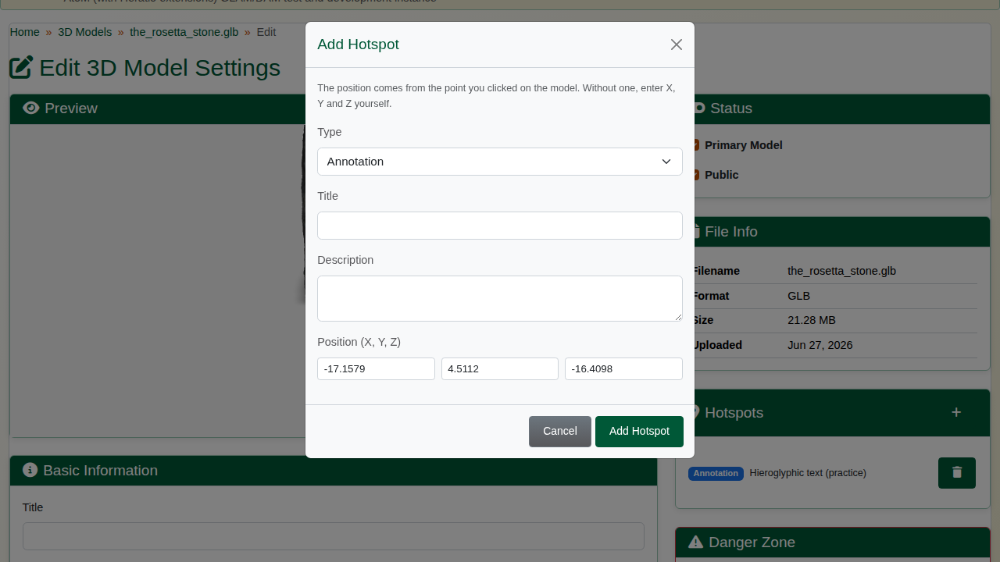
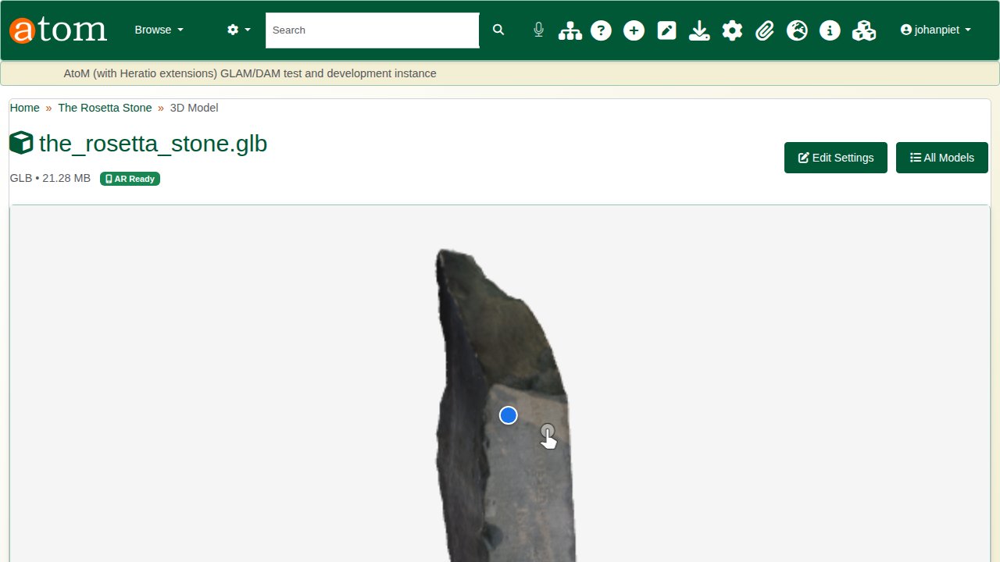
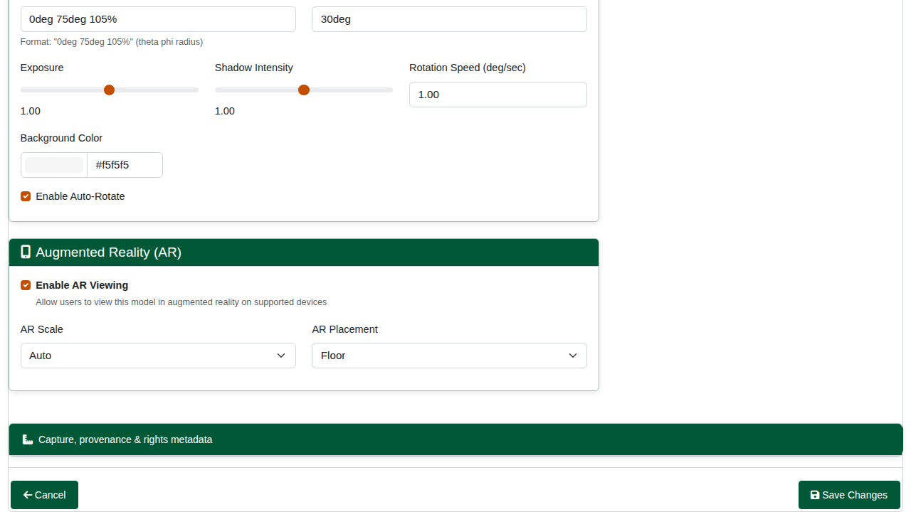
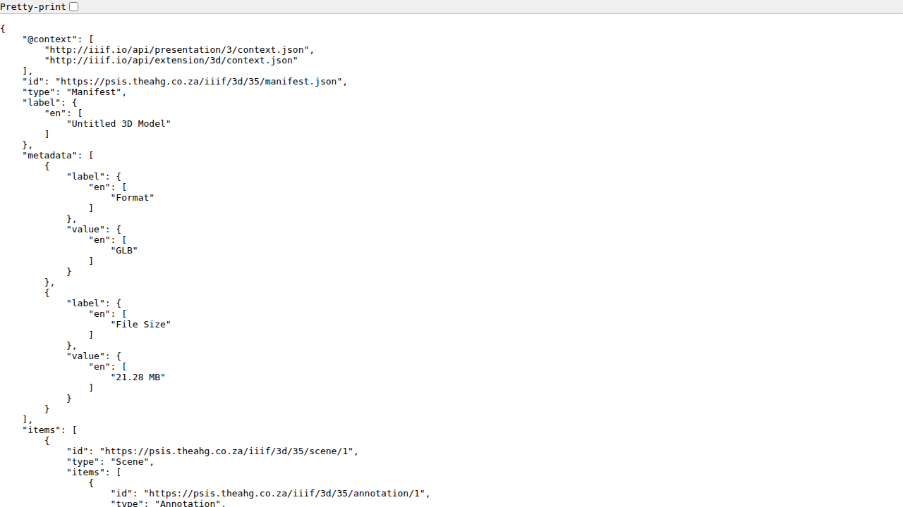
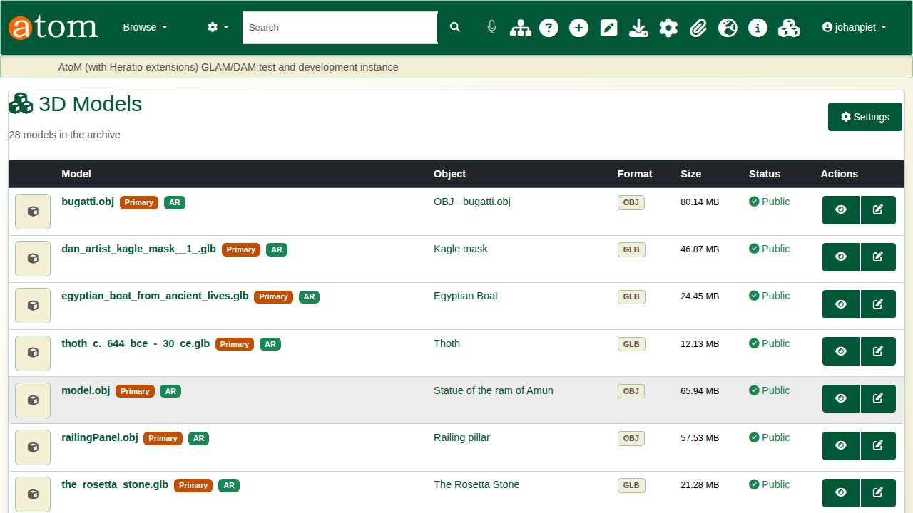
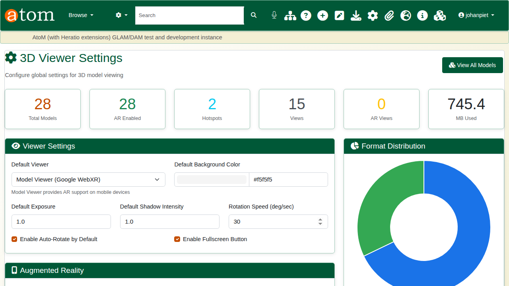

| Field | Value |
|---|---|
| Document title | Training: Discovery, Part 2 - 3D Models |
| Author | Dr Johan Pieterse |
| Owner | The Archive and Heritage Group (Pty) Ltd |
| Version | 1.0 |
| Status | Released |
| Date | 15 October 2026 |
| Prepared for | Curators, archivists and digitisation staff using the AHG extensions |
| Classification | Public |
| Reference | AHG-TRN-DIS-02 |

: Document control

This guide goes with part 2 of the discovery training videos. It covers how 3D models of objects are shown and annotated: the viewer on a record, the model page and augmented reality, hotspots, each model's settings, the IIIF 3D manifest and the administration pages. Allow about 15 minutes.

## Before you start

| What | Notes |
|---|---|
| Viewing | Anyone, for published records. |
| Hotspots and settings | An editor or administrator. |
| Formats | GLB and glTF are recommended for the web; OBJ, STL and USDZ are also handled. |
| Example | A 3D scan of the Rosetta Stone. |

: What you need before you start

## 1. On the record

A record whose digital object is a 3D model shows it in a 3D viewer on its page. Drag to turn it, scroll to zoom; it turns slowly by itself until you take hold of it. Models are served through an access-controlled route (`/3d/file/<id>`), so visitors who are not signed in can view them while the master file stays protected.

## 2. The model page and augmented reality

The model page (`/ahg3DModel/view/<model id>`) gives the viewer more room, with full-screen, rotation and reset controls, the format and size, and an **AR Ready** badge when augmented reality is on. On a phone or tablet (iOS Safari, Chrome on Android, WebXR browsers), the AR button places the object in the room in front of you, at its real size.

## 3. Hotspots

Hotspots mark details on the model. In the model's settings (**Edit Settings**), click the point on the model in the preview. The **Add Hotspot** form opens with that position filled in; a drag that turns the model is not taken as a click.

| Field | Notes |
|---|---|
| Type | Annotation, information, link, damage or detail; each has its own colour |
| Title and description | Shown when a visitor points at or clicks the hotspot |
| Position | Filled in from the click; X, Y and Z can also be typed |

: Hotspot fields

A **damage** hotspot links to the object's condition assessment automatically.

The hotspots then sit on the model for every visitor and are listed beside it.

## 4. Model settings

Each model has its own settings:

| Section | Settings |
|---|---|
| Viewer | Camera orbit, field of view, exposure, shadow intensity, rotation speed, background colour, auto-rotate |
| Augmented reality | On or off, scale (auto or fixed), placement (floor or wall) |
| Status | Primary model, public |
| Capture, provenance and rights | How and when it was captured, with what, by whom; processing; licence and attribution |

: Model settings

**Delete Model** removes the model's 3D settings and hotspots. For a model registered from a record's digital object, the master file itself is kept.

## 5. IIIF 3D

Every model has a IIIF 3D manifest at `/iiif/3d/<model id>/manifest.json`, with its hotspots as annotations, so systems that follow the IIIF 3D work can show it. The model page has the link, with **Copy** and **View**.

## 6. Managing models

**3D Models** (`/ahg3DModel/index`) lists every model with its object, format, size and status. **3D Viewer Settings** (`/ahg3DSettings/index`) set the defaults for all models: the viewer, background, exposure, auto-rotate and full screen; augmented reality; the formats and file size allowed for upload, and downloads; hotspots; and watermarking. Usage figures are at the top.

## Recap

1. 3D models open in the viewer on the record.
2. They can be seen in augmented reality on a phone or tablet.
3. Hotspots mark details, added by a click on the model.
4. Each model is published as IIIF 3D.

Part 3 covers discovery search.
