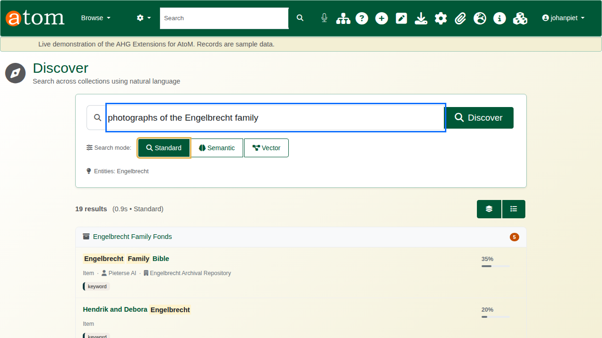
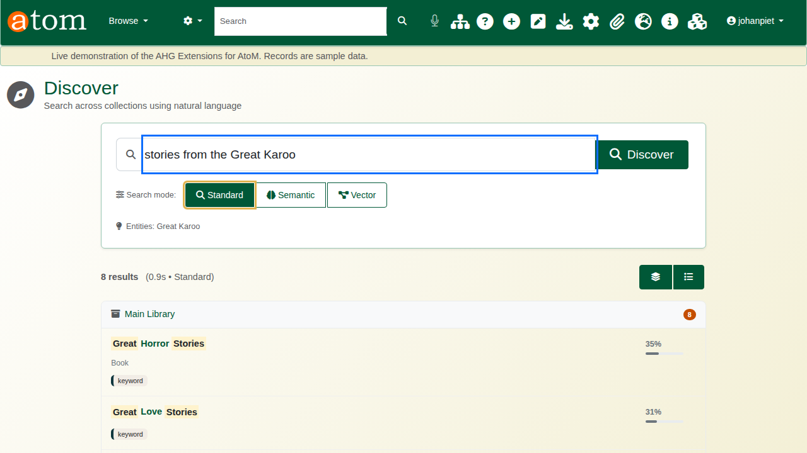
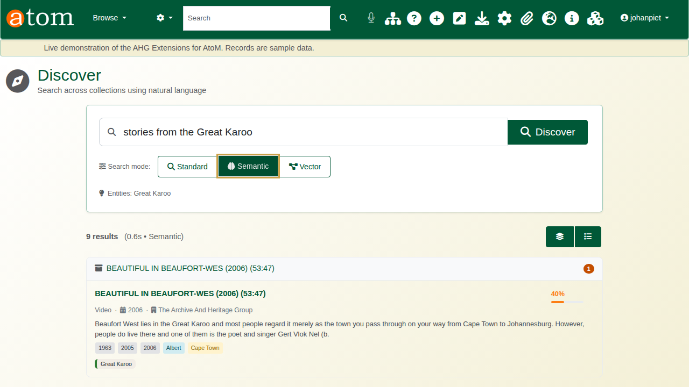
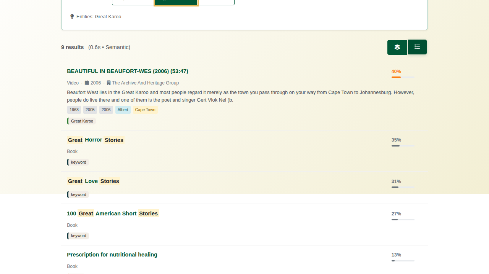
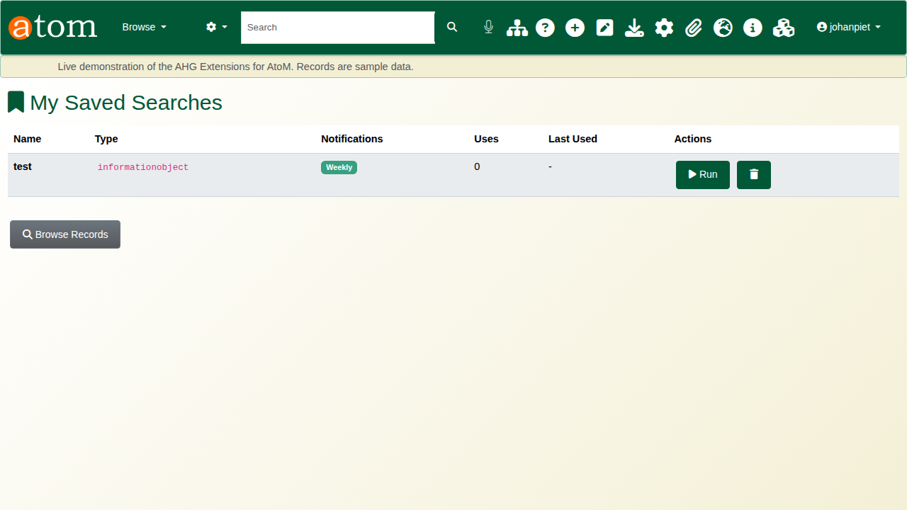
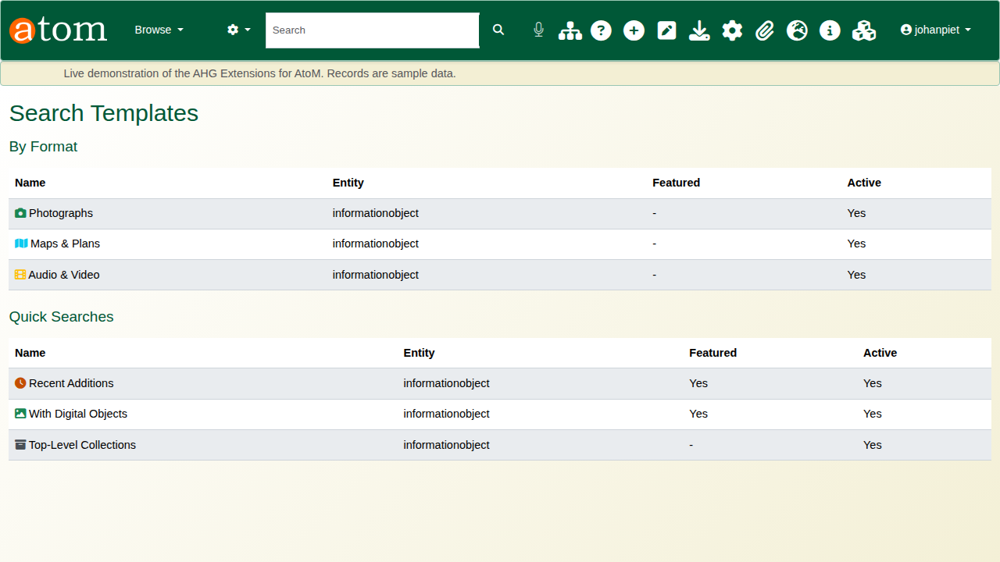

| Field | Value |
|---|---|
| Document title | Training: Discovery, Part 3 - Discovery Search |
| Author | Dr Johan Pieterse |
| Owner | The Archive and Heritage Group (Pty) Ltd |
| Version | 1.0 |
| Status | Released |
| Date | 15 October 2026 |
| Prepared for | Researchers, reading-room staff and archivists using the AHG extensions |
| Classification | Public |
| Reference | AHG-TRN-DIS-03 |

: Document control

This guide goes with part 3 of the discovery training videos. It covers Discover, the plain-language search: asking a question, reading why each result was found, using names in the question with Semantic mode, switching views, and keeping searches with saved searches, history and templates. Allow about 15 minutes.

## Before you start

| What | Notes |
|---|---|
| Searching | Anyone, for published records. |
| Saved searches and history | A signed-in user. |
| Search templates | An administrator. |

: What you need before you start

## 1. Discover

Open **Discover** (`/discovery`) and type a question in your own words, for example *photographs of the Engelbrecht family*. Results are grouped by the collection (fonds) they belong to, each with a score and the reasons it was found:

| Reason | Meaning |
|---|---|
| keyword | The words of the question appear in the record's title or description |
| A name or place | The record's description mentions a name, place or date the question contains (Semantic mode) |
| sibling or child | The record sits beside, or below, a record that matched |

: Why a result was found

## 2. Names in the question and the search modes

Discover reads the question for names, places and dates, and shows what it recognised under the search box (**Entities**). The search modes decide how much it does with them:

| Mode | What it searches |
|---|---|
| Standard | The words of the question, plus related records in the hierarchy |
| Semantic | Standard, plus the names, places, organisations and dates extracted from the records' descriptions (the entity index built by the AI tools) |
| Vector | Semantic, plus meaning-based similarity, where a vector index is configured |

: Search modes

For *stories from the Great Karoo*, Standard mode matches the words and finds books with *great* and *stories* in their titles. Semantic mode also searches the entity index and puts first a documentary filmed in the Great Karoo, whose description names the place.

## 3. Views and popular searches

The buttons above the results switch between the grouped view and a single list. Before you search, the most popular searches are offered as a starting point. Clicking a result opens the record.

## 4. Saved searches, history and templates

A search you run often can be saved, with an optional notification when new records match. **My Saved Searches** (`/search/enhancement/saved`) lists them with their notifications and use, ready to run again; **Search History** (`/search/enhancement/history`) keeps your recent searches.

**Search Templates** (`/admin/search-templates`) are ready-made searches set up by an administrator, such as photographs, maps and plans, audio and video, or recent additions, offered to every user as a quick start.

## Recap

1. Ask in plain language.
2. Read why each result was found.
3. Let the names in your question narrow it, with Semantic mode.
4. Save the searches you need again.

Part 4 covers landing pages.
