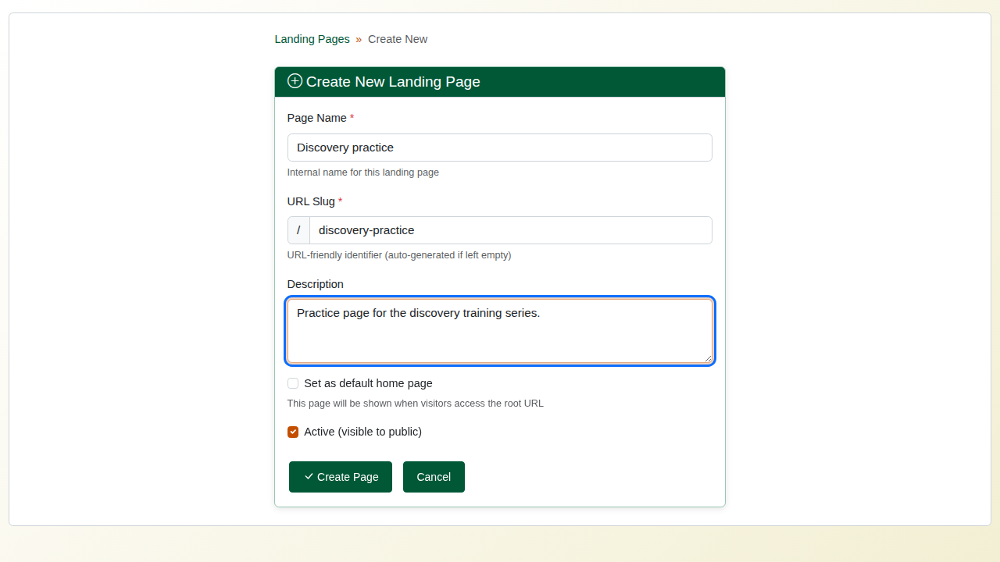
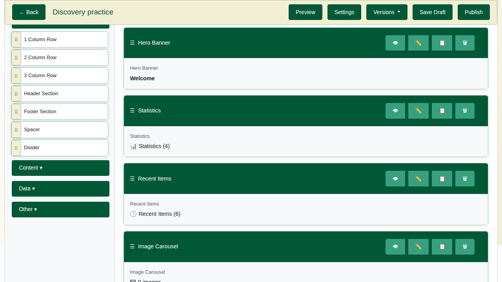
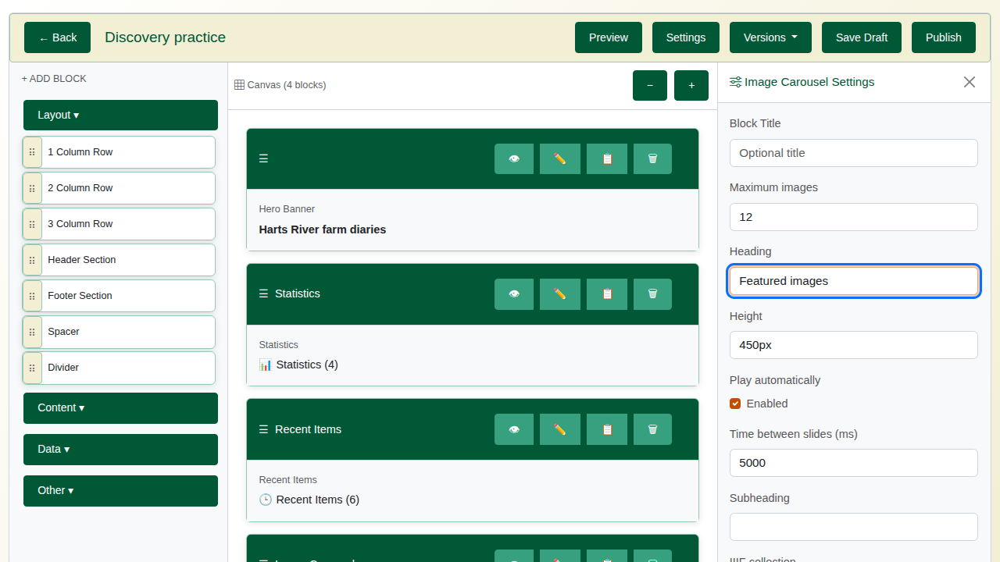
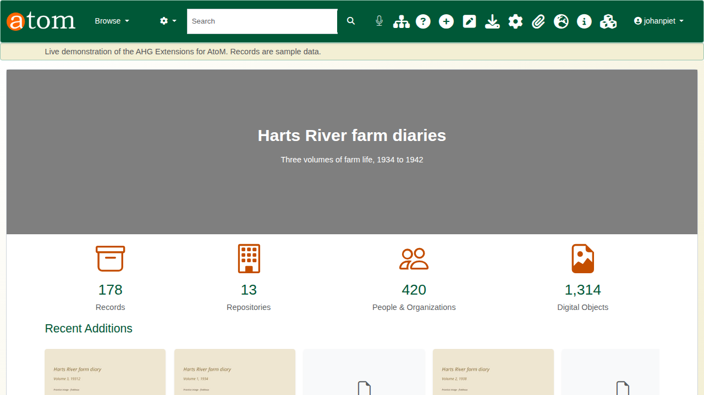
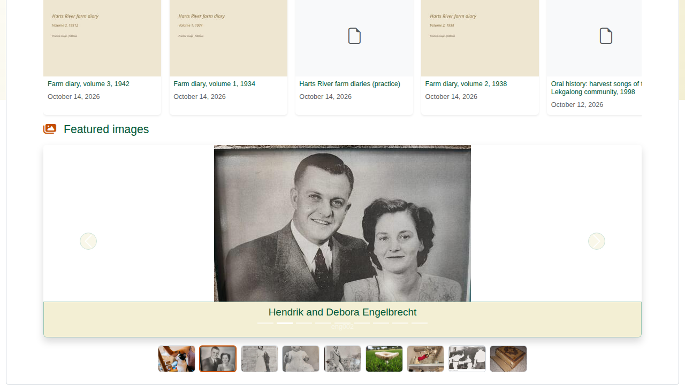

| Field | Value |
|---|---|
| Document title | Training: Discovery, Part 4 - Landing Pages |
| Author | Dr Johan Pieterse |
| Owner | The Archive and Heritage Group (Pty) Ltd |
| Version | 1.0 |
| Status | Released |
| Date | 15 October 2026 |
| Prepared for | Administrators and archivists who present collections to the public |
| Classification | Public |
| Reference | AHG-TRN-DIS-04 |

: Document control

This guide goes with part 4 of the discovery training videos. A landing page is a public page built from blocks, to introduce a collection or welcome visitors. The guide covers creating a page, adding blocks, setting each one up, publishing, and restoring an earlier version. Allow about 15 minutes.

## Before you start

| What | Notes |
|---|---|
| Building pages | An administrator account. |
| Image carousel | The IIIF plugin enabled, and a IIIF collection to show. |
| Seeing a page | Anyone, once it is active and published. |

: What you need before you start

## 1. Create a page

Landing pages are listed at **Admin > Landing Pages** (`/admin/landing-pages`). Each has its own address, `/landing/<address>`. Choose **Create New Page** and fill in:

| Field | Notes |
|---|---|
| Page name | For staff; shown in the list. |
| URL slug | The page's address, for example `discovery-practice`. Made from the name if left empty. |
| Description | A note for colleagues on what the page is for. |
| Set as default home page | Leave off unless the page should replace the site's front page. |
| Active | On, so the public can see the page once it is published. |

: New page settings

## 2. Add blocks

The editor shows the blocks on the left, grouped as **Layout**, **Content**, **Data** and **Other**, and the page on the right. Click a block to add it; the page reloads with the block at the end. Drag a block by its handle to change the order. Each block has buttons to hide it (it stays on the page in the editor, but visitors do not see it), edit it, copy it or delete it.

| Block | What it shows |
|---|---|
| Hero banner | A large title and subtitle, over an image or a plain band |
| Statistics | Counts of records, repositories, people and organisations, and digital objects |
| Recent items | The newest published records, with thumbnails |
| Image carousel | The images of a IIIF collection as a slideshow |
| Rows (1, 2 or 3 columns) | Containers that place other blocks side by side |
| Text, search box, browse panels, holdings, map, quick links | Further blocks for content and navigation |

: Commonly used blocks

## 3. Set up each block

Choose the pencil on a block to open its settings on the right, change them, and choose **Save Changes**. The editor card then shows the new values.

For the hero banner, set the title, subtitle and height (for example `300px`). For the image carousel, enter the IIIF collection's short name (for example `featured-collection-1`) and a heading.

Statistics and recent items need no settings. They are counted and listed from the catalogue every time the page is shown, and only published records appear on them.

## 4. Publish

**Save Draft** keeps your work without changing what visitors see. **Publish** makes it live. Each publish keeps a version, and the **Versions** menu restores an earlier one.

## 5. The result

Open the page at its address (`/landing/discovery-practice` in the video) to see it as a visitor does. Link it from a menu or the home page so visitors can find it.

## Recap

1. Create the page.
2. Add blocks.
3. Set up each block.
4. Publish, and check the page as a visitor sees it.

Part 5 covers DOIs for records and the public chatbot.
