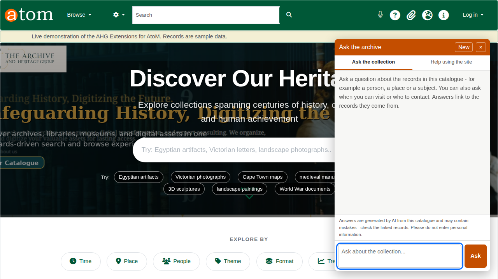
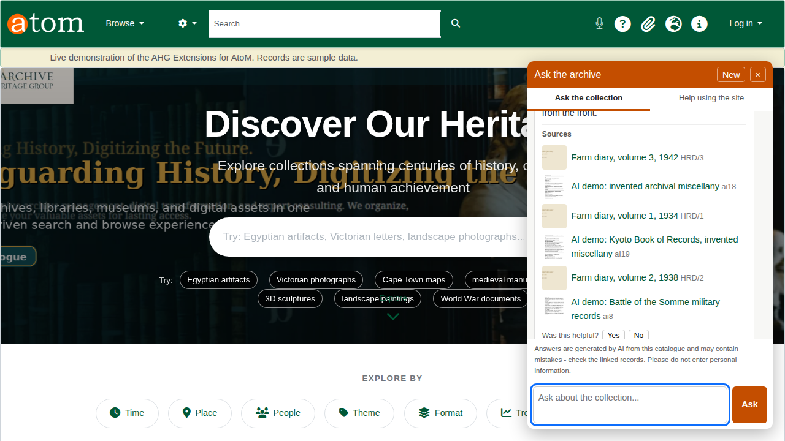
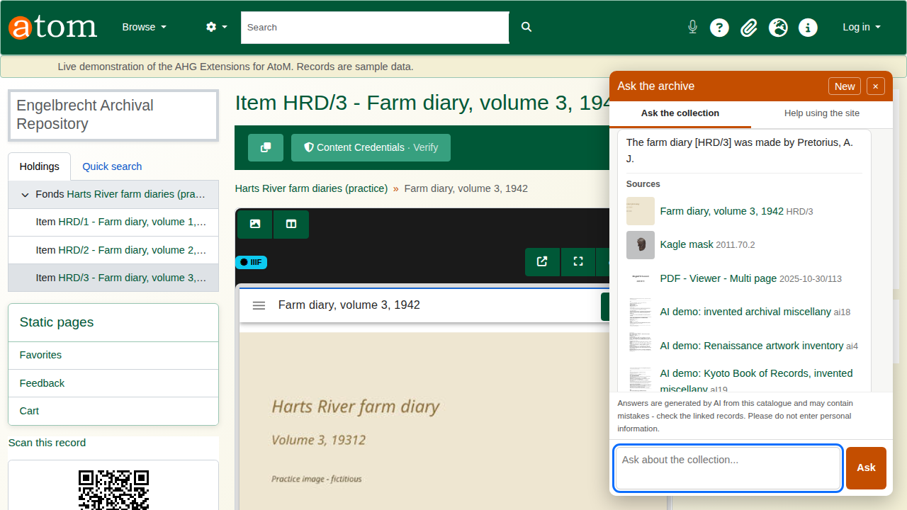
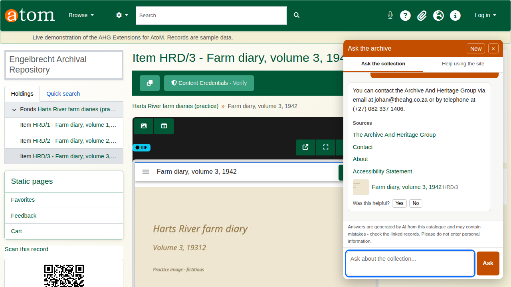
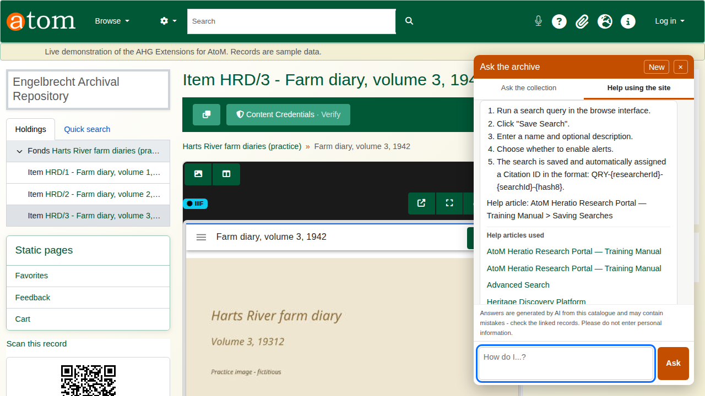
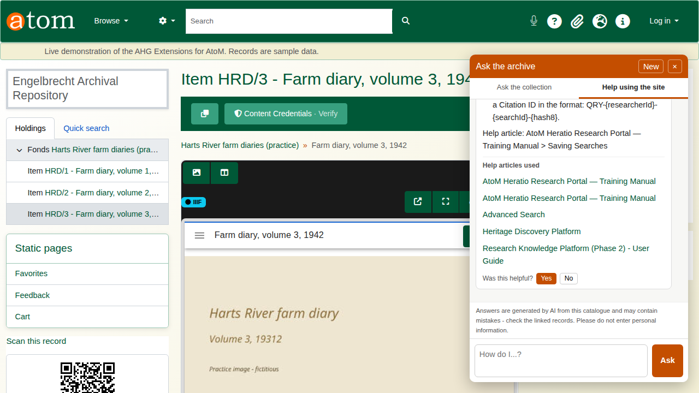
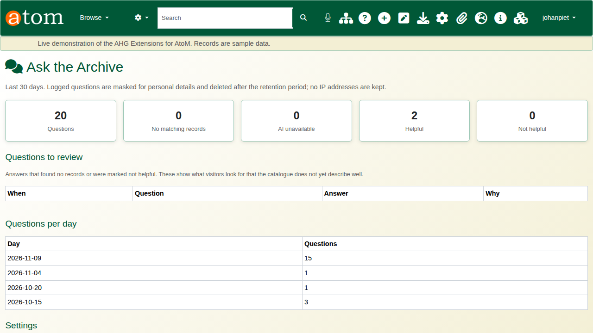
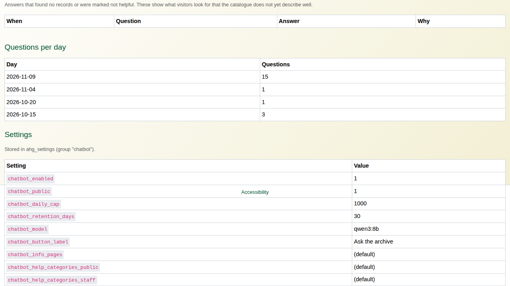

| Field | Value |
|---|---|
| Document title | Training: Discovery, Part 5 - Ask the Archive |
| Author | Dr Johan Pieterse |
| Owner | The Archive and Heritage Group (Pty) Ltd |
| Version | 1.0 |
| Status | Released |
| Date | 9 November 2026 |
| Prepared for | Archivists and administrators who offer the catalogue to the public |
| Classification | Public |
| Reference | AHG-TRN-DIS-05 |

: Document control

This guide goes with part 5 of the discovery training videos. Ask the Archive is a chatbot on every public page. A visitor asks a question in plain words and gets an answer written from the published catalogue, with a link to each record it used. The guide covers what visitors can ask, how answers are kept to what they may see, and what the administrator's page shows. Allow about 10 minutes.

## Before you start

| What | Notes |
|---|---|
| Plugin | Ask the Archive (ahgChatbotPlugin), enabled. |
| Search index | The catalogue indexed for the chatbot (`php symfony chatbot:index --prune`, run nightly by cron). |
| Answers | Written by a language model through the AHG AI gateway. No setting can send questions anywhere else. |
| Visitors | No account needed, unless the chatbot is set to signed-in users only. |
| Administrator page | An administrator account. |

: What you need before you start

Only published records are used, and never one that is restricted: a security classification, a donor agreement, a full embargo, an indigenous cultural access restriction or a use prohibition all keep a record out. The check runs on every record at the moment it is used, so a record unpublished this morning is not quoted this afternoon.

## 1. Open the chatbot

The **Ask the archive** button sits at the bottom right of every page. It opens a panel with two tabs: **Ask the collection** and **Help using the site**. The conversation stays open while the visitor moves from page to page, and **New** starts again.

## 2. Ask about the collection

Type a question in plain words and choose **Ask**. In the video: *Which farm diary covers rationing and letters from the front?* The answer names the record (Farm diary, volume 3, 1942), and under **Sources** lists every record the answer drew on, each with its thumbnail and reference code. A source opens the record's page, so the visitor can check the answer against the description.

The chatbot reads titles, scope and content, creators and dates, and the text extracted from PDFs and scanned pages. If nothing in the catalogue answers the question, it says so rather than guessing.

## 3. Ask about a record

On a description page, a question such as *Who made this?* is taken to mean that record. In the video the answer, on volume 3 of the Harts River farm diaries, gives the creator, Pretorius, A. J.

## 4. Contact and visiting

Questions about contact, visiting, opening times and services are answered from the institution's own public information: the repository record (opening times, access, services and its contacts) and the static pages listed in the settings, by default Contact, About and Accessibility. The contact details of donors, rights holders, authority records and users are never read.

An answer can only be as good as these pages. If the repository record has no opening times, the chatbot says they are not listed, so fill in the repository's access and services fields.

## 5. Help using the site

The **Help using the site** tab answers how-to questions from the site's help articles. In the video: *How do I save a search?* The steps come back, followed by the help articles they came from. Visitors and researchers only ever see public help categories; staff help (cataloguing and administration) is given only to editors, contributors and administrators.

## 6. Rate an answer

Each answer ends with **Was this helpful?** and **Yes** or **No**. The rating is stored with the answer and counted on the administrator's page.

## 7. For administrators

Open **Admin > Ask the Archive** (`/chatbot/admin`). The page covers the last 30 days:

| Section | What it shows |
|---|---|
| Totals | Questions asked, answers that found no records, times the AI was unavailable, and helpful and not helpful ratings. |
| Questions to review | Every question that found nothing or was rated not helpful, with the answer given. This is what visitors look for and the catalogue does not yet describe. |
| Questions per day | How much the chatbot is used. |
| Settings | The current settings, stored as AHG settings in the `chatbot` group. |

: The administrator's page

| Setting | Meaning |
|---|---|
| chatbot_enabled | Switches the chatbot on or off. |
| chatbot_public | 0 limits it to signed-in users. |
| chatbot_daily_cap | Questions per day for the whole site (default 1000). |
| chatbot_retention_days | Days a conversation is kept (default 30). |
| chatbot_model | The chat model on the gateway. |
| chatbot_button_label | The launcher text. |
| chatbot_info_pages | Static pages used for contact and visiting questions. |

: Chatbot settings

**Privacy.** Before a question is logged, email addresses, phone numbers and South African ID numbers are masked. No IP address is stored, and logs are deleted after the retention period. Each visitor may ask 10 questions a minute and 100 a day, and a question over 1,000 characters is refused before any model is called.

## Recap

1. Open **Ask the archive** on any page.
2. Ask about the collection, or about the record in front of you.
3. Check the sources.
4. Use the help tab for how-to questions.
5. Review what visitors ask on the administrator's page.

Part 6 covers registering DOIs for records.
