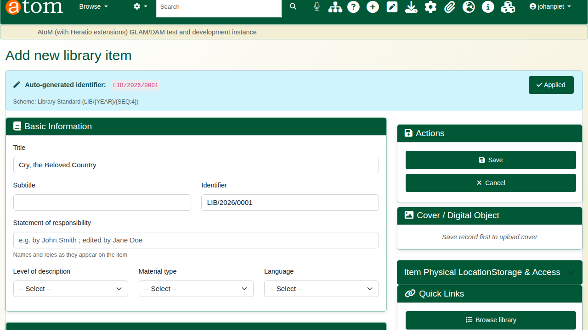
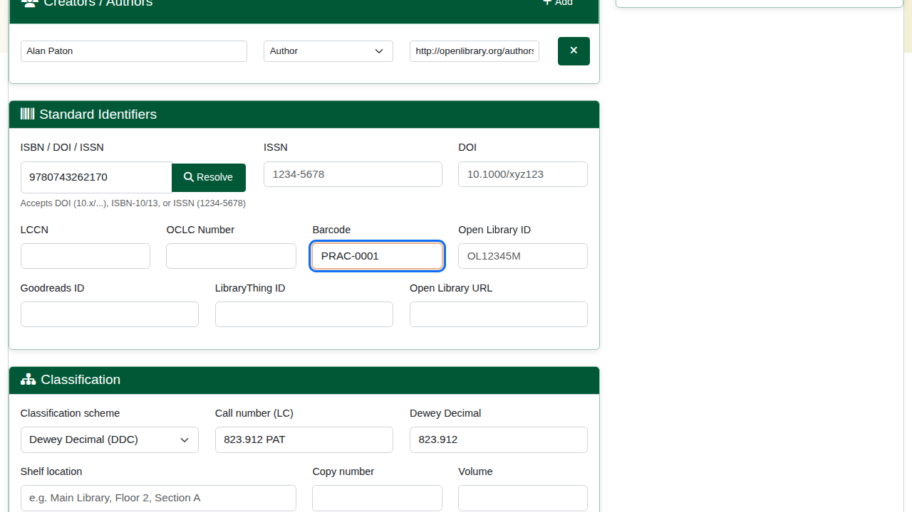
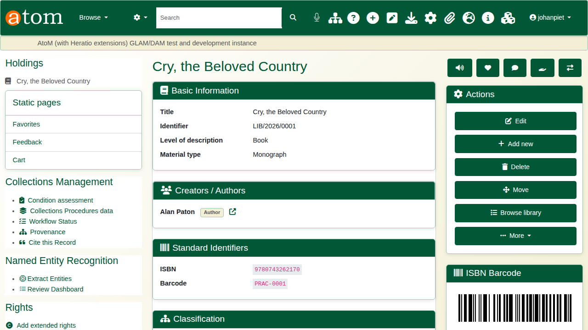
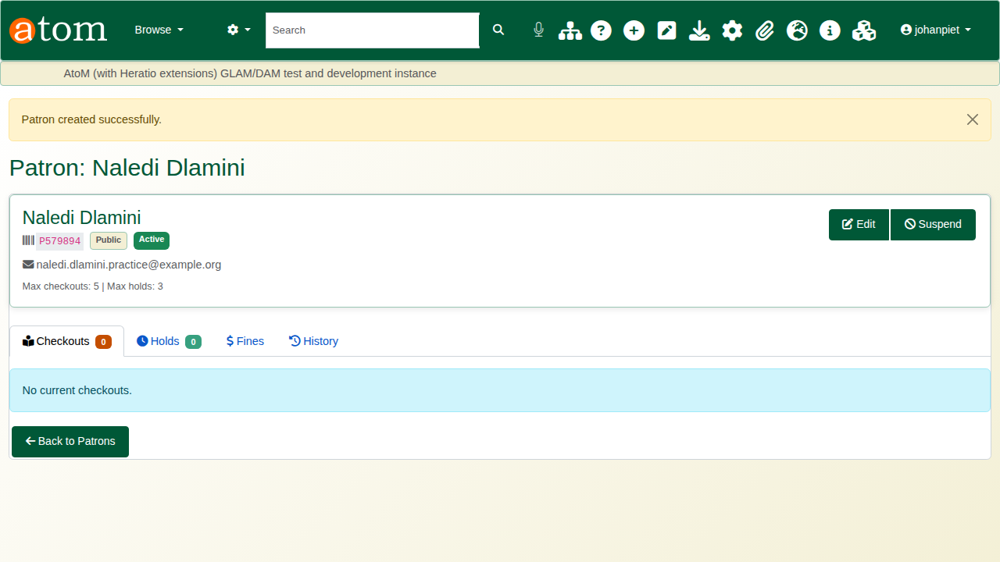
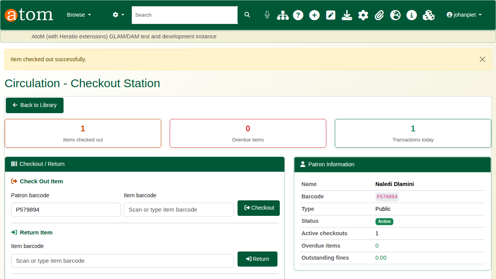
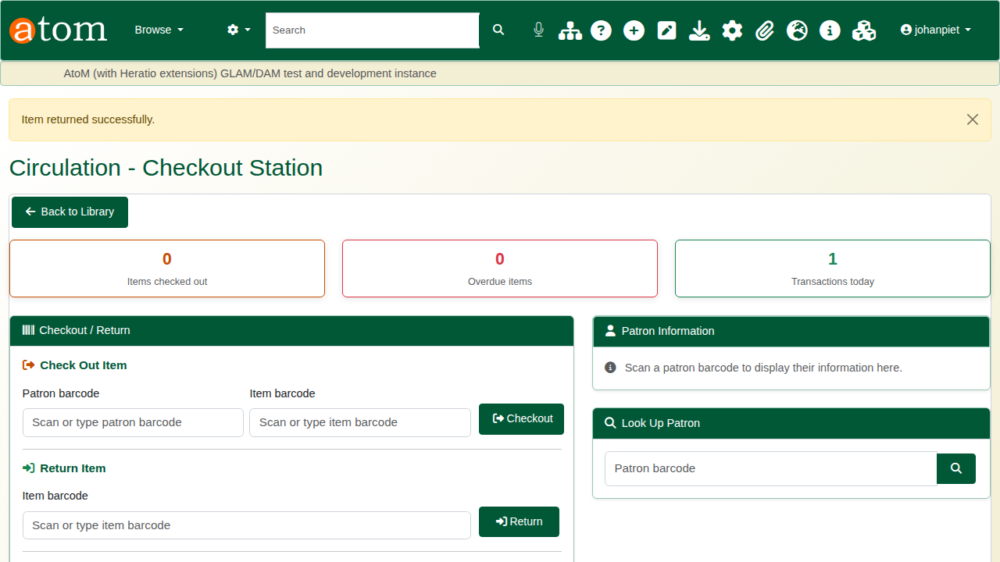
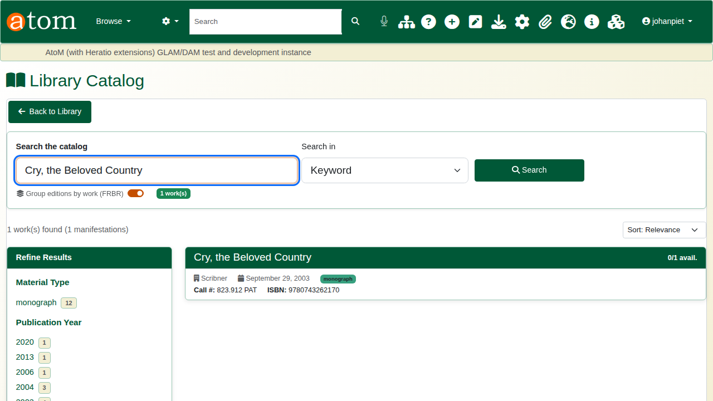
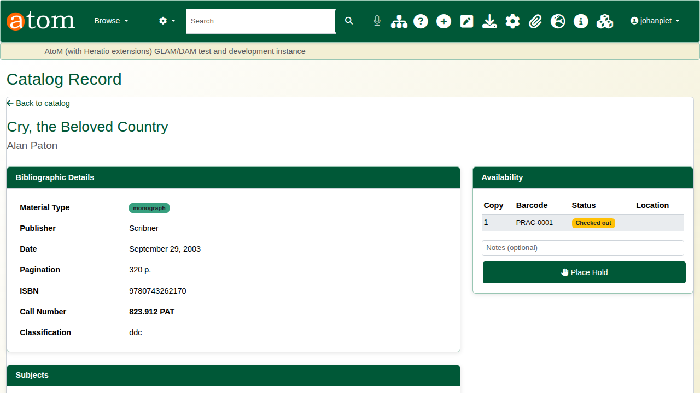

| Field | Value |
|---|---|
| Document title | Walkthrough: Library Services |
| Author | Dr Johan Pieterse |
| Owner | The Archive and Heritage Group (Pty) Ltd |
| Version | 1.0 |
| Status | Released |
| Date | 13 October 2026 |
| Prepared for | Librarians and circulation staff using the AHG extensions |
| Classification | Public |
| Reference | AHG-TRN-LIB-01 |

: Document control

This guide goes with the Library Services walkthrough video. The library runs on the same platform as the archive: a book is a catalogue record like any other description, with library details, copies and loans added. You catalogue a book from its ISBN, register a reader, lend the book and take it back, and see the public catalogue follow. Allow about 15 minutes.

## Before you start

| What | Notes |
|---|---|
| A librarian or administrator account | Cataloguing, patrons and circulation are staff pages. |
| A barcode label for the copy | Any unique code; the example uses PRAC-0001. |
| Loan rules | Set under Circulation > Loan rules. The installed rules lend a monograph for 21 days. |

: What you need before you start

The reader, the barcodes and the card number in the examples are fictitious.

## 1. Catalogue from an ISBN

Open **Library > Add new item** (`/library/add`). In **ISBN / DOI / ISSN**, type the ISBN and click **Resolve**. The lookup asks Open Library and the other configured providers, and after you confirm, fills in the title, author, publisher, date, pagination and subjects.

Then add the local details:

| Field | Example | Notes |
|---|---|---|
| Level of description | Book | Required |
| Classification scheme | Dewey Decimal (DDC) | |
| Dewey Decimal | 823.912 | |
| Call number | 823.912 PAT | What goes on the spine label |
| Barcode | PRAC-0001 | The copy's barcode; circulation scans this |

: Local details for the book

Click **Save**. Saving with a barcode creates the item's first copy, ready to lend. Further copies come from acquisitions (receiving an order or batch capture).

## 2. Publish

New records start as drafts, which the public catalogue does not show. Open the book, and under **More** choose **Update publication status**, set **Published** and click **Update**.

## 3. Register a reader

Under **Patrons** (`/patron`), click **Add Patron**. Enter the first and last name, the email address and the patron type (Student, Staff, Faculty, Public, Researcher and others). Maximum loans and holds can be set per reader. Save: the system issues a library card number, shown on the patron's page.

## 4. Lend and return

Open the circulation desk (`/circulation`). Under **Check Out Item**, scan or type the reader's card number and the book's barcode, and click **Checkout**. The loan rule for the material type and reader type sets the due date. The reader's details, current loans and overdue count appear beside the form.

When the book comes back, scan its barcode under **Return Item** and click **Return**. The loan closes, the copy is available again, and a late return raises an overdue fine when automatic fines are on. **Renew Item** extends a loan in the same way.

## 5. The public catalogue

Readers search the public catalogue (`/opac`) by keyword, title, author, subject or ISBN, and refine by material type and publication year. Editions of the same work can be grouped together. Each result shows how many copies are available.

The record shows the bibliographic details and, under **Availability**, each copy with its barcode and status, so a reader can see whether the book is on the shelf.

## Also in the library module

| Area | What it covers |
|---|---|
| Circulation | Renewals, overdue lists, loan rules per material and reader type |
| Acquisitions | Orders, receiving, budgets, batch capture from ISBNs |
| Serials | Subscriptions, issue check-in, claims, bindery |
| Interlibrary loans | Requests and their status history |
| Copy cataloguing | Import records from other libraries over Z39.50 (targets configured by an administrator) |
| Export | MARC and other bibliographic exports |

: Other library functions

## Recap

1. Catalogue from the ISBN; add the shelf details and barcode.
2. Publish the record.
3. Register the reader.
4. Lend and return at the circulation desk.
5. The public catalogue shows what is on the shelf.
