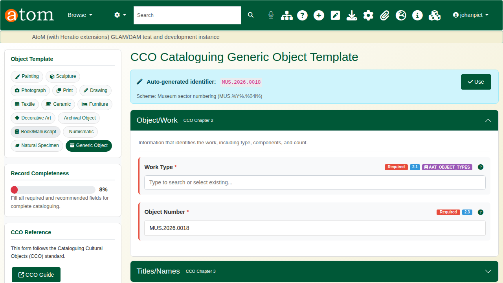
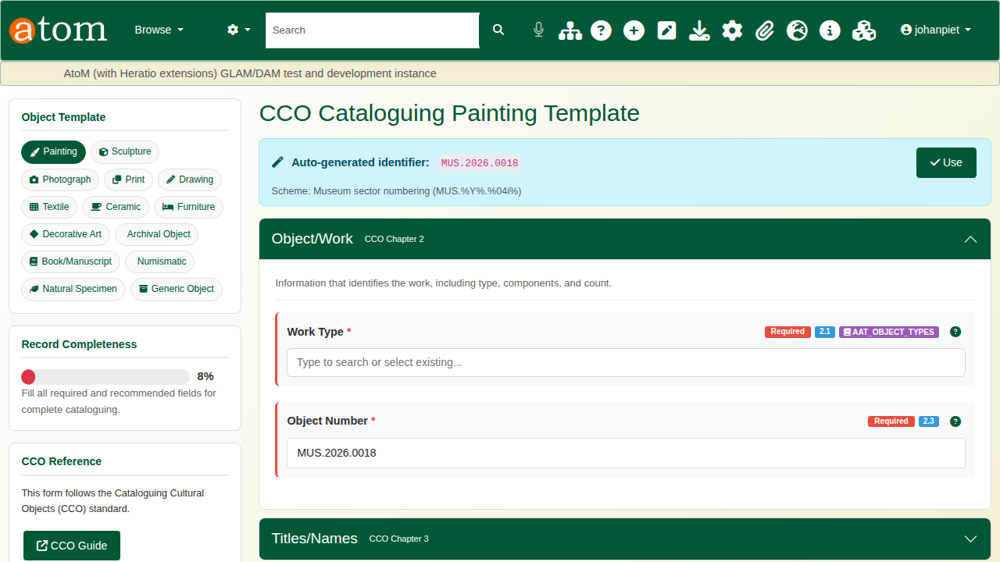
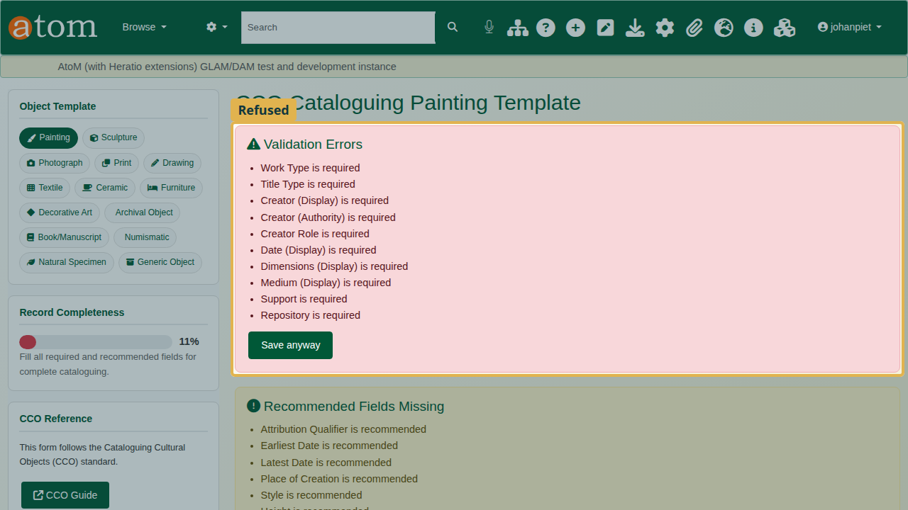
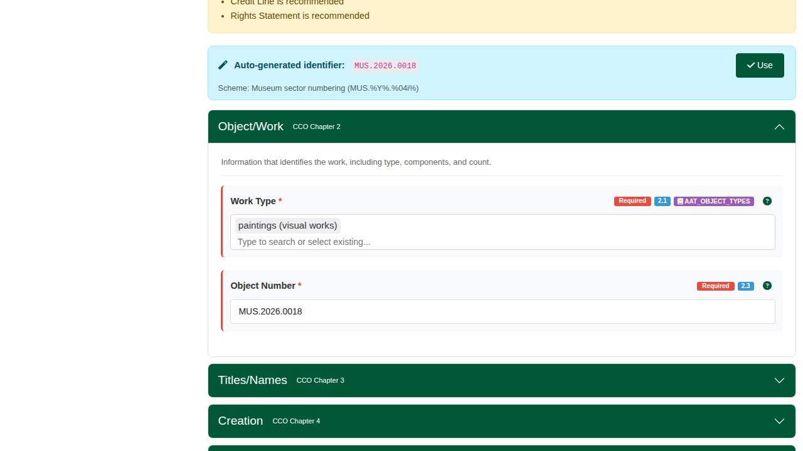
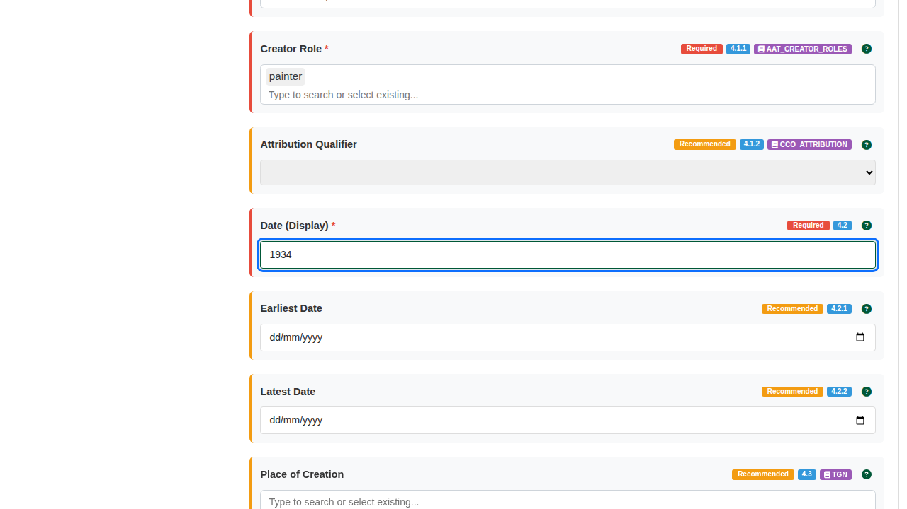
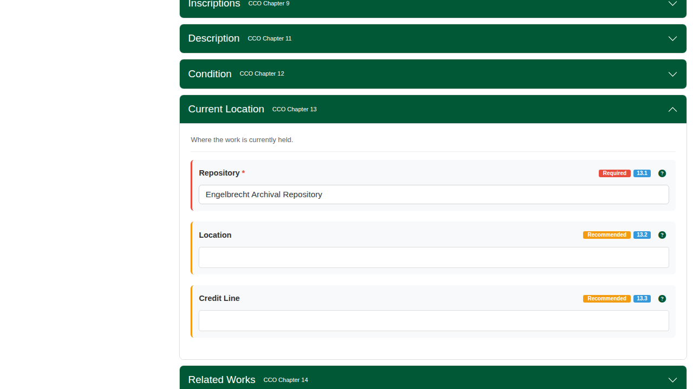
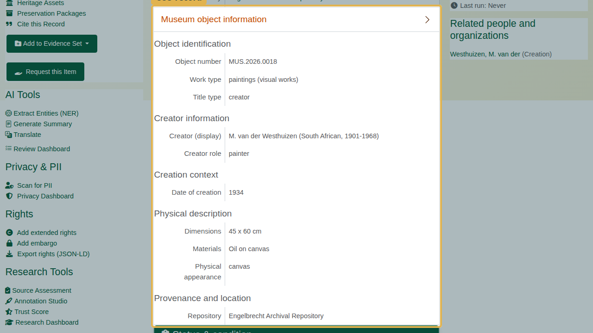

| Field | Value |
|---|---|
| Document title | Training: Museum, Part 1 - Cataloguing a Museum Object |
| Author | Dr Johan Pieterse |
| Owner | The Archive and Heritage Group (Pty) Ltd |
| Version | 1.0 |
| Status | Released |
| Date | 12 October 2026 |
| Prepared for | Museum cataloguers and registrars using the AHG extensions |
| Classification | Public |
| Reference | AHG-TRN-MUS-01 |

: Document control

This guide goes with part 1 of the museum training videos. It describes a painting to the CCO standard (Cataloging Cultural Objects), using a Getty Art & Architecture Thesaurus term for the work type and linking the artist to an authority record. Allow about 15 minutes.

## Before you start

| What | Notes |
|---|---|
| An editor or administrator account | Museum cataloguing needs create rights. |
| The artist as an authority record | The video uses a fictitious painter, "Westhuizen, M. van der". Create the authority record first (Add > Authority record). |
| A repository | The institution that holds the object. |

: What you need before you start

## 1. Choose a template

Go to **Add museum object** (`/museum/add`). The **Object Template** panel offers fourteen templates: Painting, Sculpture, Photograph, Print, Drawing, Textile, Ceramic, Furniture, Decorative Art, Archival Object, Book/Manuscript, Numismatic, Natural Specimen and Generic Object. Each sets which fields are required, recommended or hidden for that kind of object.

Choose **Painting**. The object number is generated from the museum numbering scheme (for example `MUS.2026.0018`); **Use** accepts it.

The form follows the CCO chapters: Object/Work, Titles/Names, Creation, Styles/Periods, Measurements, Materials/Techniques, Subject Matter, Inscriptions, Description, Condition, Current Location, Related Works and Rights. **Record Completeness** shows how much of the template is filled.

## 2. Required fields

The deliberate mistake: save with only a title. The record is refused. **Validation Errors** lists every field the template requires that is still empty, **Recommended Fields Missing** lists what is worth adding, and everything typed is kept.

For the Painting template the required fields are:

| Section | Required fields |
|---|---|
| Object/Work | Work Type, Object Number |
| Titles/Names | Title, Title Type |
| Creation | Creator (Display), Creator (Authority), Creator Role, Date (Display) |
| Measurements | Dimensions (Display) |
| Materials/Techniques | Medium (Display), Support |
| Current Location | Repository |

: Required fields in the Painting template

**Save anyway** saves an incomplete record on purpose, for example when the information is not yet known.

## 3. Describe the painting

**Work Type** uses the Getty Art & Architecture Thesaurus: start typing and choose a term, here **paintings (visual works)**. **Title Type** records where the title comes from; here, **Creator (given by artist)**.

Under **Creation**, give the creator's name as it should be displayed, choose the authority record it links to, the role (**painter**) and the date as it should be displayed (**1934**). Earliest and latest dates are recommended for searching by date.

Under **Measurements** and **Materials/Techniques**, write the dimensions and medium as they would appear on a label (**45 x 60 cm**, **Oil on canvas**) and index the **Support** (**canvas**). A term that is not yet in the local list is added when you choose it. Under **Current Location**, choose the **Repository**.

## 4. The catalogue record

Click **Save**. The record's **Museum object information** shows the object number, the work type with its Getty term, the creator linked to the authority record, the date, the dimensions, the medium and the repository.

## Recap

1. Choose the template that fits the object.
2. Fill the required fields; the record will not save without them unless you choose Save anyway.
3. Use the Getty term for the work type.
4. Link the creator to an authority record.

Part 2 covers the collections procedures: object entry and acquisition.
