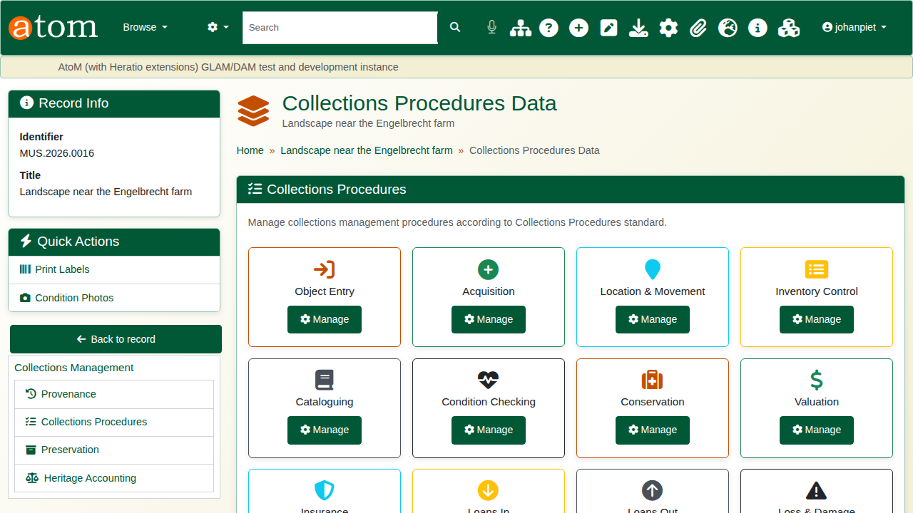
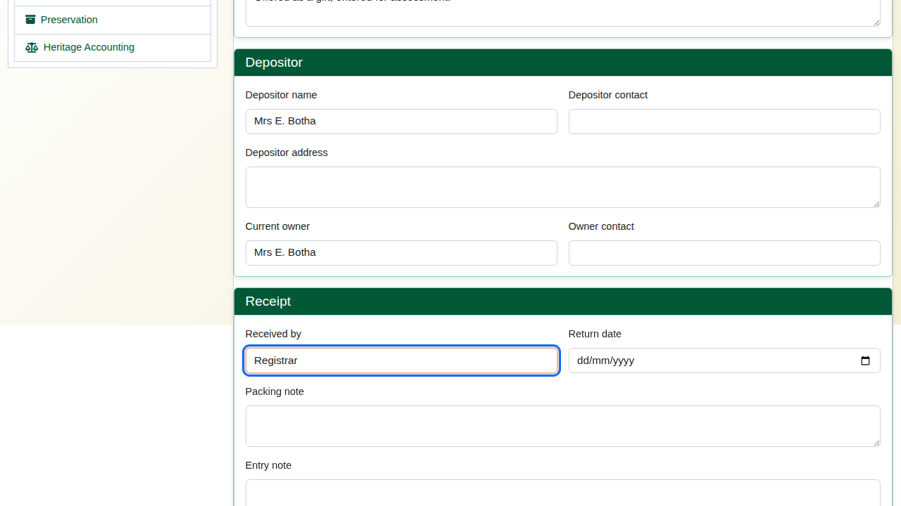
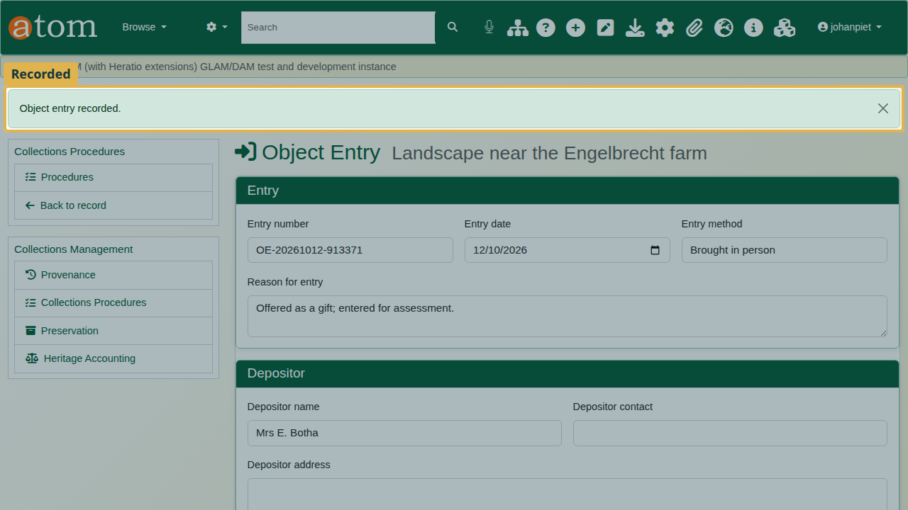
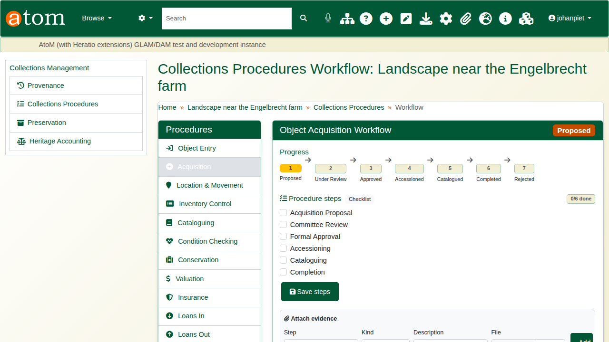
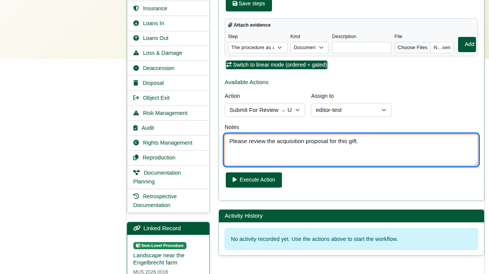
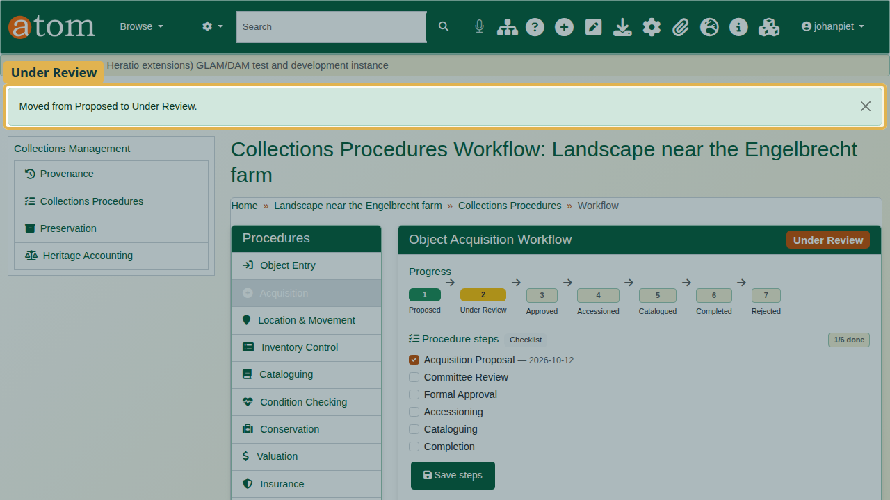
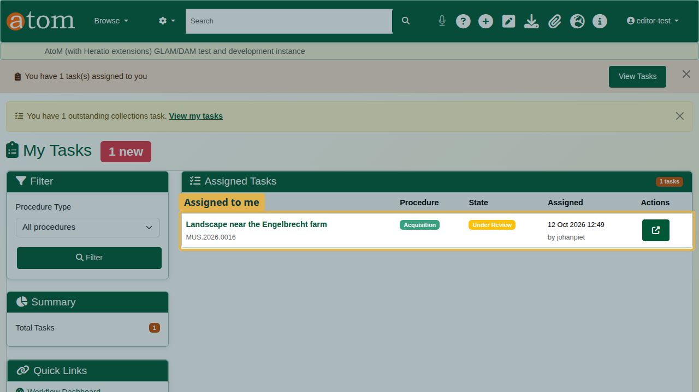
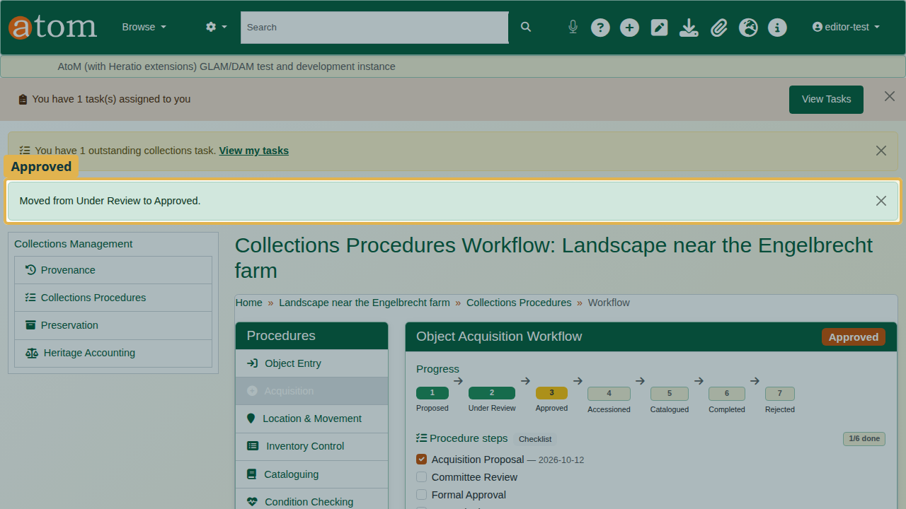
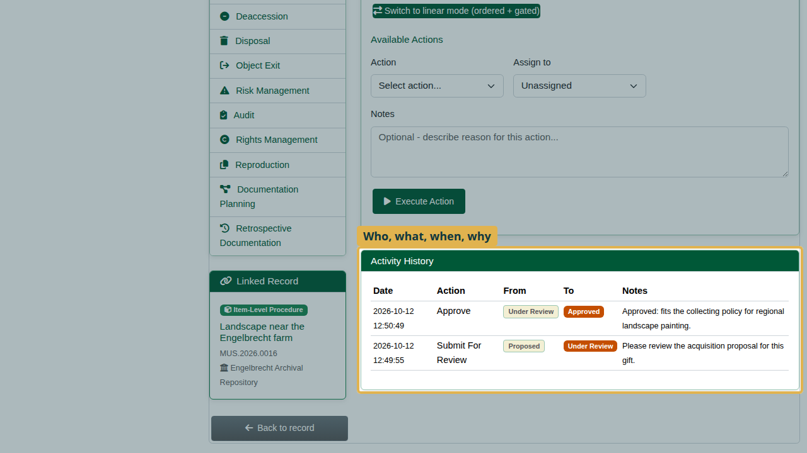
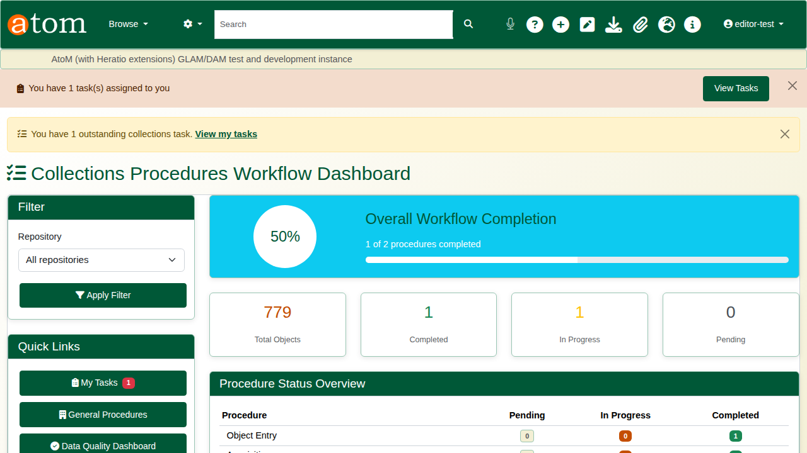

| Field | Value |
|---|---|
| Document title | Training: Museum, Part 2 - Spectrum Collections Procedures |
| Author | Dr Johan Pieterse |
| Owner | The Archive and Heritage Group (Pty) Ltd |
| Version | 1.0 |
| Status | Released |
| Date | 12 October 2026 |
| Prepared for | Registrars, curators and collections staff using the AHG extensions |
| Classification | Public |
| Reference | AHG-TRN-MUS-02 |

: Document control

This guide goes with part 2 of the museum training videos. The painting catalogued in part 1 enters the museum as an offered gift: its object entry is recorded, and its acquisition is taken through review and approval as a workflow, with the review step assigned to a colleague. Allow about 15 minutes.

## Before you start

| What | Notes |
|---|---|
| A registrar account | Administrator rights; starts the procedures and assigns tasks. |
| A reviewer account | Editor rights; receives and acts on the assigned task. |
| A museum object | The painting from part 1. The painting, the people and the gift are fictitious. |

: What you need before you start

## 1. The procedures

On the object, open **Collections Procedures data** (`/<slug>/spectrum`). It lists the 21 Spectrum 5.1 procedures, from Object Entry and Acquisition through Location & Movement, Condition Checking, Valuation, Loans In and Out, Audit and Disposal, to Retrospective Documentation. **Manage** opens each one.

## 2. Object entry

Open **Object Entry**. Record the entry date, how the object came in, the reason for entry, the depositor, the current owner and who received it. Packing notes and a return date are there for loans and deposits.

Click **Record object entry**. The entry gets its own number (for example `OE-20261012-913371`).

## 3. The acquisition workflow

Open **Acquisition**. The progress bar shows the workflow's states: Proposed, Under Review, Approved, Accessioned, Catalogued, Completed, and Rejected. Under **Procedure steps**, tick each step as it is done (Acquisition Proposal, Committee Review, Formal Approval, Accessioning, Cataloguing, Completion) and click **Save steps**. Evidence can be attached to a step.

Under **Available Actions**, choose the action (**Submit For Review**), who it is assigned to, and a note saying what is needed. Click **Execute Action**.

The workflow moves from Proposed to Under Review.

## 4. The reviewer

When the reviewer signs in, a notice says a task is waiting. **My Tasks** (`/spectrum/my-tasks`) lists it with the object, the procedure, its state, and who assigned it and when.

The reviewer opens the workflow. The actions on offer depend on the state: here, **Approve** or **Reject**. Choose **Approve**, give the reason, and click **Execute Action**. The acquisition moves to Approved.

## 5. The record of it

**Activity History** keeps every move: the date, the action, the states it moved from and to, and the note.

The **Collections Procedures Workflow Dashboard** (`/spectrum/dashboard`) shows every procedure across the collection: pending, in progress and completed.

## Recap

1. Record every object entry.
2. Run acquisition as a workflow and tick the steps as they are done.
3. Assign the next step to a colleague; it arrives in their tasks.
4. Every move is recorded with who, when and why.

Part 3 covers condition checking.
