| Field | Value |
|---|---|
| Document title | Training: Museum, Part 3 - Condition Checking |
| Author | Dr Johan Pieterse |
| Owner | The Archive and Heritage Group (Pty) Ltd |
| Version | 1.0 |
| Status | Released |
| Date | 12 October 2026 |
| Prepared for | Conservators, registrars and collections staff using the AHG extensions |
| Classification | Public |
| Reference | AHG-TRN-MUS-03 |

: Document control

This guide goes with part 3 of the museum training videos. The painting from part 1 has a tear. You record a condition check with the full assessment, photograph the damage, mark it on the photograph, and export the condition report. Allow about 15 minutes.

## Before you start

| What | Notes |
|---|---|
| An editor or administrator account | Condition checking is a staff function. |
| A museum object | The painting from part 1. |
| A photograph of the object | The practice photograph `landscape-painting-practice.jpg` is in `docs/training-files/` of the AHG extensions catalogue: a fictitious landscape with a tear in the lower left. |

: What you need before you start

## 1. A new condition check

On the object, open **Condition assessment** (under Collections Management). **Condition Reports** shows the object's condition history.

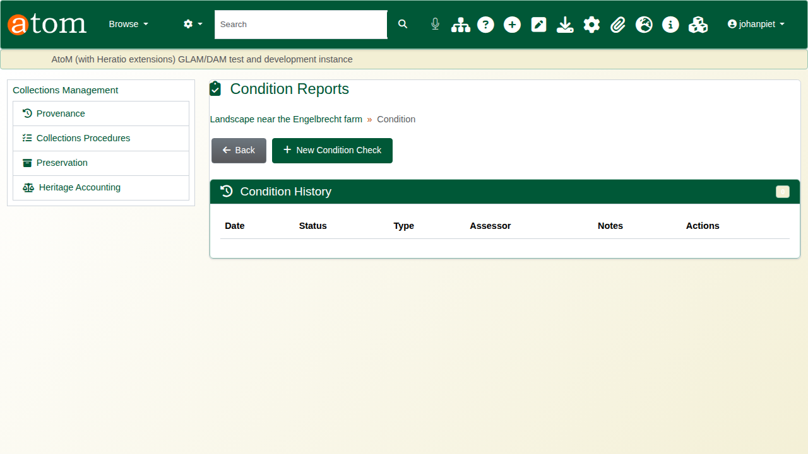

Click **New Condition Check**. The check date and the person checking are filled in; the check is created only when the form is saved.

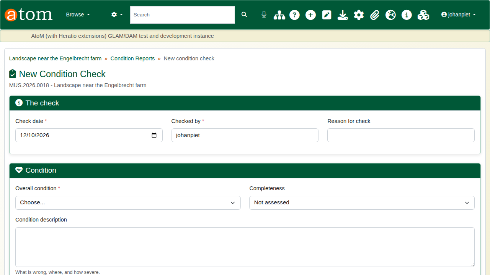

## 2. The assessment

The form has four parts:

| Part | Fields |
|---|---|
| The check | Check date (required), checked by (required), reason for check |
| Condition | Overall condition (required), completeness, condition description, hazards noted, technical assessment |
| Treatment | Treatment recommendations, treatment priority, next check |
| Care recommendations | Environment, handling, display, storage, packing and transport, additional notes |

: The condition check form

The deliberate mistake: save without rating the overall condition. The check is refused, the missing field is marked, and everything typed is kept.

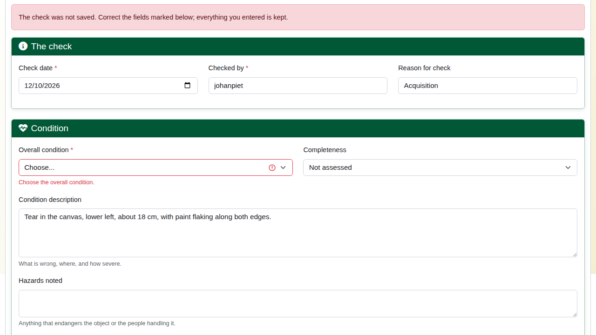

Rate the overall condition (Excellent, Good, Fair, Poor or Critical), then complete the assessment: completeness, hazards, the recommended treatment, its priority (Low, Medium, High or Urgent), the next check date, and care advice. The next check cannot be before this one. Click **Record condition check**.

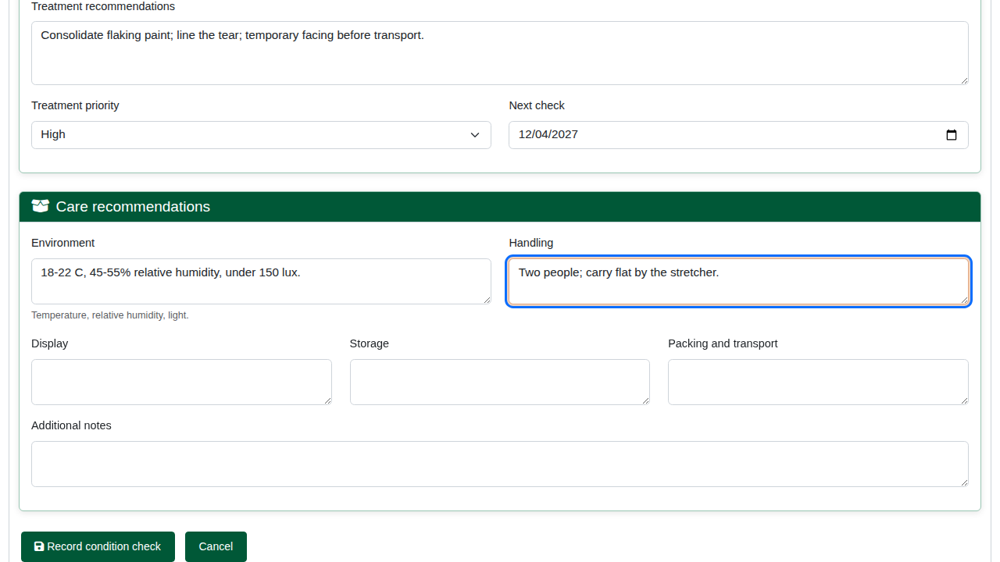

The check gets its own reference (for example `CC-20261012-913375`) and shows the rating, priority, next check, and the notes and recommendations. **Edit Condition Check** corrects it later.

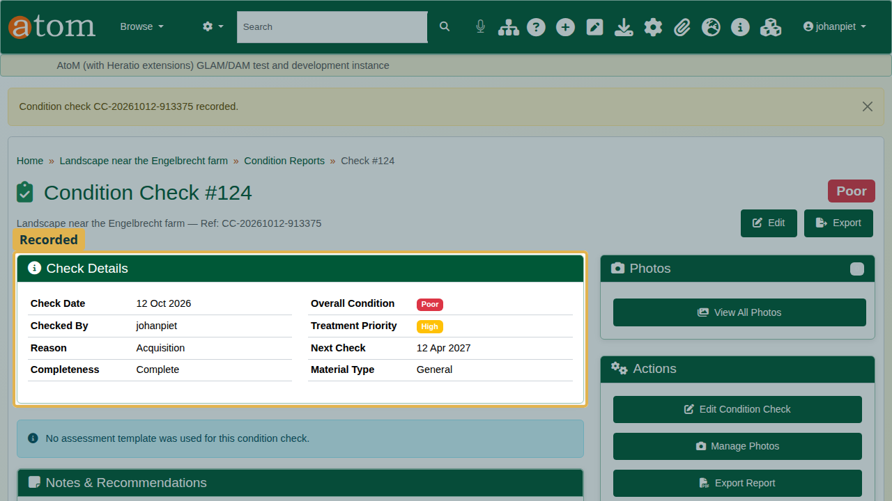

## 3. Photographs

Click **Manage Photos**. Choose the kind of photograph (Overall View, Detail, Damage, Before Treatment, After Treatment or Other), give it a caption, choose the file and click **Upload Photo**.

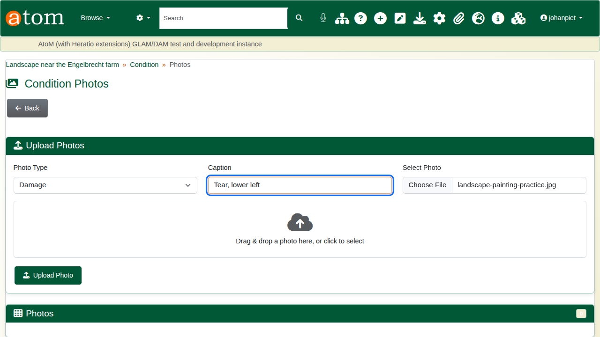

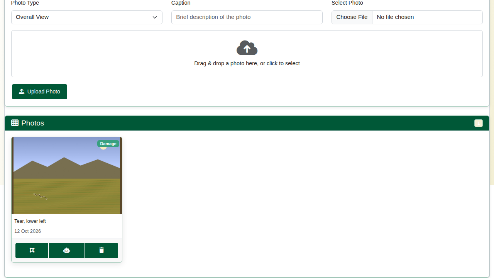

## 4. Marking the damage

On the photograph, click the annotate button. Choose the **Category** (here **Tear**; others include Crack, Stain, Loss/Missing, Mould/Fungus, Pest Damage, Water Damage, Abrasion/Wear and Corrosion), take the **Rectangle** tool and draw around the damage. Circle, arrow, freehand, text and marker tools are also available. Click **Save Annotations**.

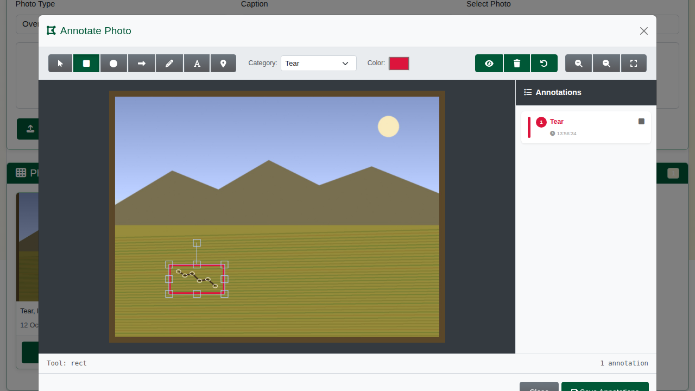

The photograph now shows how many marked areas it carries.

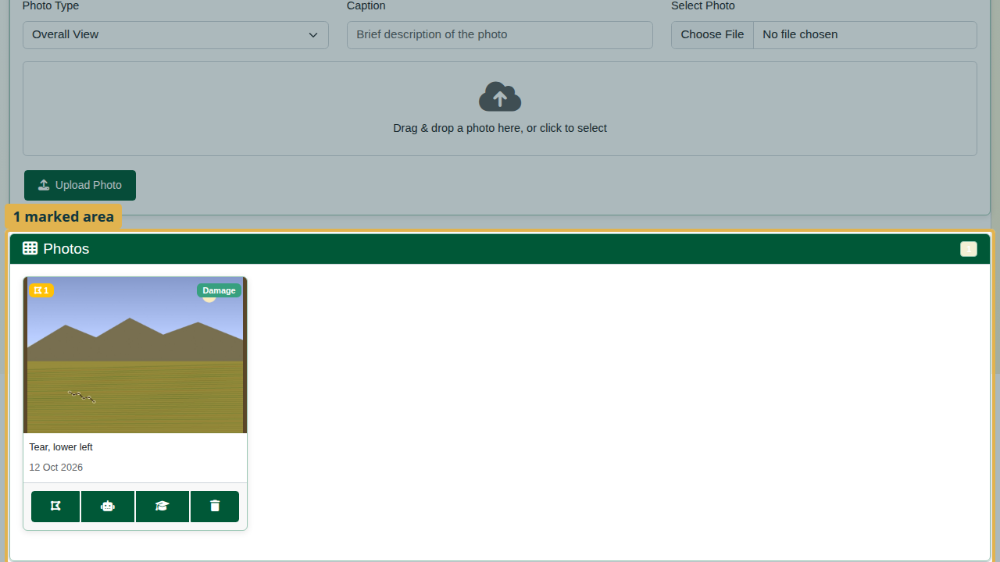

## 5. The report

**Export Report** gives a printable condition report: reference, date, who checked it, overall condition, completeness, treatment priority, next check, the condition description, hazards, recommended treatment, care recommendations, and the photographs.

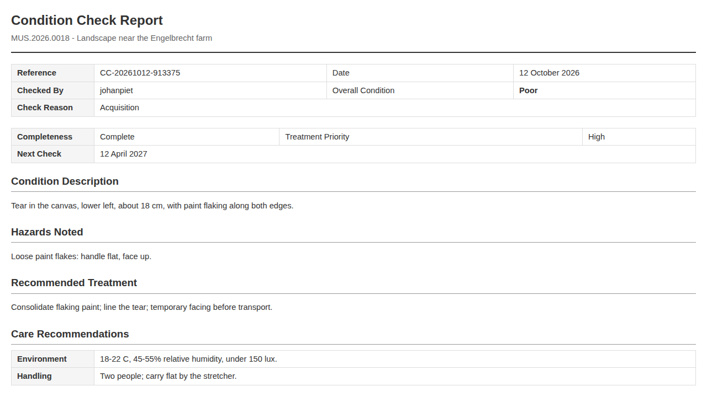

Back on the object, **Condition History** lists the check with its date, rating, assessor and a summary of the description.

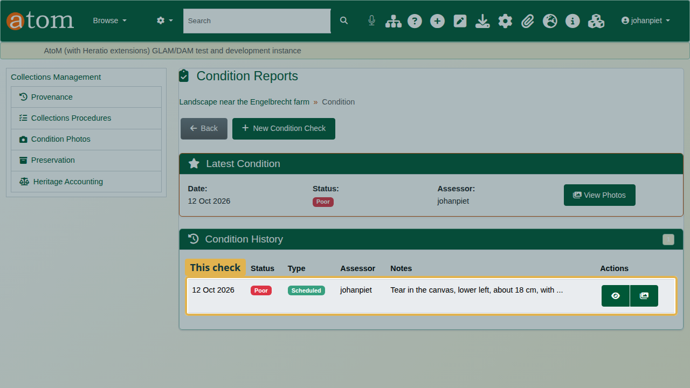

## Recap

1. Start a condition check from the object.
2. Rate the overall condition; the check will not save without it.
3. Record the assessment, treatment and care advice.
4. Photograph the damage and mark it.
5. Export the report.

Part 4 covers provenance and the chain of custody.
