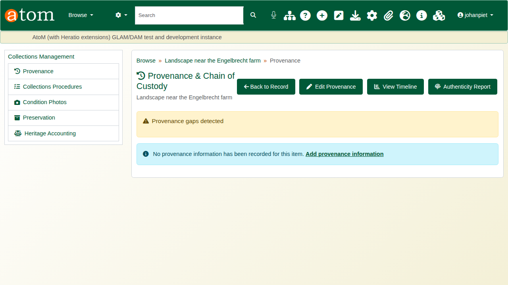
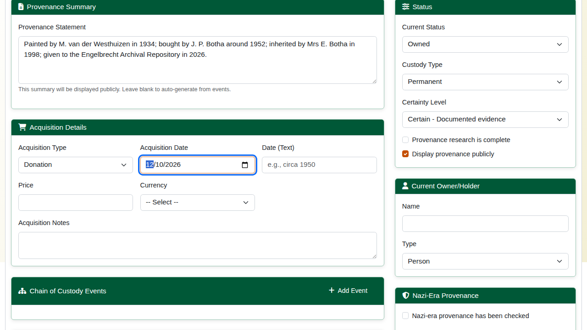
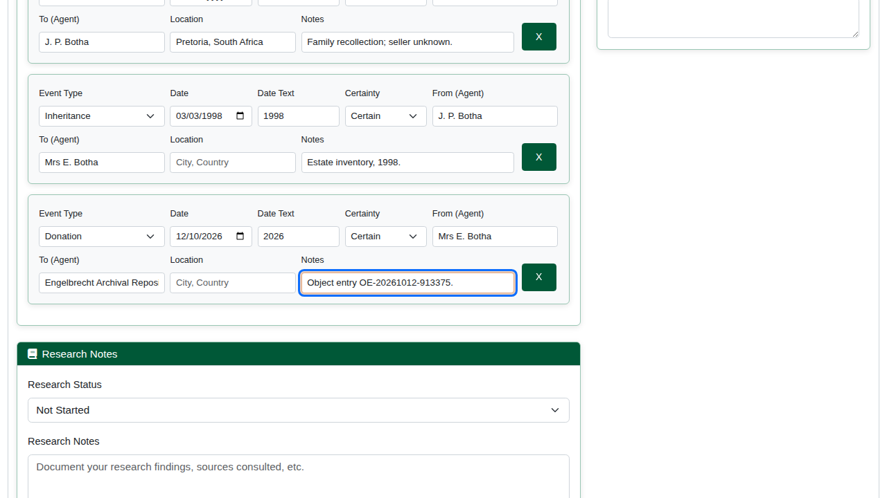
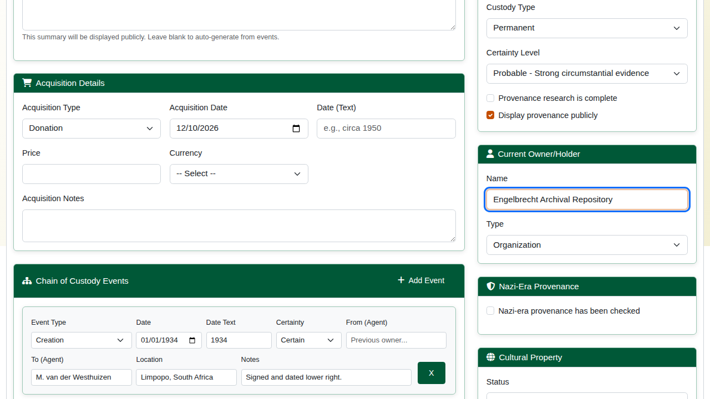
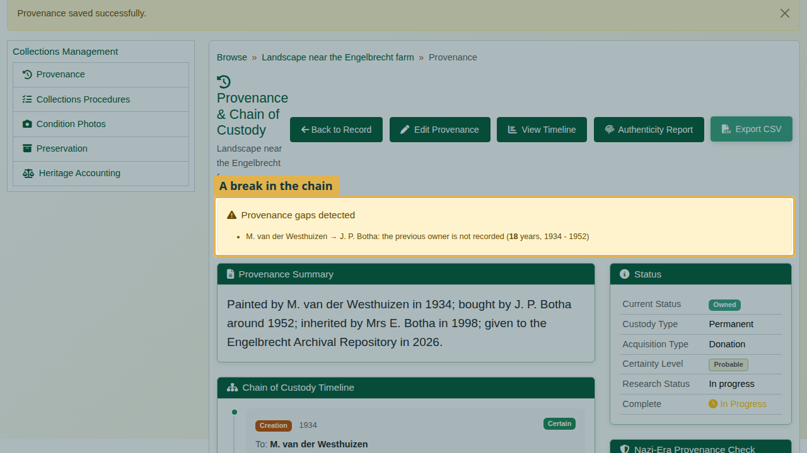
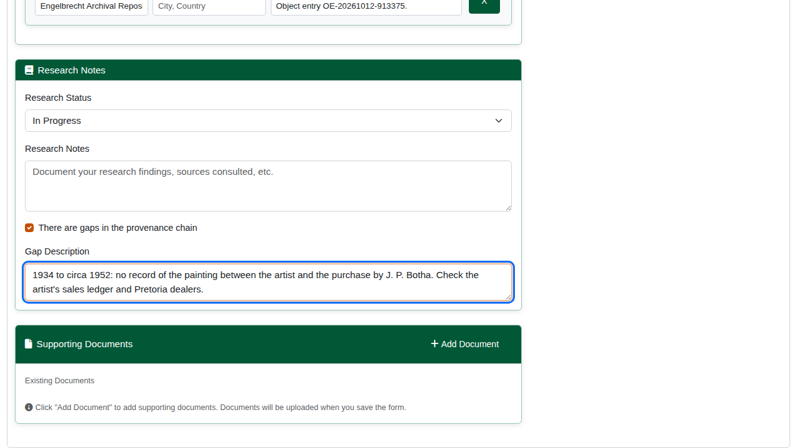
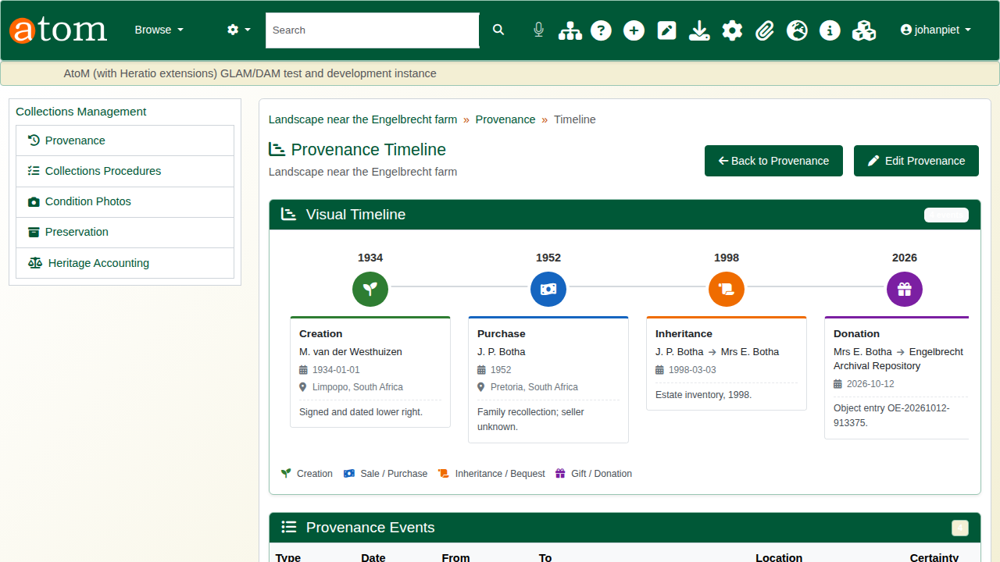
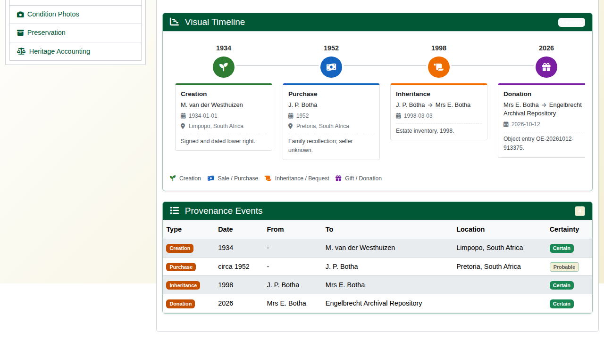

| Field | Value |
|---|---|
| Document title | Training: Museum, Part 4 - Provenance and the Chain of Custody |
| Author | Dr Johan Pieterse |
| Owner | The Archive and Heritage Group (Pty) Ltd |
| Version | 1.0 |
| Status | Released |
| Date | 12 October 2026 |
| Prepared for | Curators, registrars and provenance researchers using the AHG extensions |
| Classification | Public |
| Reference | AHG-TRN-MUS-04 |

: Document control

This guide goes with part 4 of the museum training videos. You record who has owned the painting since it was made, see the system find a break in the chain, and record that gap so the next researcher knows where to look. Allow about 15 minutes.

## Before you start

| What | Notes |
|---|---|
| An editor or administrator account | Provenance is edited by staff; the summary can be shown publicly. |
| A museum object | The painting from part 1. Every owner and date in its history is fictitious. |

: What you need before you start

## 1. Open the provenance

On the object, under **Collections Management**, open **Provenance**. With nothing recorded yet, click **Add provenance information**.

## 2. Summary and acquisition

Write a **Provenance Statement** in plain words; it is shown publicly when **Display provenance publicly** is ticked. Under **Acquisition Details**, record how the institution acquired the object (here **Donation**), the date, and any price, currency and notes.

## 3. The chain of custody

Under **Chain of Custody Events**, click **Add Event** for each change of custody. Each event has:

| Field | Meaning |
|---|---|
| Type | Creation, sale, purchase, auction, gift, donation, bequest, inheritance, transfer, loan, deposit, theft, recovery and more |
| Date / Date (text) | An exact date, or an approximate one such as "circa 1952" |
| Certainty | Certain, probable, possible or uncertain |
| From / To | Who the object passed from and to |
| Location, Notes | Where it happened and the evidence for it |

: Chain of custody event fields

The example chain:

| Event | Date | From | To | Certainty |
|---|---|---|---|---|
| Creation | 1934 | - | M. van der Westhuizen | Certain |
| Purchase | circa 1952 | (unknown) | J. P. Botha | Probable |
| Inheritance | 1998 | J. P. Botha | Mrs E. Botha | Certain |
| Donation | 2026 | Mrs E. Botha | Engelbrecht Archival Repository | Certain |

: The example chain of custody

Set the **Research Status**, the overall **Certainty Level** and the **Current Owner/Holder**, then click **Save Provenance**.

## 4. A gap in the chain

The system reads the chain link by link: each event's "from" should be the previous event's "to". Where it is missing, or names someone else, **Provenance gaps detected** reports the break, with the years it covers when they are known. Here the purchase has no recorded seller, so the 18 years from 1934 to 1952 are unaccounted for.

Record the gap rather than hide it: **Edit Provenance**, tick **There are gaps in the provenance chain** and describe what is missing and where to look. Save.

## 5. Timeline and export

**View Timeline** lays the chain out in order on a timeline, with approximate dates placed by their year, and lists the events in a table. **Export CSV** exports the chain for a loan or a due-diligence check; **Authenticity Report** summarises the evidence.

The edit form also records a Nazi-era provenance check (1933-1945), cultural property status and claims, and supporting documents.

## Recap

1. Write a public summary and record the acquisition.
2. Enter the chain of custody event by event, with a certainty for each.
3. Let the system find the gaps.
4. Record gaps rather than hide them.

Part 5 covers loans and exhibitions.
