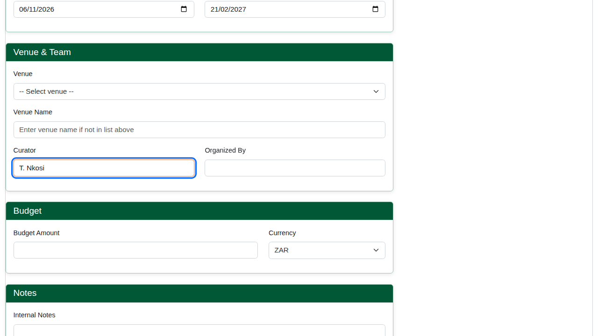
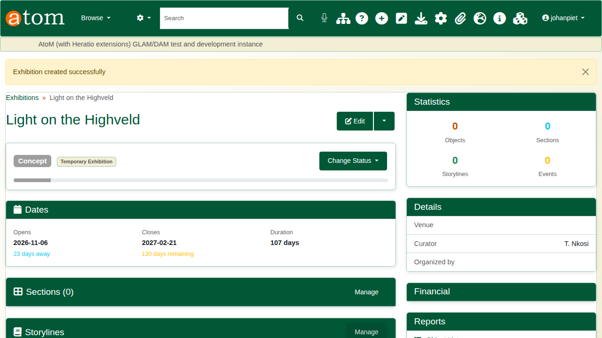
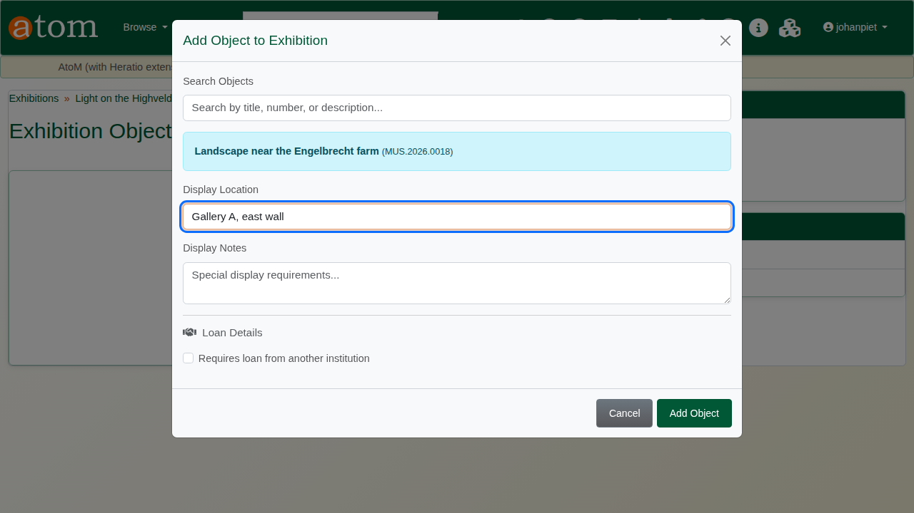
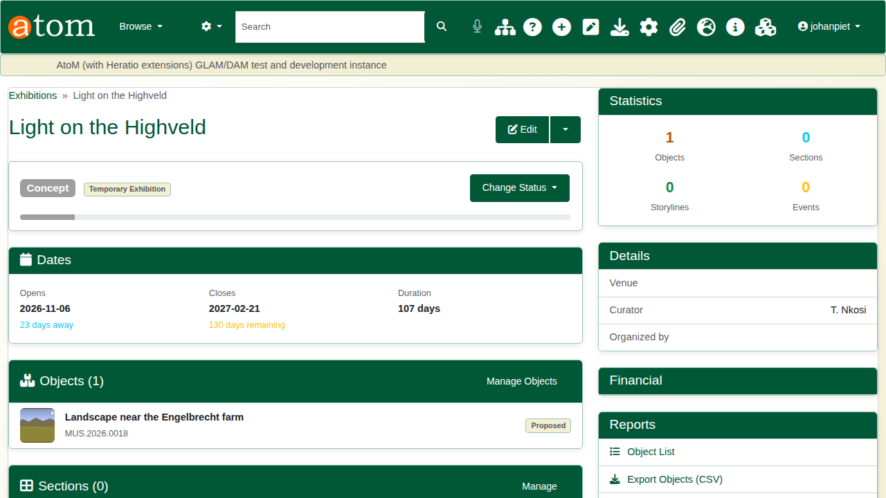
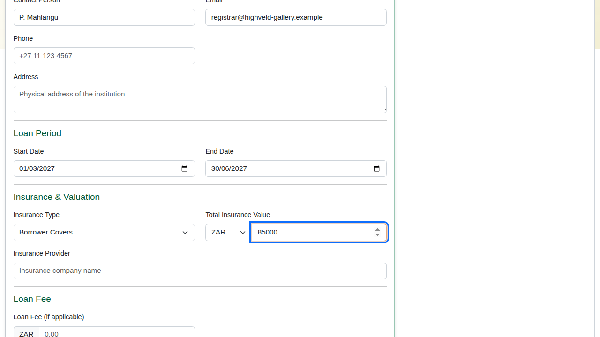
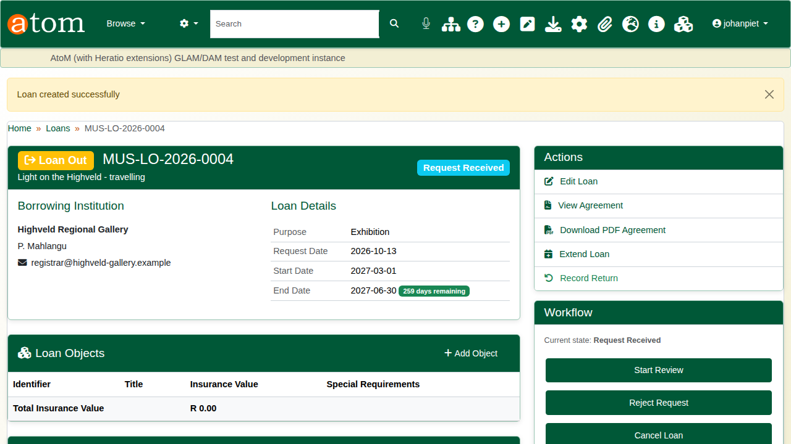
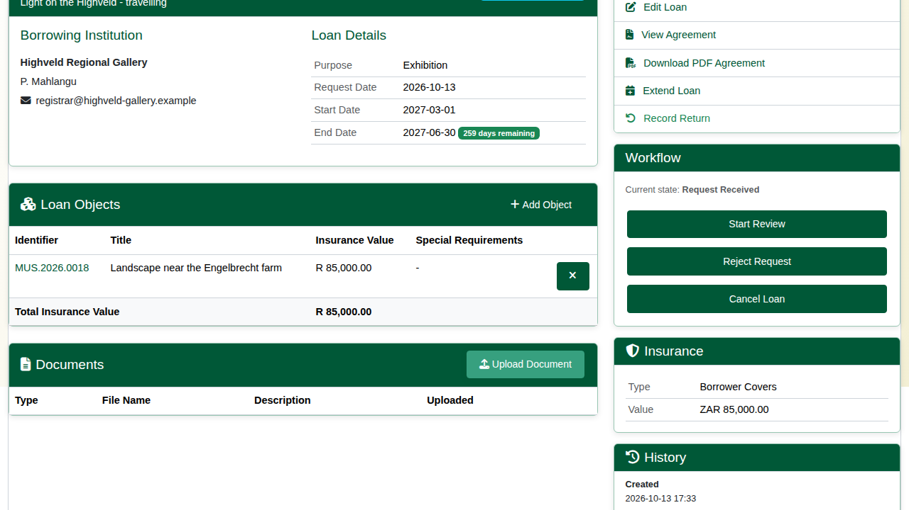
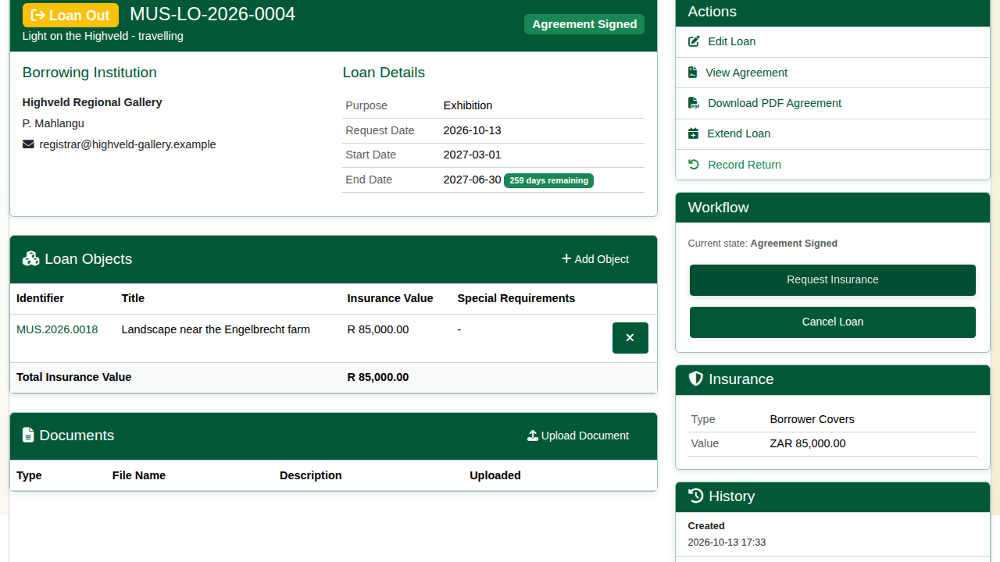
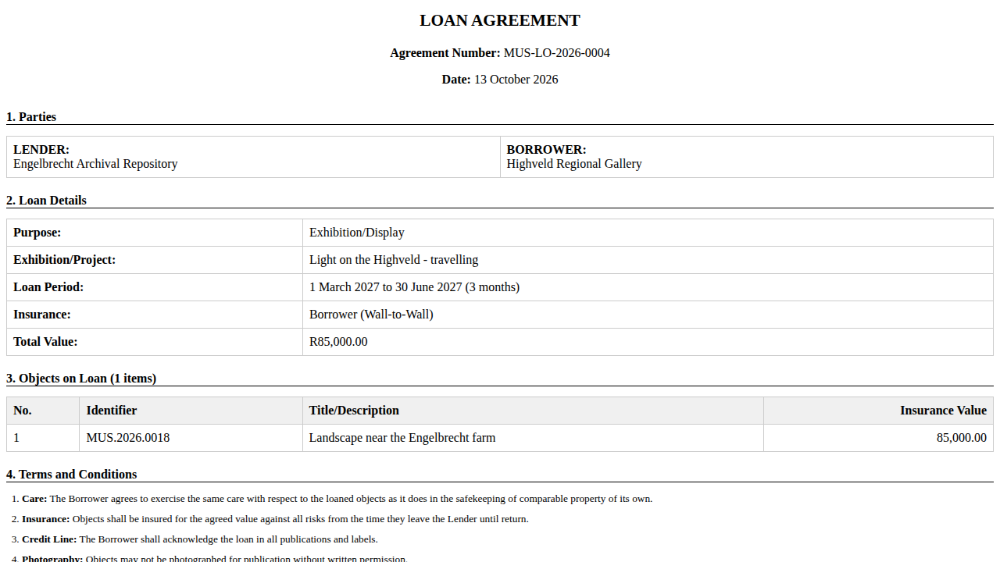
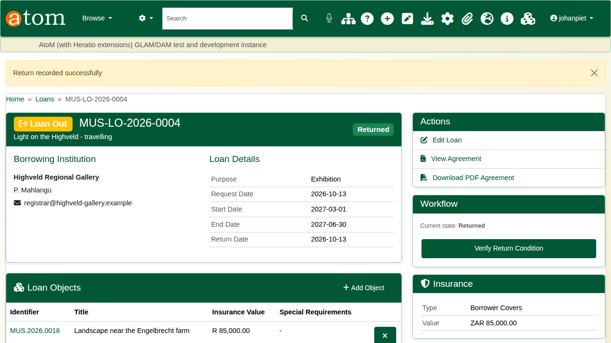

| Field | Value |
|---|---|
| Document title | Training: Museum, Part 5 - Exhibitions and Loans |
| Author | Dr Johan Pieterse |
| Owner | The Archive and Heritage Group (Pty) Ltd |
| Version | 1.0 |
| Status | Released |
| Date | 13 October 2026 |
| Prepared for | Curators and registrars using the AHG extensions |
| Classification | Public |
| Reference | AHG-TRN-MUS-05 |

: Document control

This guide goes with part 5 of the museum training videos. You plan an exhibition and add the painting to it, then lend the painting to another gallery, take the loan through approval and the signed agreement, and record its return. Allow about 20 minutes.

## Before you start

| What | Notes |
|---|---|
| An editor or administrator account | Exhibitions and loans are staff pages. |
| A museum object | The painting from part 1. |
| Fictitious details | The exhibition, the borrowing gallery and the people named are made up for this practice. |

: What you need before you start

## 1. Plan an exhibition

Under **Exhibitions**, choose **Add** (`/exhibition/add`). Enter a title, the exhibition type (permanent, temporary, travelling, online, pop-up and others), the opening and closing dates and the curator. Venue, organiser, budget and a project code are optional. Save: the exhibition starts at the **Concept** stage, and its page shows the dates, the duration and how long until it opens.

## 2. Add objects

On the exhibition, open **Manage Objects** and click **Add Object**. Search by title or object number, choose the object, and say where it will be displayed (here, Gallery A, east wall). Objects can also be placed in sections and storylines, and flagged when they need to be borrowed from another institution.

The exhibition page counts its objects, sections, storylines and events. Under **Reports**, **Object List** prints the list for installers and **Export Objects (CSV)** exports it as a spreadsheet.

## 3. Record a loan out

Under **Loans**, add a museum loan (`/loan/museum/add`). Record:

| Field | Example |
|---|---|
| Title | Light on the Highveld - travelling |
| Purpose | Exhibition (also research, conservation, photography, education, touring exhibition) |
| Borrowing institution and contact | Highveld Regional Gallery; P. Mahlangu |
| Loan dates | 1 March 2027 to 30 June 2027 |
| Insurance | Borrower covers; ZAR 85,000 |

: The loan out

Save. The loan gets its own number (for example MUS-LO-2026-0004) and starts at **Request Received**.

## 4. Add the object

Under **Loan Objects**, click **Add Object**, search for the painting and give its insurance value. A loan can carry several objects; the page totals their insurance value, and that total is what the agreement shows.

## 5. Approval and the agreement

A loan out follows a workflow, and the **Workflow** panel offers only the steps that make sense from where the loan stands. The first steps are:

| Step | From | To |
|---|---|---|
| Start Review | Request Received | Under Review |
| Approve | Under Review | Approved |
| Send Agreement | Approved | Agreement Pending |
| Agreement Received | Agreement Pending | Agreement Signed |

: The first workflow steps for a loan out

Later steps cover insurance, condition checks, packing, courier and dispatch, display at the borrower, and the return. Each change is recorded in the loan's status history with the user and time, and the badge at the top shows the current state.

**View Agreement** generates the loan agreement from the record: lender and borrower, purpose, loan period, insurance, the objects with their values, standard terms and signature blocks. **Download PDF Agreement** gives the same as a PDF. The lender is the repository that holds the objects.

## 6. Record the return

When the object comes back, choose **Record Return** under **Actions**, give the return date and a note on its condition, and click **Record Return**. The loan is marked **Returned**, the return is added to its history, and the workflow offers the next step, **Verify Return Condition**. **Extend Loan** changes the end date if the borrower asks for longer.

## Recap

1. Plan the exhibition and add its objects.
2. Record the loan with its borrower, dates and insurance.
3. Move it through approval and the agreement, step by step.
4. Record the return.

Part 6 covers heritage accounting.
