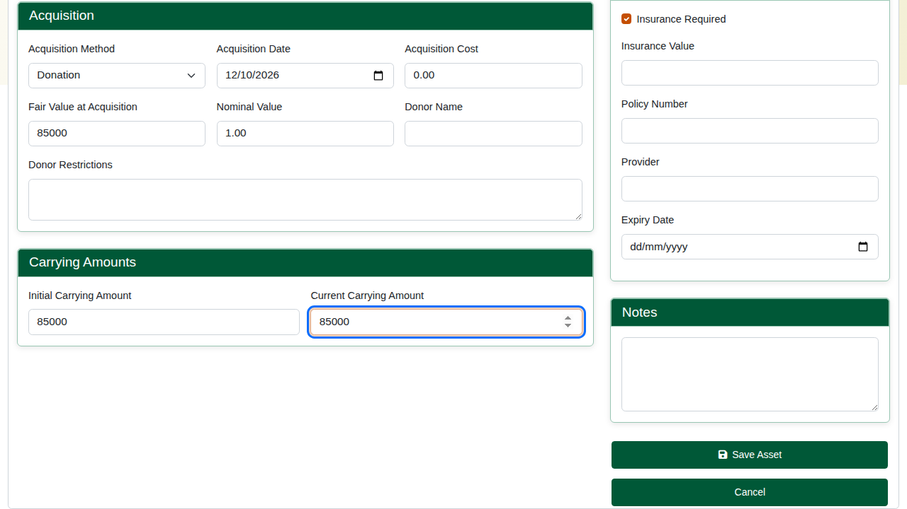
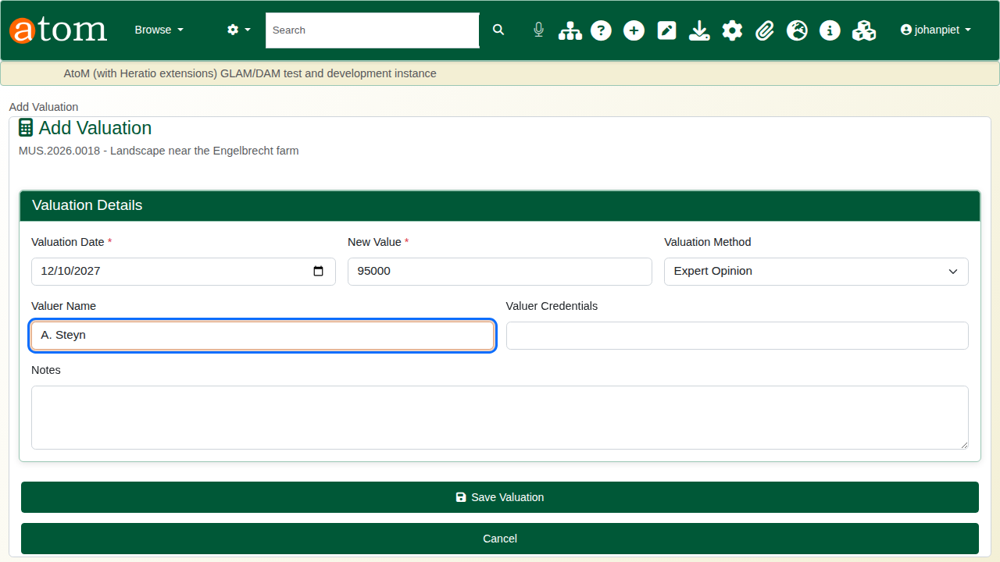
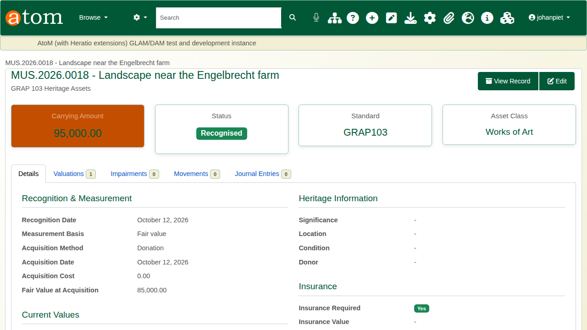
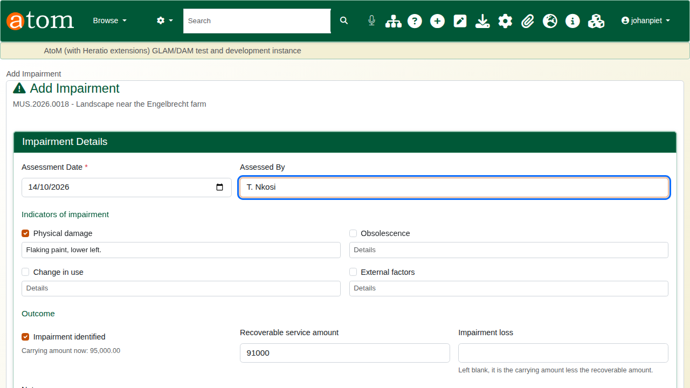
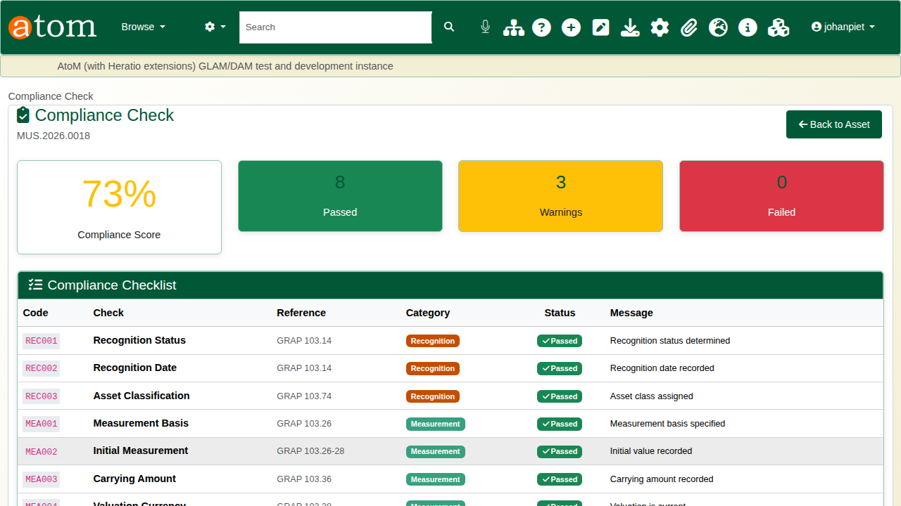
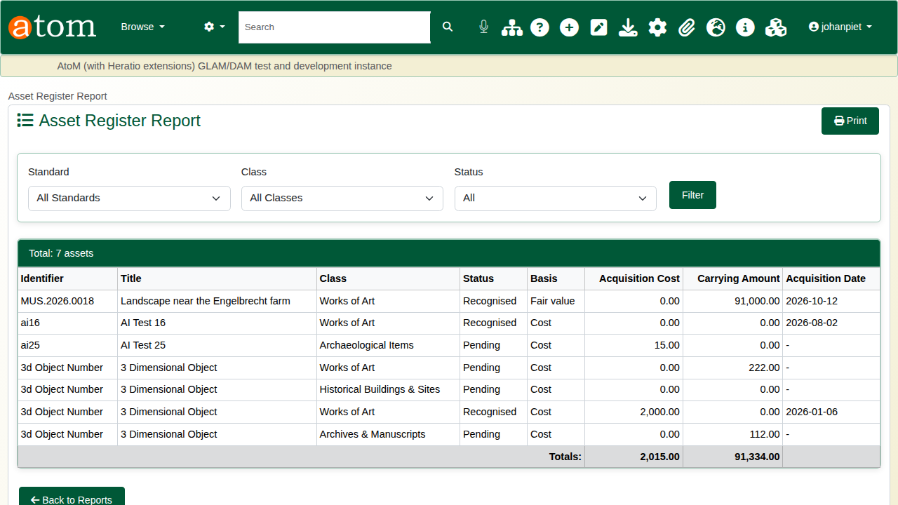
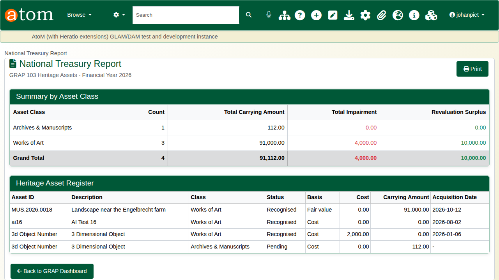
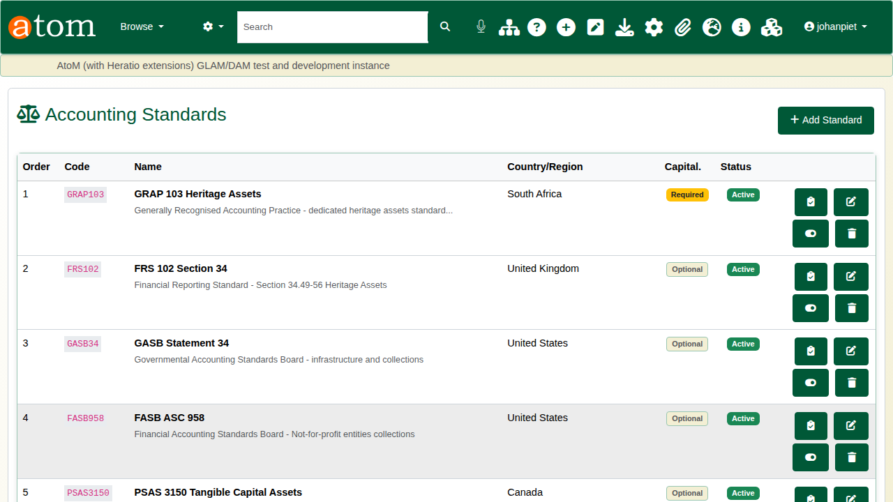

| Field | Value |
|---|---|
| Document title | Training: Museum, Part 6 - Heritage Accounting |
| Author | Dr Johan Pieterse |
| Owner | The Archive and Heritage Group (Pty) Ltd |
| Version | 1.0 |
| Status | Released |
| Date | 14 October 2026 |
| Prepared for | Finance officers, registrars and curators using the AHG extensions |
| Classification | Public |
| Reference | AHG-TRN-MUS-06 |

: Document control

This guide goes with part 6, the last part of the museum training videos. You recognise the painting from part 1 as a heritage asset under GRAP 103, revalue it, record an impairment, check the record against the standard, and produce the reports that auditors and National Treasury ask for. Allow about 20 minutes.

## Before you start

| What | Notes |
|---|---|
| An administrator account | Heritage accounting is a staff function. |
| A museum object | The painting from part 1. |
| Fictitious figures | The values, the valuer and the damage in this guide are made up for the practice. |

: What you need before you start

## 1. Recognise the asset

On the object, under **Collections Management**, open **Heritage Accounting** and click **Create Heritage Asset Record**. The form opens already linked to the object.

| Field | Example | Notes |
|---|---|---|
| Accounting standard | GRAP 103 Heritage Assets | IPSAS 45, IAS 16, FRS 102, GASB 34 and others are available |
| Asset class | Works of Art | |
| Recognition status and date | Recognised, 12 October 2026 | |
| Measurement basis | Fair value | Cost, fair value, nominal, or not practicable |
| Acquisition method and date | Donation, 12 October 2026 | |
| Fair value at acquisition | 85,000 | |
| Initial and current carrying amount | 85,000 | |

: Recognising the painting

Save. The asset page shows the carrying amount, status, standard and class, with tabs for **Valuations**, **Impairments**, **Movements** and **Journal Entries**.

## 2. Revaluation

On the **Valuations** tab, add a valuation: the date, the new value, the method (market value, cost approach, income approach, expert opinion, insurance valuation) and the valuer. Under the revaluation model an increase is credited to the **revaluation surplus**; a decrease is charged against the surplus first.

| Before | Valuation | After |
|---|---|---|
| Carrying amount 85,000 | 95,000, expert opinion | Carrying amount 95,000; revaluation surplus 10,000 |

: The example revaluation

## 3. Impairment

On the **Impairments** tab, add an assessment. Tick the indicators that apply (physical damage, obsolescence, change in use, external factors) and describe them, mark **Impairment identified**, and give the **recoverable service amount** and who assessed it. If the loss is left blank it is worked out as the carrying amount less the recoverable amount, and the carrying amount is reduced to match.

| Before | Assessment | After |
|---|---|---|
| Carrying amount 95,000 | Physical damage; recoverable amount 91,000 | Impairment loss 4,000; carrying amount 91,000 |

: The example impairment

## 4. Checking against GRAP 103

Open the asset's **Compliance Check** (`/grap/check/<asset id>`). Each requirement is listed with its GRAP 103 paragraph, category and status, and the page gives a compliance score. For the painting, recognition and measurement pass, with warnings for the significance statement, the insurance details and the location.

Edit the asset to deal with them: heritage significance and a statement, the current location, and the insured value with the policy number. Check again: every requirement passes.

The **GRAP Dashboard** (`/grap/dashboard`) shows the same picture across all assets and can run a batch check.

## 5. Reports

| Report | Shows |
|---|---|
| Asset register | Every heritage asset with its class, status, basis, cost and carrying amount, filterable by standard, class and status |
| National Treasury report | Totals by asset class with impairments and revaluation surplus, and the full register, for the annual financial statements |
| Valuation and movement reports | Valuation history and revaluation surplus; loans, transfers, exhibitions and storage changes |

: Heritage accounting reports

## 6. Other standards

GRAP 103 is one of several accounting standards built in, each with its own compliance rules: IPSAS 45 and IPSAS 17, IAS 16, FRS 102, GASB 34, FASB 958, PSAS 3150, AASB 116 and a custom local standard. Administrators manage them under **Accounting Standards**.

## Recap

1. Recognise the object as a heritage asset under the right standard.
2. Record valuations and impairments as they happen.
3. Check the record against the standard and fix what it flags.
4. Produce the asset register and the treasury report from the same data.

That completes the museum training series.
