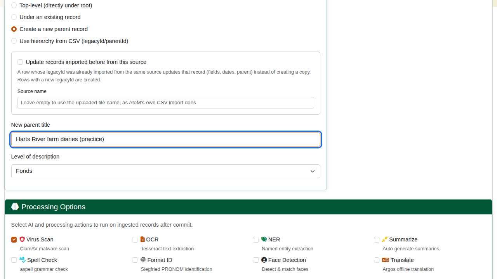
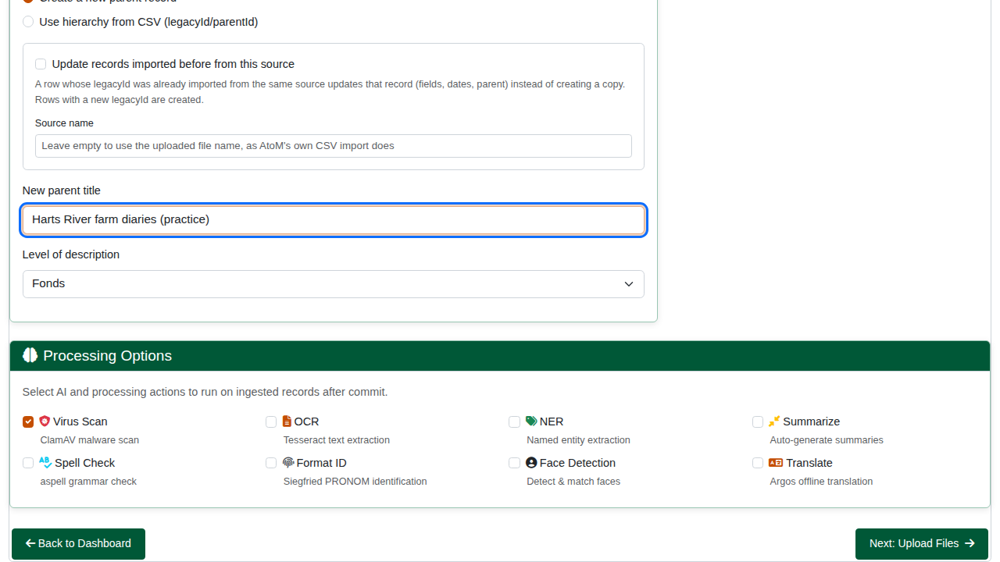
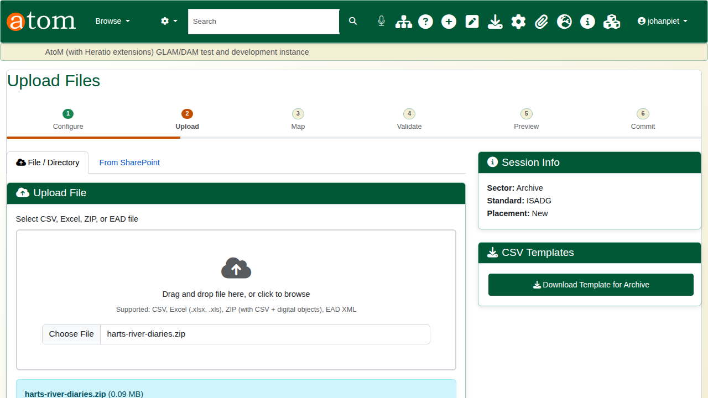
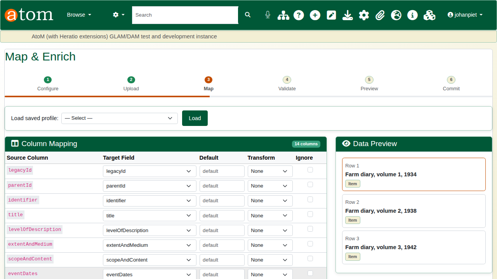
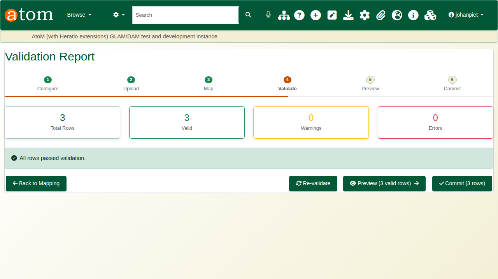
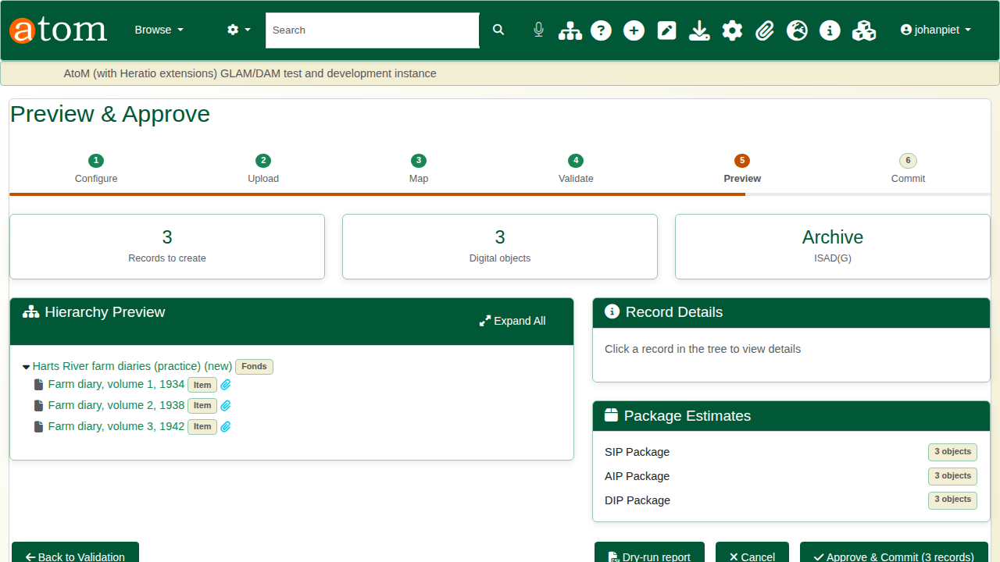
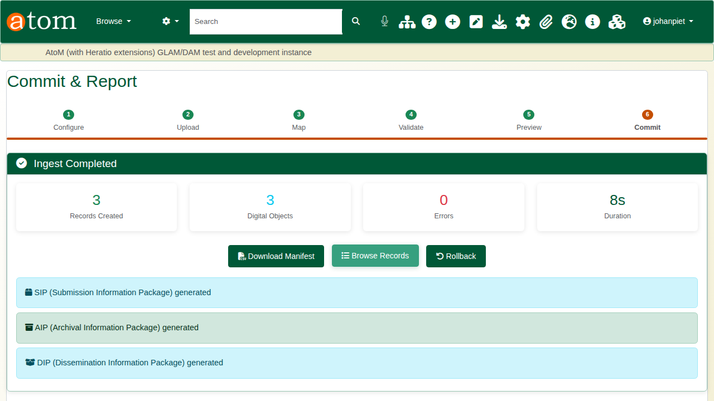
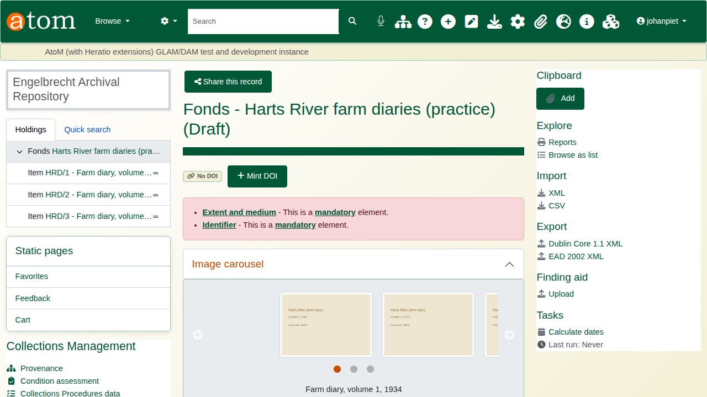
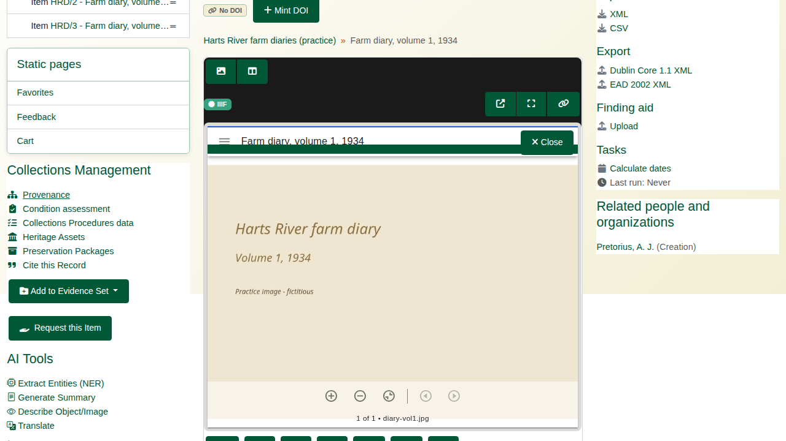
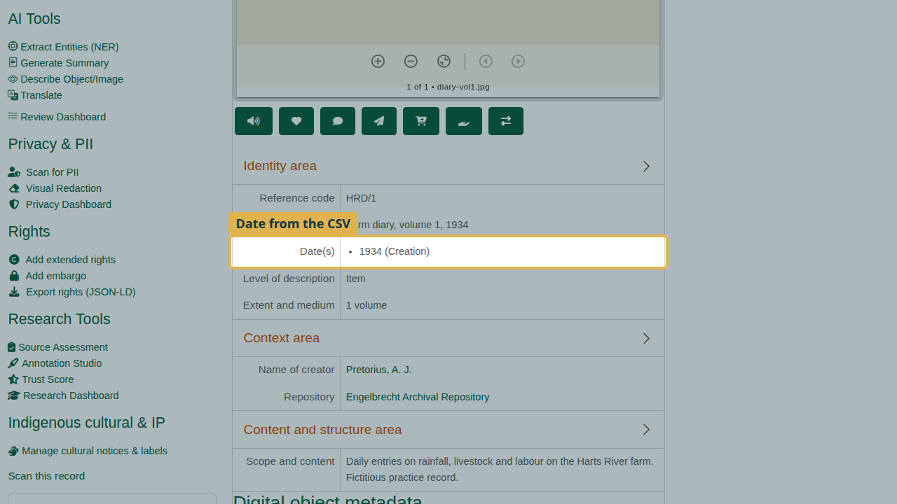

| Field | Value |
|---|---|
| Document title | Training: Preservation, Part 1 - The Ingest Wizard |
| Author | Dr Johan Pieterse |
| Owner | The Archive and Heritage Group (Pty) Ltd |
| Version | 1.0 |
| Status | Released |
| Date | 14 October 2026 |
| Prepared for | Archivists and digitisation staff using the AHG extensions |
| Classification | Public |
| Reference | AHG-TRN-PRS-01 |

: Document control

This guide goes with part 1 of the preservation training videos. You bring three digitised farm diaries into the archive through the ingest wizard: a ZIP file holding a CSV that describes them and the three scanned pages. The wizard maps and checks the data, shows you the result before anything is written, and then creates the records and writes the OAIS packages. Allow about 20 minutes.

## Before you start

| What | Notes |
|---|---|
| An administrator account | The Ingestion Manager is a staff function. |
| The practice ZIP | `harts-river-diaries.zip`: `harts-river-diaries.csv` and `diary-vol1.jpg` to `diary-vol3.jpg`. |
| Fictitious records | The diaries, their writer and their contents are made up for the practice. |

: What you need before you start

The CSV uses AtoM's own import column names, so it maps without any work:

| Column | Example |
|---|---|
| legacyId | HRD-001 |
| identifier | HRD/1 |
| title | Farm diary, volume 1, 1934 |
| levelOfDescription | Item |
| extentAndMedium | 1 volume |
| scopeAndContent | Daily entries on rainfall, livestock and labour |
| eventDates, eventStartDates, eventEndDates | 1934; 1934-01-01; 1934-12-31 |
| eventActors, eventTypes | Pretorius, A. J.; Creation |
| digitalObjectPath | diary-vol1.jpg |

: The practice CSV

## 1. Configure

Open **Admin > Ingestion Manager** (`/ingest`) and click **New Ingest**.

| Setting | Example | Notes |
|---|---|---|
| Session title | Harts River farm diaries (practice) | Names the session on the dashboard |
| Record type | Archival descriptions | Accessions can be ingested too |
| Sector and standard | Archive, ISAD(G) | Library, museum, gallery and DAM sectors offer their own standards |
| Repository | Engelbrecht Archival Repository | Holds the new records |
| Hierarchy placement | Create a new parent record | Or top level, under an existing record, or the hierarchy in the CSV (legacyId and parentId) |
| New parent title and level | Harts River farm diaries (practice), Fonds | Created at commit; the rows are filed under it |

: Configuring the session

On the right, **Output Options** set what the commit produces: the AtoM records, the SIP, AIP and DIP packages, and thumbnails and reference images. An optional **Security Classification** is applied to every record after commit. Below, **Processing Options** run on the ingested records: virus scan (on by default), OCR, named entity extraction, summaries, spell check, format identification, face detection and translation. The defaults for all of these are set under **Admin > AHG Settings > Data Ingest Defaults**.

## 2. Upload

Choose the file and click **Upload & Continue**. A CSV on its own is accepted, as is a ZIP holding the CSV with the digital objects beside it, or EAD. The wizard unpacks a ZIP, finds the CSV and counts its rows.

## 3. Map and enrich

Each source column is matched to a target field. Columns with AtoM's import names map themselves; any other column is flagged as unmapped for you to choose its field, give it a default or a transform, or ignore it. The **Data Preview** shows the rows as they will be read, and **Digital Object Matching** pairs the files in the ZIP with rows by file name. A mapping can be saved as a profile and loaded for the next batch. Click **Save Mappings & Validate**.

## 4. Validate

Validation checks required fields, dates, the hierarchy, duplicates and checksums before anything is written. Each failing row is listed with the reason: fix the file and upload it again, or exclude the row. All three practice rows pass.

## 5. Preview

The preview shows the tree as it will be built: the new fonds marked **(new)**, with the three diaries under it, each with its digital object. **Package Estimates** lists the packages to be written. **Dry-run report** downloads the same plan as a CSV, row by row (what is created or updated, and where it is placed), without writing anything.

## 6. Commit

Click **Approve & Commit**, then **Start Commit**. The commit runs as a background job (`php symfony ingest:commit`), so a large batch does not tie up the browser; the page follows its progress and post-processing. The report gives the records and digital objects created, the errors and the time taken, and confirms each package.

| Package | Written to | Holds |
|---|---|---|
| SIP (submission) | `sip/` in the ingest work folder | A JSON manifest of what was submitted, with checksums |
| AIP (archival) | `aip/` in the ingest work folder | A folder: `objects/`, `metadata/` (per-record metadata and `premis.json`) and `manifest.json` |
| DIP (dissemination) | `dip/` in the ingest work folder | Access URLs and slugs for the new records |

: The OAIS packages

The ingest work folder is `/var/lib/ahg-ingest/<instance>` unless an administrator sets `ingest_work_dir`. It sits outside the web root, so packages, uploaded files and job logs cannot be downloaded from the site. A session with its own output paths, set on the Configure step, writes there instead.

## 7. The new records

**Browse Records** opens the record the batch went under, here the new fonds with the three diaries. The wizard creates the fonds with its title only, so AtoM flags its identifier and extent as missing until you add them: edit the fonds and complete it.

Each diary carries its description and its scan in the IIIF viewer.

The CSV's event columns (`eventTypes`, `eventActors`, `eventDates`, `eventStartDates`, `eventEndDates`, pipe-separated and aligned by position) become the record's dates and creator. A creator not yet in the archive becomes a new authority record, shared by every row that names it; a missing event type is Creation.

## Rolling back

If a batch turns out to be wrong, **Rollback** on the commit report (or on the dashboard) deletes everything the ingest created: the digital objects, the records and a parent record it created, provided nothing else has since been filed under that parent. Keep the practice diaries for part 2.

## Recap

1. Configure the session, its standard and where the records go.
2. Upload a CSV, or a ZIP with the digital objects.
3. Map the columns and check the validation.
4. Preview the tree, then commit: the records and the SIP, AIP and DIP are written.

Part 2 covers fixity checks, format identification, virus scanning and PREMIS events.
