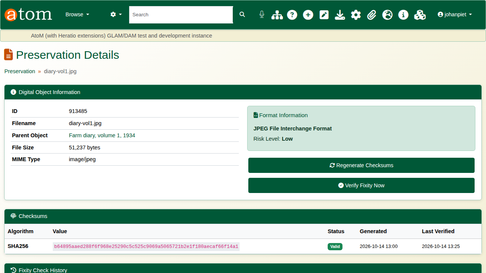
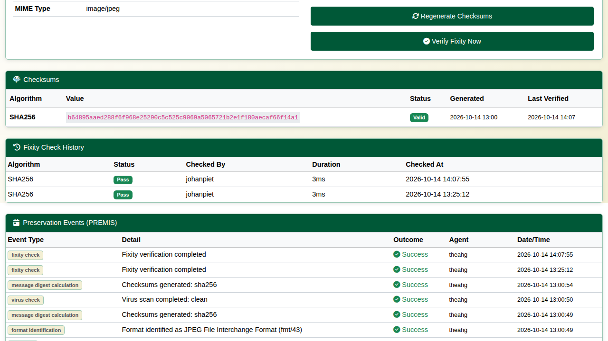
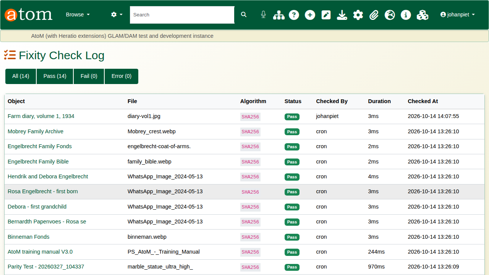
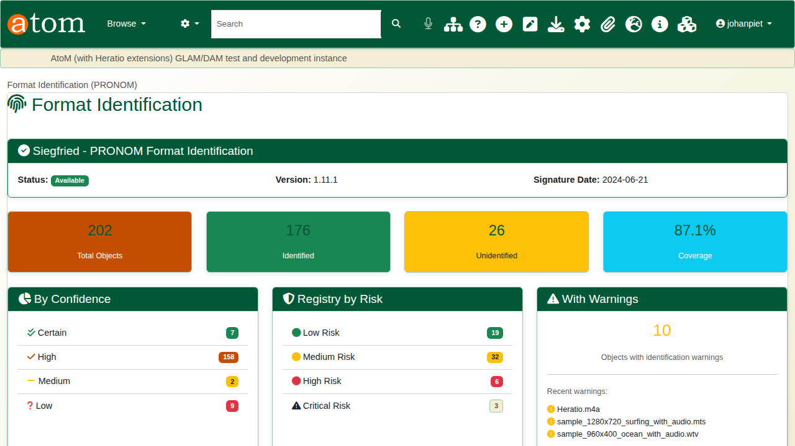
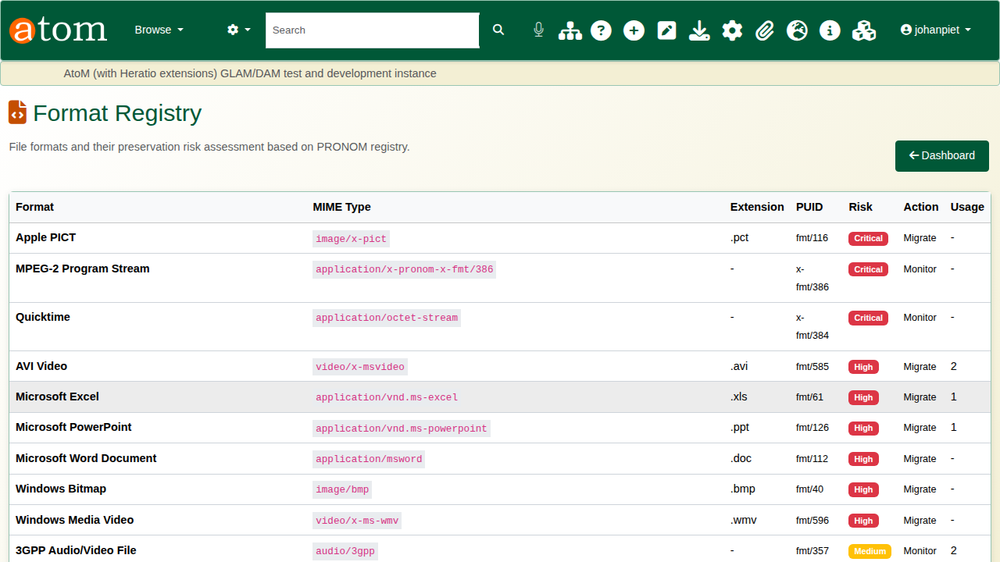
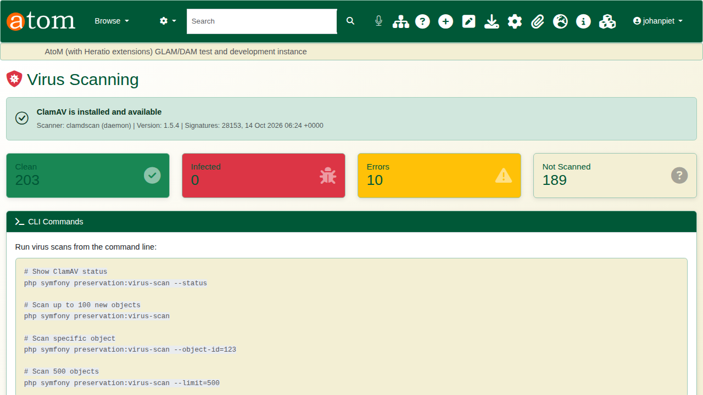
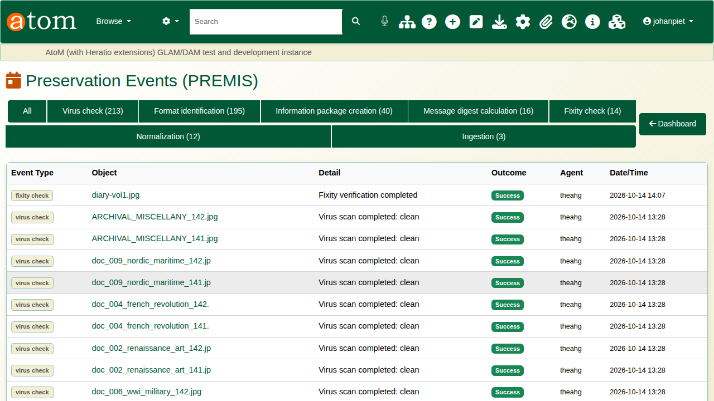
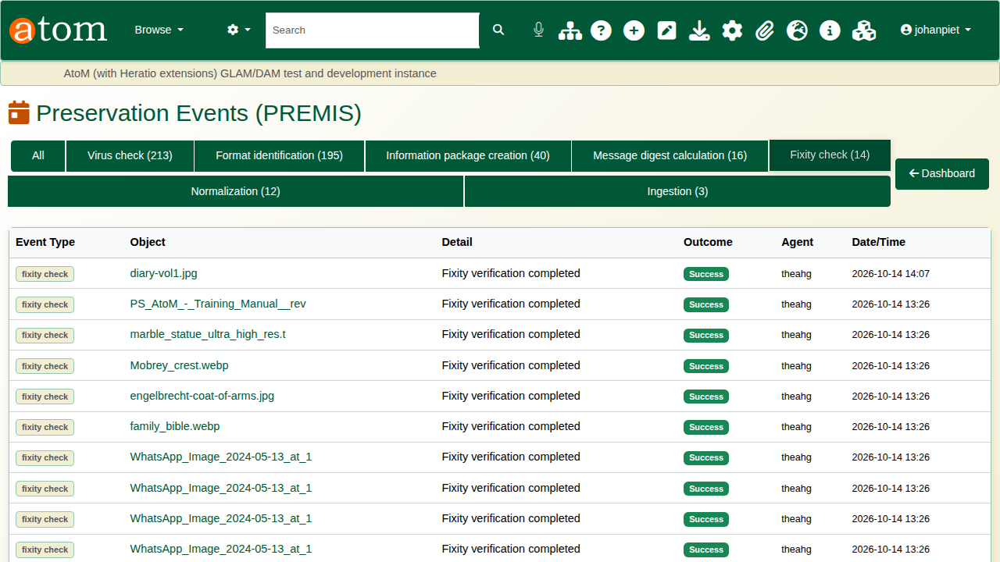
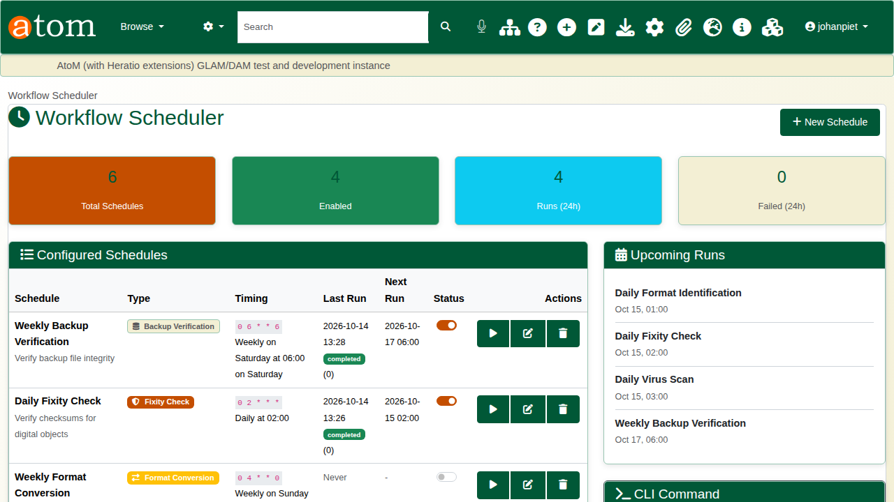

| Field | Value |
|---|---|
| Document title | Training: Preservation, Part 2 - Fixity, Formats and PREMIS |
| Author | Dr Johan Pieterse |
| Owner | The Archive and Heritage Group (Pty) Ltd |
| Version | 1.0 |
| Status | Released |
| Date | 14 October 2026 |
| Prepared for | Archivists and digital preservation staff using the AHG extensions |
| Classification | Public |
| Reference | AHG-TRN-PRS-02 |

: Document control

This guide goes with part 2 of the preservation training videos. Using the farm diaries ingested in part 1, you look at how the archive proves a file is unchanged, says what format it is and how much at risk, scans it for viruses, and records every one of those actions as a PREMIS event. Allow about 20 minutes.

## Before you start

| What | Notes |
|---|---|
| An administrator account | The preservation pages are under **Admin > Preservation**. |
| The farm diaries from part 1 | Fictitious practice records with three scanned pages. |

: What you need before you start

## 1. One file's preservation record

Every digital object has a preservation page (`/admin/preservation/object/<digital object id>`), reached from the file name on any preservation list. It shows the file's details, its format and risk, its checksums, its fixity history and its PREMIS events.

At ingest the wizard already calculated a SHA-256 checksum, identified the format and scanned the file, so the diary's page starts with those events.



## 2. Fixity

A checksum is a fingerprint of the file's exact bytes. **Verify Fixity Now** reads the file again and compares it with the stored checksum: a match passes, and any change (disk fault, corruption, tampering) fails and flags the file. Each check is added to the fixity history and logged as a **fixity check** event. **Regenerate Checksums** makes new ones, for instance after a deliberate, recorded change to the file.



The **Fixity Log** (`/admin/preservation/fixity-log`) lists every check across the archive with its result, who or which job ran it, and when; it can be filtered to failures.



## 3. Format identification

**Format Identification** (`/admin/preservation/identification`) uses Siegfried against PRONOM, the format registry of The National Archives (UK). It shows the coverage of the collection, the confidence of each match, the formats with warnings, the most used formats and the latest identifications. A file Siegfried cannot match is logged as a warning ("no PRONOM match") for follow-up.

| Confidence | Meaning |
|---|---|
| Certain / High | Matched on the file's internal signature (and usually its extension) |
| Medium | Matched with a warning |
| Low | Matched on extension only, or a weak signature |

: Identification confidence



The **Format Registry** (`/admin/preservation/formats`) rates each format's preservation risk and the action it needs, most at risk first. Preservation formats (TIFF, PDF/A, plain text, WAV, FLAC and others) are marked as such.

| Risk | Typical formats | Action |
|---|---|---|
| Critical, High | Old Office binaries (.doc, .xls, .ppt), Windows Media, AVI, PICT | Migrate |
| Medium | Proprietary or less documented formats | Monitor |
| Low | TIFF, PDF/A, PNG, JPEG, plain text | None |

: Format risk levels



## 4. Virus scanning

**Virus Scanning** (`/admin/preservation/virus-scan`) uses ClamAV. The header shows the scanner (daemon or command line), the engine version and the signature version with its date; keep the signatures current (the `clamav-freshclam` service). The counts show clean, infected, error and not-yet-scanned files. An infected file is moved to quarantine and logged as a failed **virus check** event.



## 5. PREMIS events

**Preservation Events** (`/admin/preservation/events`) is the audit trail, in PREMIS terms. Filter by type to see one kind.

| Event type | Recorded when |
|---|---|
| Ingestion | A file enters through the ingest wizard |
| Message digest calculation | A checksum is made |
| Fixity check | A file is verified against its checksum |
| Format identification | A file is identified (or not) against PRONOM |
| Virus check | A file is scanned |
| Information package creation | A SIP, AIP or DIP is written |
| Normalization | A file is converted to a preservation format |

: PREMIS event types





## 6. Scheduling

The **Workflow Scheduler** (`/admin/preservation/scheduler`) runs the work on a timetable: daily format identification, fixity checks and virus scans, and weekly backup verification, each over a set number of objects. It shows each schedule's last run and result, the next run, and the upcoming runs; the play button starts a schedule at once. The scheduler itself is started every minute by cron:

```
* * * * * www-data cd /usr/share/nginx/archive && php symfony preservation:scheduler
```



## Recap

1. Checksums are made at ingest and verified again over time.
2. Formats are identified against PRONOM and rated for risk.
3. Files are scanned for viruses, and infected files are quarantined.
4. Every action is a PREMIS event; the scheduler keeps it all running.

Part 3 covers backup and restore.
