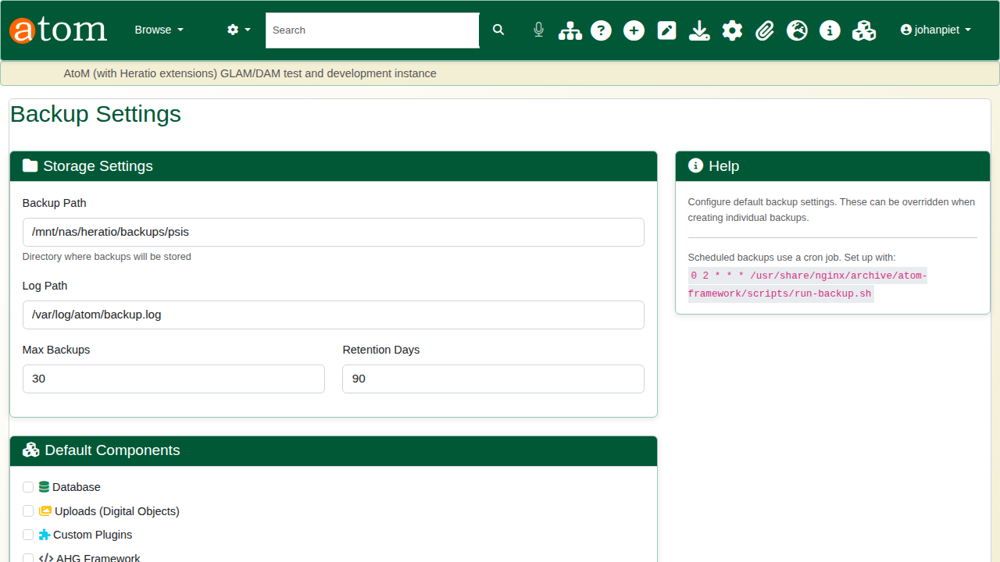
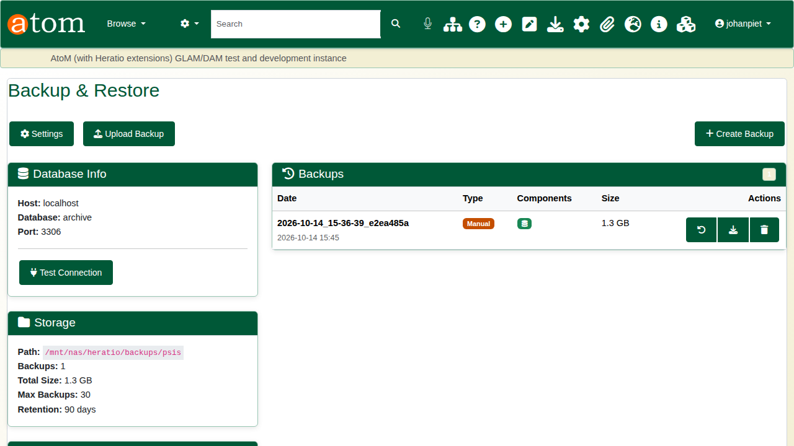
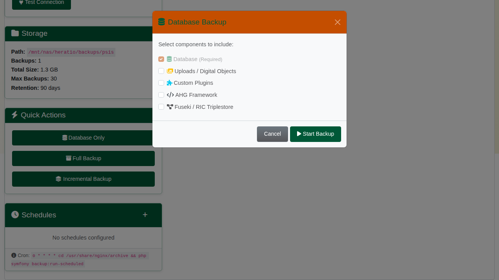
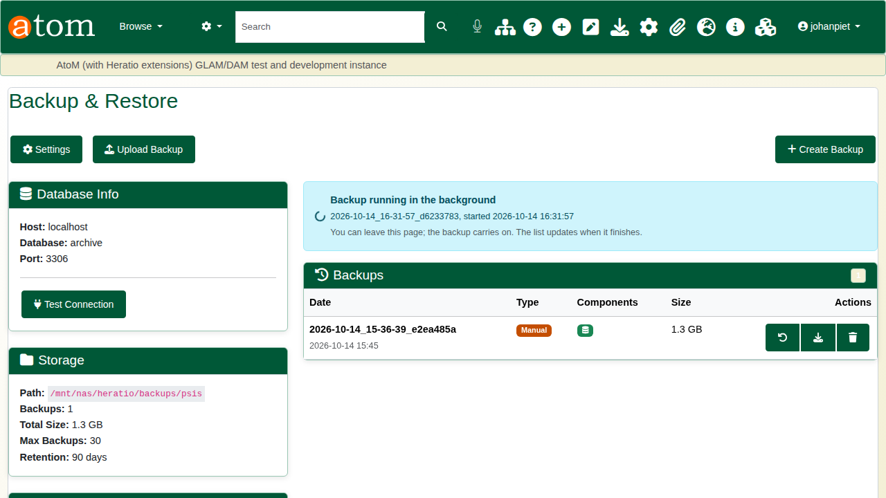
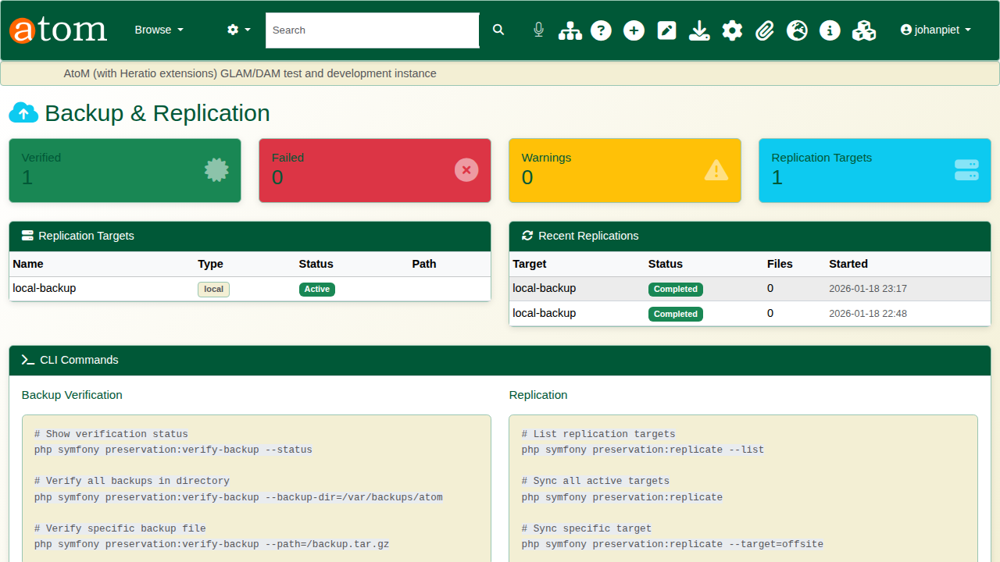
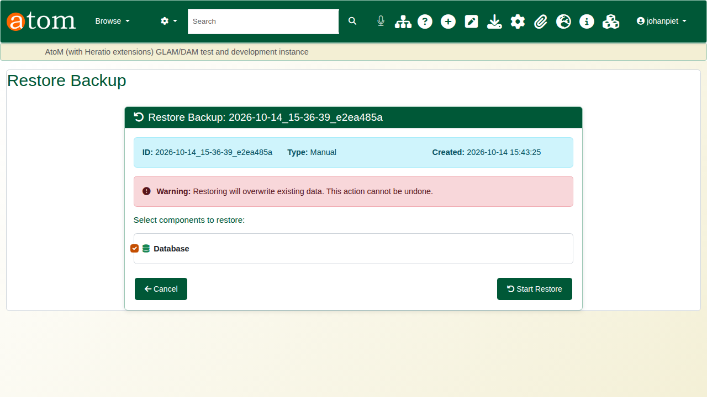
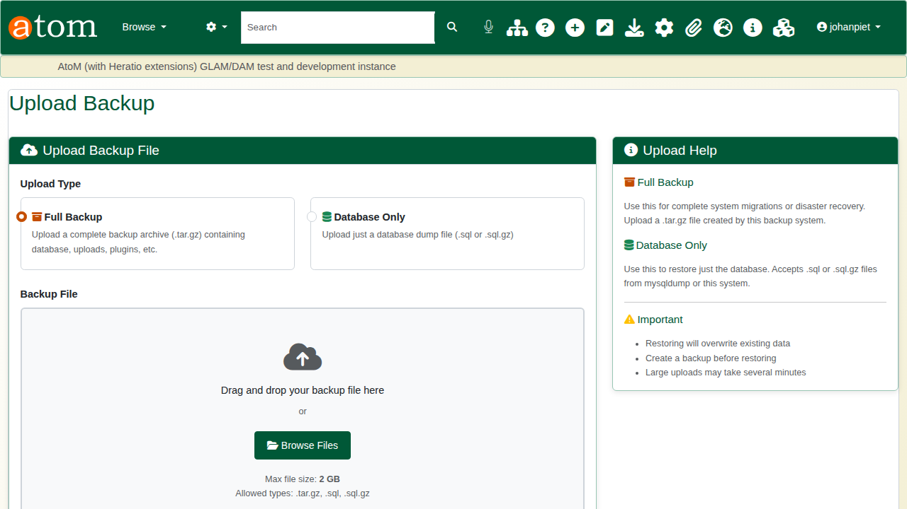

| Field | Value |
|---|---|
| Document title | Training: Preservation, Part 3 - Backup and Restore |
| Author | Dr Johan Pieterse |
| Owner | The Archive and Heritage Group (Pty) Ltd |
| Version | 1.0 |
| Status | Released |
| Date | 14 October 2026 |
| Prepared for | System administrators and archivists using the AHG extensions |
| Classification | Public |
| Reference | AHG-TRN-PRS-03 |

: Document control

This guide goes with part 3 of the preservation training videos. You set where backups are kept, make a database backup, see it listed and verified, and look at how a backup is restored. Allow about 15 minutes.

## Before you start

| What | Notes |
|---|---|
| An administrator account | **Admin > Backup & Restore** (`/backup`). |
| Separate storage | Network storage or another disk the web server can write to. |
| Care with restore | Restoring overwrites the live database. Practise restores on a test system, never on production. |

: What you need before you start

## 1. Settings

**Settings** (`/backup/settings`) sets:

| Setting | Notes |
|---|---|
| Backup path | Where backups are written. Keep it off the server's own disk; it must be writable by the web server user. |
| Log path | The backup log. |
| Max backups, retention days | Older backups beyond these limits are removed. |
| Default components | Database, uploads (digital objects), custom plugins, AHG framework. |
| Plugins to back up | Which AHG plugins a plugin backup includes. |

: Backup settings

## 2. Making a backup

The **Backup & Restore** page shows the database, the storage path with the number and total size of backups, quick actions (**Database Only**, **Full Backup**, **Incremental Backup**) and any backup schedules.

Choose **Database Only** (or **Create Backup** to pick components) and start it. The backup runs in the background (`php symfony backup:create`), because a real database takes minutes to dump: the page shows a "Backup running in the background" banner, you can leave and come back, and the list updates when it finishes. A second backup cannot be started while one is running.

Each finished backup is listed with its date, type, components and size, with buttons to restore, download and delete it. On disk it is a folder (the compressed database dump and a `manifest.json`) and a zip of the same. A dump that does not complete (for example, if mysqldump reports an error) fails the backup rather than recording an incomplete one.

Backups can also be scheduled from the page (**Schedules**). Schedules only run if the schedule runner, `php symfony backup:run-scheduled`, is started hourly by cron as the web server user, for example `0 * * * * www-data cd /usr/share/nginx/archive && php symfony backup:run-scheduled`.

## 3. Verification

The preservation scheduler's **Weekly Backup Verification** checks every backup file in the backup path: it records the SHA-256 checksum and tests the archive's integrity. Results appear on **Admin > Preservation > Backup & Replication** (`/admin/preservation/backup`) with the verified, failed and warning counts, and on the scheduler (see part 2). A schedule can be run at once from the scheduler with its play button.

## 4. Restore

Open a backup's restore button to see its details and choose what to restore: database, uploads, plugins or framework (only the components the backup holds are offered). The warning is plain: restoring overwrites existing data and cannot be undone. **Start Restore** asks for confirmation before it begins.

A backup made on another system can be brought in with **Upload Backup**: a full backup archive (.tar.gz) or a database dump (.sql or .sql.gz), up to 2 GB, then restored from the uploaded copy.

## Recap

1. Keep backups on separate storage the web server can write to.
2. Back up on a schedule, and on demand before big changes.
3. Verify backups regularly.
4. Restore with care, knowing exactly what will be overwritten.

Part 4 covers the portable offline export of the catalogue.
