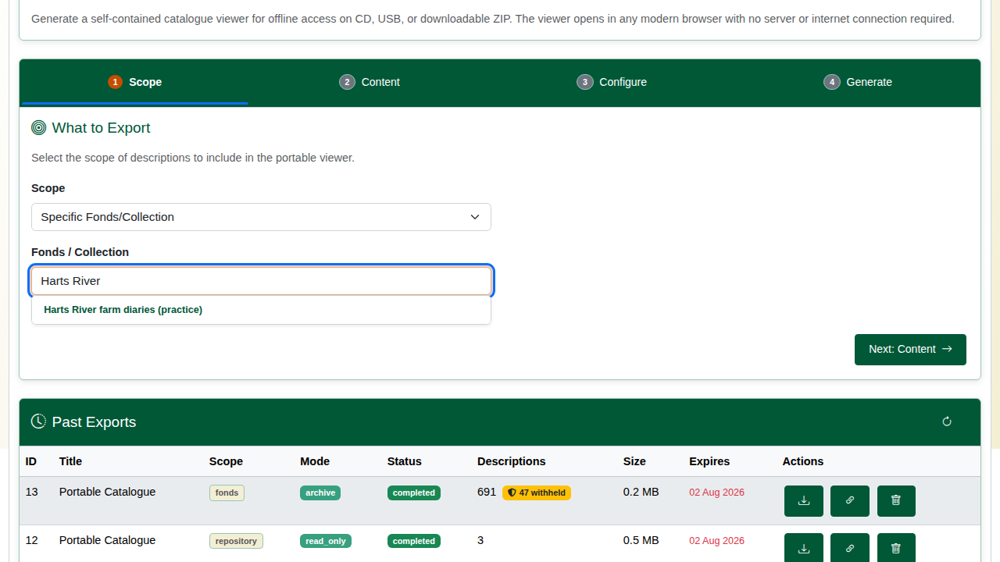
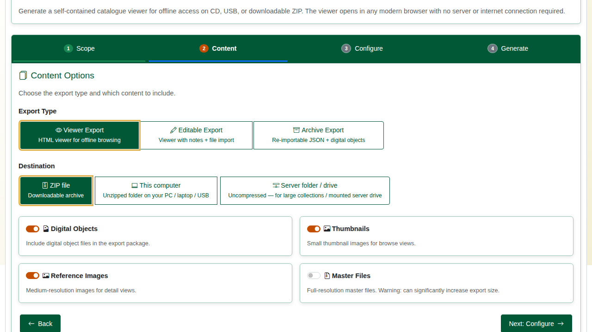
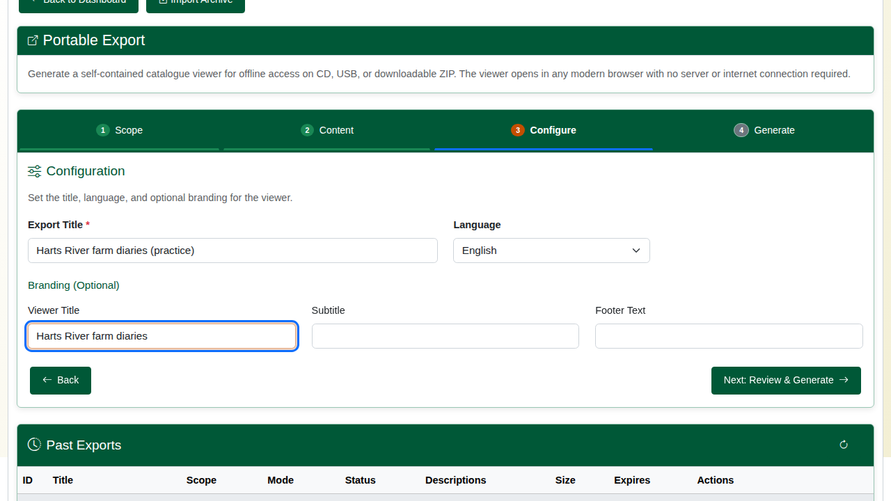
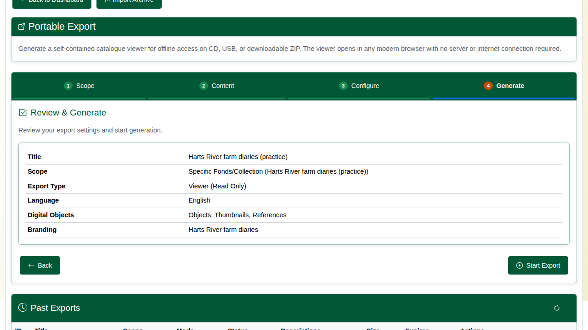
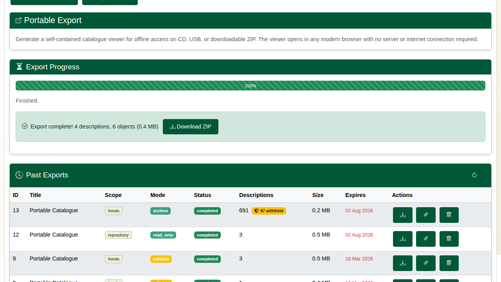
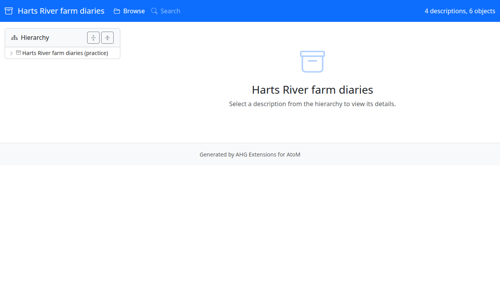
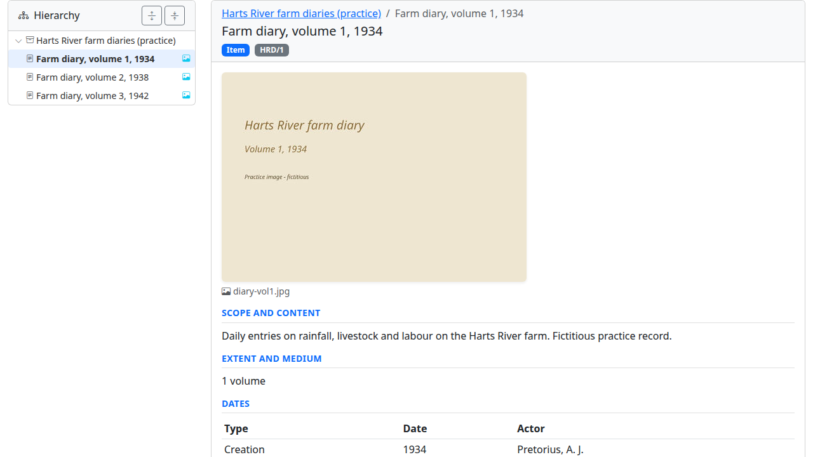
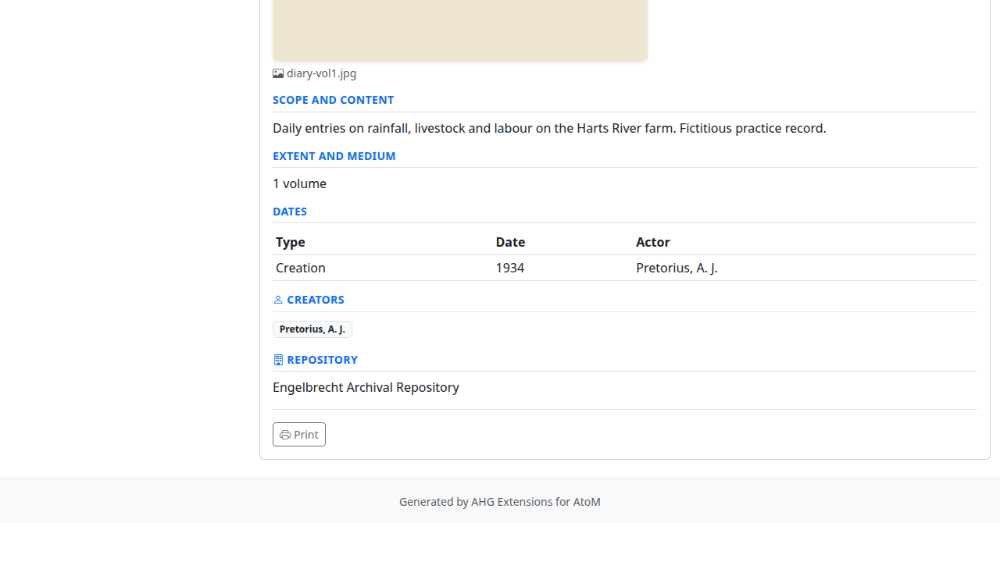
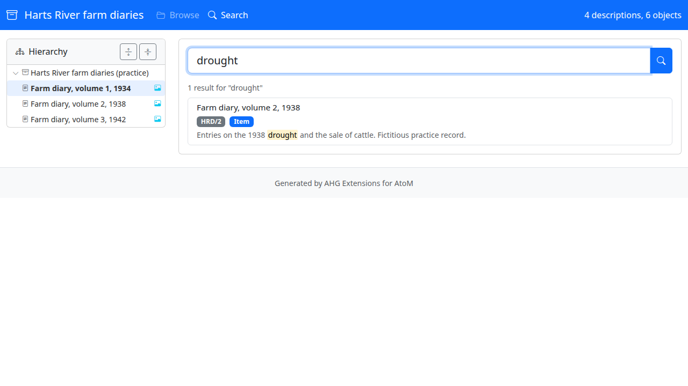
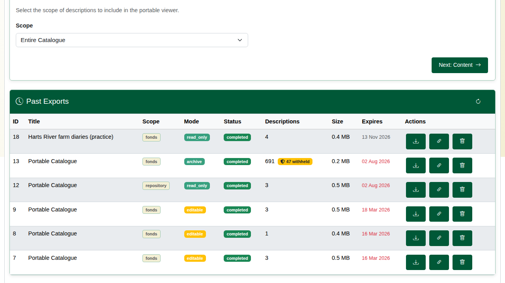

| Field | Value |
|---|---|
| Document title | Training: Preservation, Part 4 - Portable Export |
| Author | Dr Johan Pieterse |
| Owner | The Archive and Heritage Group (Pty) Ltd |
| Version | 1.0 |
| Status | Released |
| Date | 14 October 2026 |
| Prepared for | Archivists and outreach staff using the AHG extensions |
| Classification | Public |
| Reference | AHG-TRN-PRS-04 |

: Document control

This guide goes with part 4, the last part of the preservation training videos. You package the farm diaries from part 1 as a self-contained viewer that opens in any web browser from a USB stick, a CD or a downloaded ZIP, with no server and no internet connection. Allow about 15 minutes.

## Before you start

| What | Notes |
|---|---|
| An administrator account | **Admin > Portable Export** (`/portable-export`). |
| Published records | A viewer export carries published records only. Drafts and records you may not see are withheld and counted. |
| The farm diaries from part 1 | Fictitious practice records, published for this part. |

: What you need before you start

## 1. Scope

Choose what to export: the **Entire Catalogue**, one **Repository**, or a **Specific Fonds/Collection**. For a fonds, type part of its name and pick it from the list.

## 2. Content

| Choice | Options |
|---|---|
| Export type | **Viewer** (read-only HTML viewer); **Editable** (viewer where the reader can add notes, which can be imported back); **Archive** (re-importable JSON with the digital objects) |
| Destination | **ZIP file** to download; **This computer** (an unzipped folder written to a folder you pick, in browsers that allow it); **Server folder / drive** (uncompressed, for large collections) |
| Include | Digital objects, thumbnails, reference images, and optionally the full-size master files (much larger) |

: Content options

## 3. Configure

Give the export a title and choose the language. Optional branding sets the viewer's own title, subtitle and footer.

## 4. Generate

Review the choices and click **Start Export**. The export runs in the background (`php symfony portable:export`) and reports its progress. When it finishes it shows how many descriptions and objects went in, with **Download ZIP**.

Records left out (unpublished, restricted for the exporting user, under cultural protocols or access policies, or PII-redacted files) are counted on the export and listed in the package's `data/disclosure-summary.json`. If nothing in the scope can be exported, the export stops with the reason instead of producing an empty package.

## 5. The offline viewer

Unzip the download and open `index.html`. The viewer runs straight from the folder: the hierarchy on the left, each description with its images, dates, creators and other fields, and **Search** across the text.

## 6. Managing exports

**Past Exports** lists each export with its scope, type, status, descriptions, size and expiry date. Each can be downloaded again, shared through a time-limited download link (with an optional download limit), or deleted. Expired exports and their files are removed nightly by `php symfony portable:cleanup`, run from cron.

## Recap

1. Choose the scope.
2. Choose the export type and what to include.
3. Brand it if you wish, and generate it.
4. The result opens in any browser, offline.

That completes the preservation training series.
