| Field | Value |
|---|---|
| Document title | Training: Research Portal, Part 5 - Reproduction Requests |
| Author | Dr Johan Pieterse |
| Owner | The Archive and Heritage Group (Pty) Ltd |
| Version | 1.0 |
| Status | Released |
| Date | 10 October 2026 |
| Prepared for | Researchers and reading-room staff using the AHG extensions |
| Classification | Public |
| Reference | AHG-TRN-RES-05 |

: Document control

This guide goes with part 5 of the research portal training videos. A researcher asks for copies of two records. Staff then triage the request from the Requests Dashboard, keep the correspondence with it, and close it once it is fulfilled. Allow about 15 minutes.

## Before you start

| What | Notes |
|---|---|
| An approved researcher account | See part 1. |
| A staff account | An administrator or editor processes requests. Researchers see only their own requests; only staff see everyone's. |

: What you need before you start

## 1. Make a request (researcher)

From the research sidebar, open **Reproduction Requests** and click **New Request**.

| Field | Choices |
|---|---|
| Purpose of Reproduction | Academic research, publication, exhibition, documentary/film, personal use, commercial use, other |
| Intended Use | How the copies will be used |
| Publication Details | Title, publisher and date, for publication or commercial use |
| Delivery Method | Digital download, email, physical copy (post), collect in person |
| Urgency | Normal (10-15 working days), high (5-7), rush (2-3, additional fee) |

: Request details

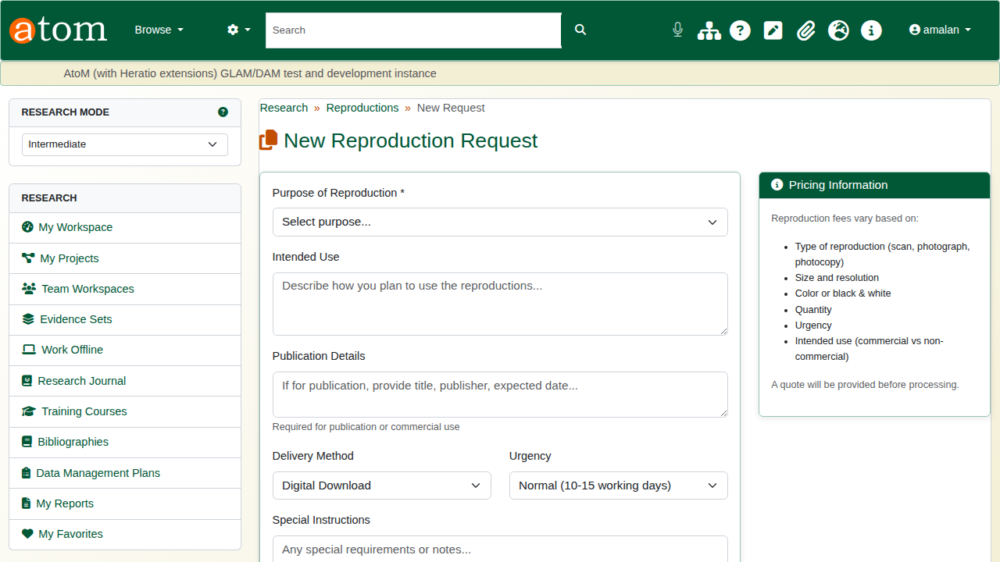

Under **Optional: Add First Item**, search the archive for the first record, and choose the type of copy, the format and any specifications.

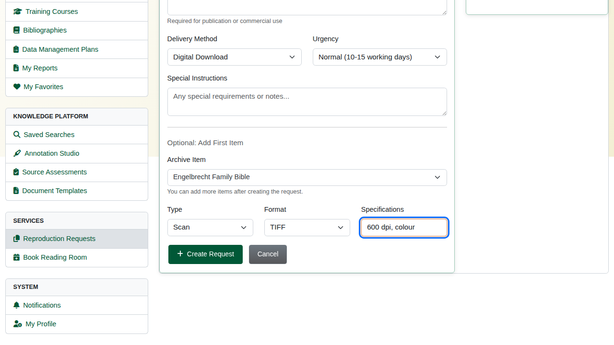

Click **Create Request**. The request is saved as a **draft** with its own reference number, so more items can be added before it is sent.

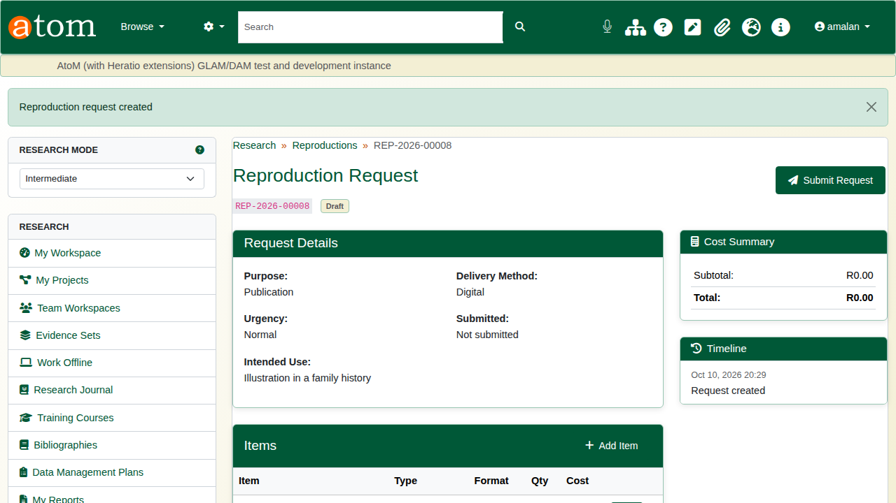

The deliberate mistake: click **Add Item** and add it without choosing a record. The form refuses an item that is not in the archive.

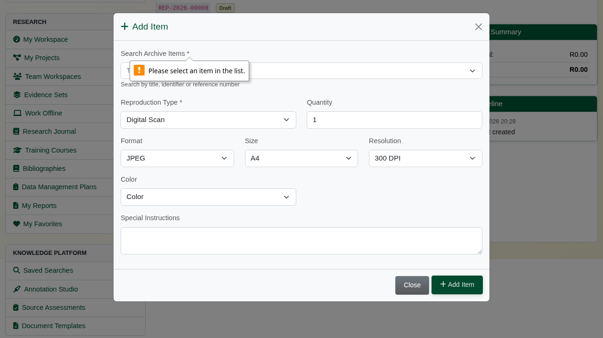

Search for the record, choose the reproduction type (digital scan, photograph, photocopy, microfilm, certified copy), format, size, resolution and colour, and click **Add Item**.

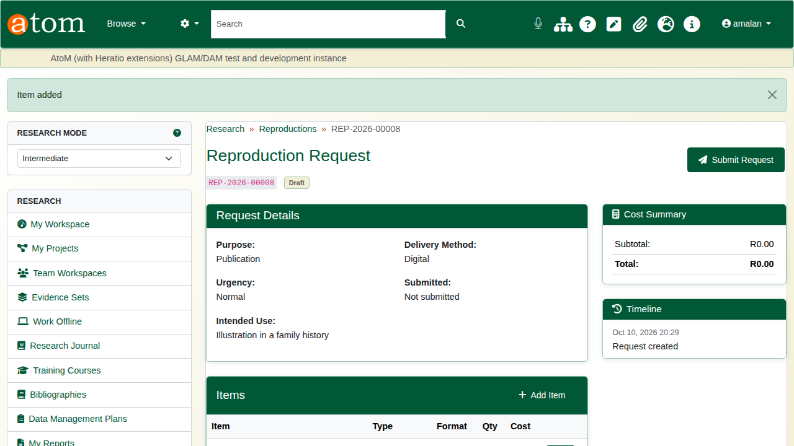

Click **Submit Request**. The status changes to **submitted**, the date is recorded, and the archive is notified by email.

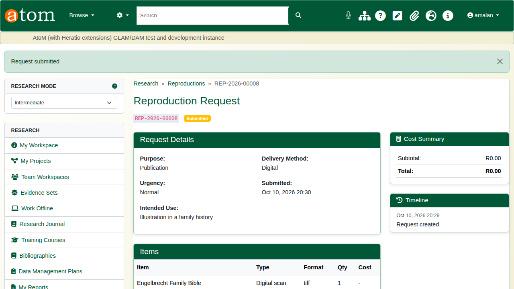

## 2. Review and complete (staff)

Open the **Requests Dashboard** (`/research/requests-dashboard`). Material requests and reproduction requests are listed side by side, each with its status, triage state and service-level clock.

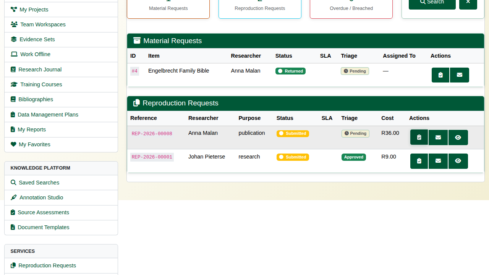

Click **Triage** on the request. It shows who is asking, why, and for what. Choose **Approve**, **Deny** or **Needs Information**, add a note, and click **Submit Decision**.

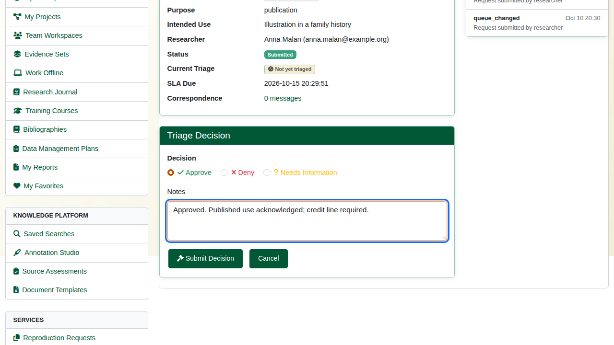

Click **Correspondence** to keep a record of what was said about the request. Tick **Internal note** for notes meant only for staff. The correspondence is kept with the request; it is not emailed to the researcher.

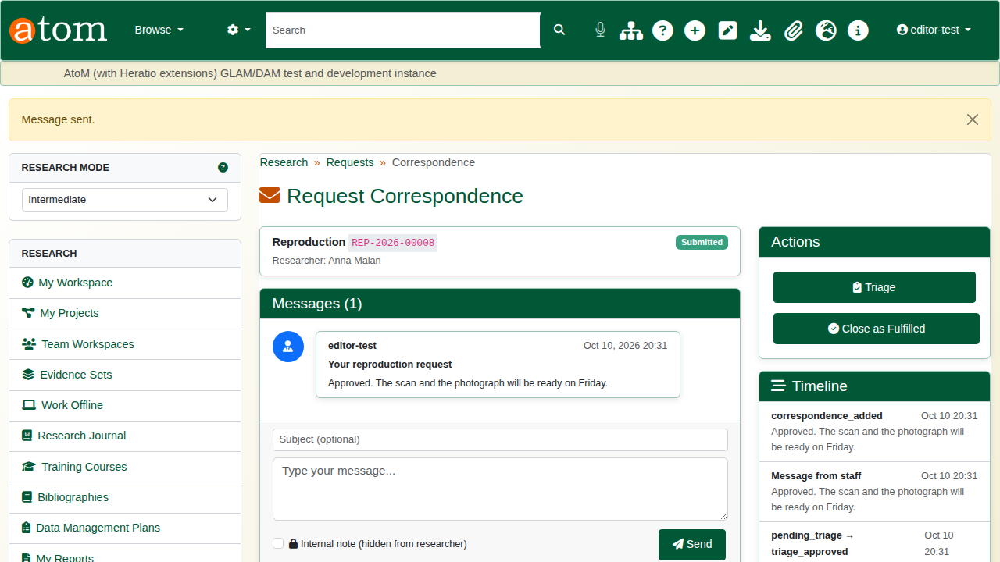

When the copies have been delivered, click **Close as Fulfilled**. The request becomes **completed**.

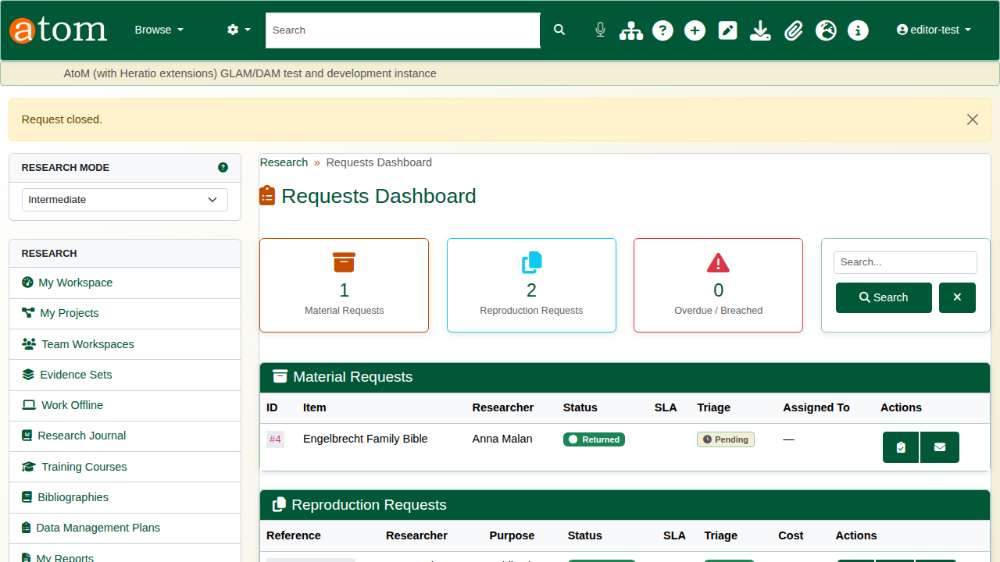

## 3. The researcher's view

The researcher's request now shows **Completed**, with each step in its timeline.

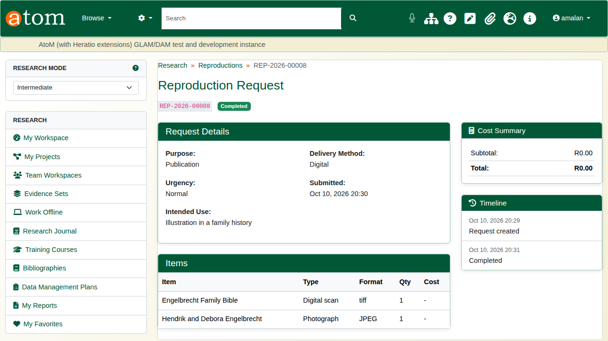

## Recap

1. Create a request and say why the copies are needed.
2. Add each record and the kind of copy wanted.
3. Submit it.
4. Staff triage it from the Requests Dashboard.
5. Keep the correspondence with it, and close it when fulfilled.

Part 6 covers researcher submissions.
