| Field | Value |
|---|---|
| Document title | Training: Research Portal, Part 6 - Researcher Submissions |
| Author | Dr Johan Pieterse |
| Owner | The Archive and Heritage Group (Pty) Ltd |
| Version | 1.0 |
| Status | Released |
| Date | 11 October 2026 |
| Prepared for | Researchers and archivists using the AHG extensions |
| Classification | Public |
| Reference | AHG-TRN-RES-06 |

: Document control

This guide goes with part 6 of the research portal training videos. A researcher who holds records of her own, family letters for instance, describes them and offers them to the archive. The archive reviews the submission in two workflow steps, then an administrator publishes it as archival descriptions with the files attached. Allow about 20 minutes.

## Before you start

| What | Notes |
|---|---|
| An approved researcher account | See part 1. Researchers see only their own submissions. |
| A reviewer and an administrator | Staff claim and approve the review steps; only an administrator can publish. |
| The practice file | `engelbrecht-letter-1912-practice.jpg` in `docs/training-files/` of the AHG extensions catalogue: a practice image of a letter. |

: What you need before you start

## 1. Build a submission (researcher)

From the user menu, choose **My Submissions**, then **New Submission**. Give it a title and a description, and choose the **Target Repository** that should keep the records. A submission can also be linked to a research project or placed under an existing record. Click **Create Submission**.

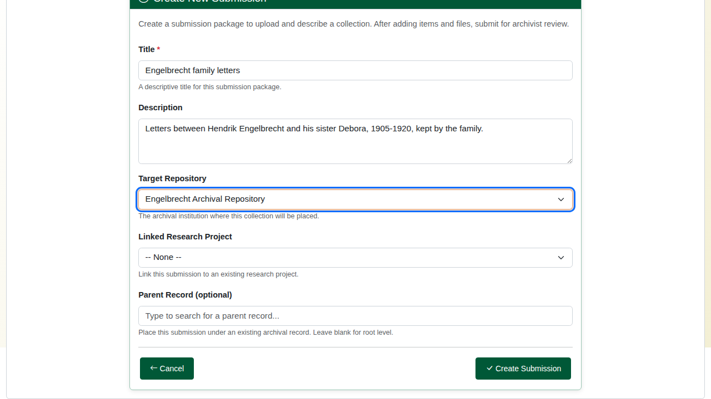

The submission is a **draft**. **Submit for Review** stays disabled until it holds at least one description.

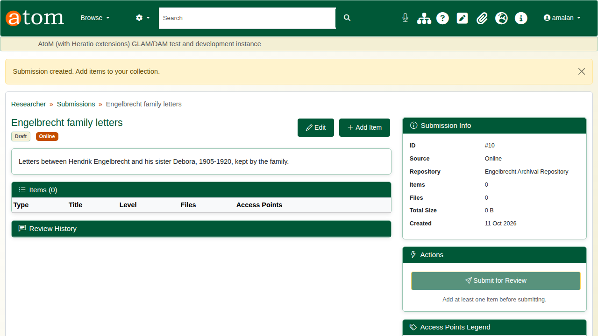

Click **Add Item**. The item form follows ISAD(G): type, parent item (for a hierarchy), title, identifier, level of description, dates, extent and medium, scope and content, creators, subjects, places, genres, access and reproduction conditions, and notes.

The deliberate mistake: an end date before the start date. On **Save** the form comes back with "The end date is before the start date". Everything typed is kept, so correct the date and save again.

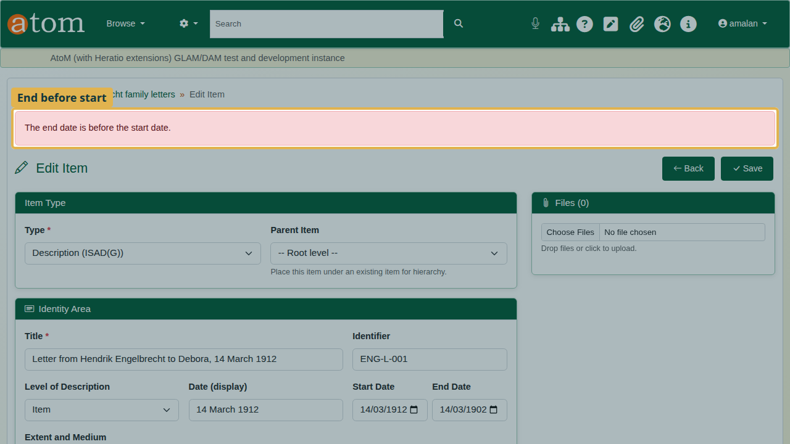

Once the item is saved, **Files** accepts uploads. Each file is stored with a SHA-256 checksum, so the archive can show it has not changed.

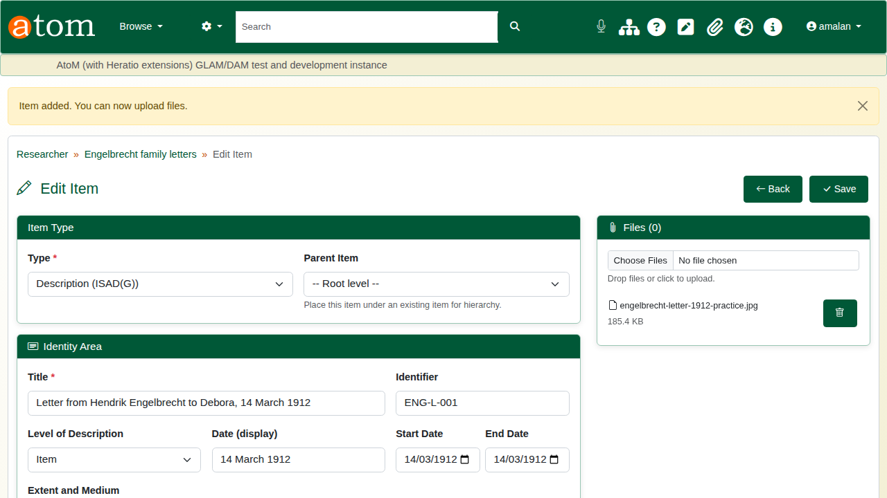

Back on the submission, click **Submit for Review**. The submission is locked while it is reviewed.

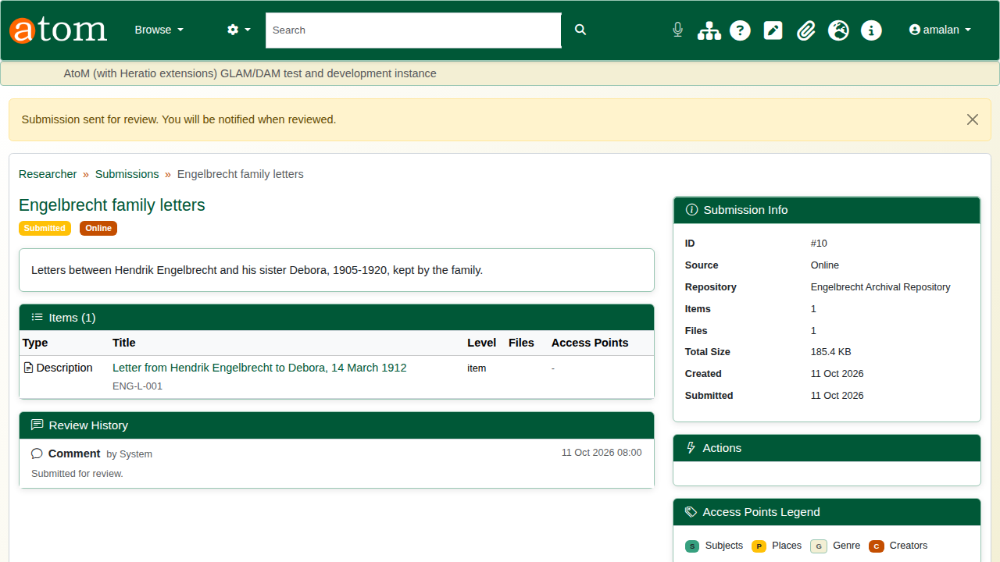

## 2. Review and approve (staff)

Submissions go through the **Researcher Submission Review** workflow, which has two steps: **Content Review** and **Publication Approval**. Open the workflow **Task Pool** (`/workflow/pool`) and click **Claim Task** on the submission.

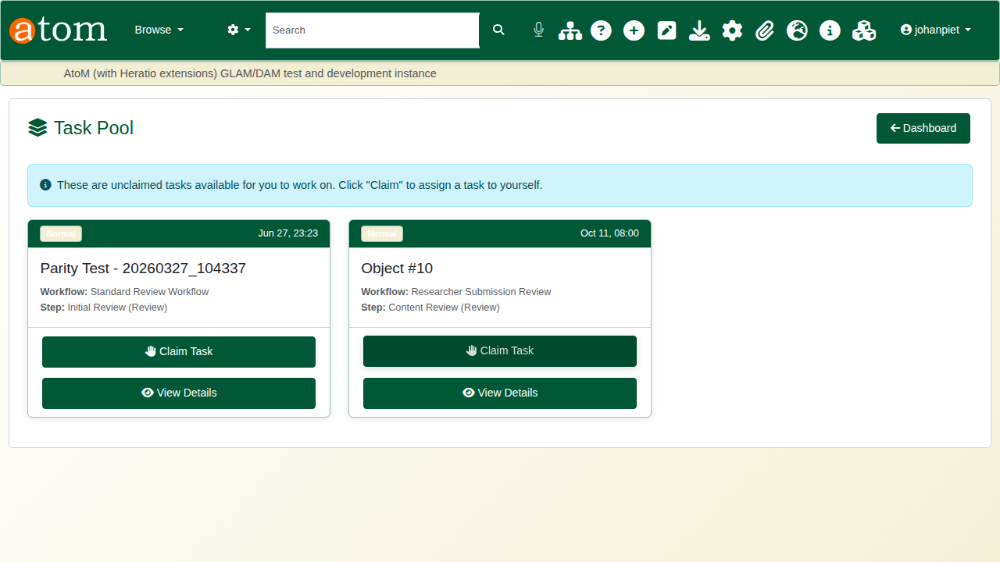

Read the instructions, check the description, write a comment and click **Approve**. **Reject** returns the submission to the researcher, who can correct and resubmit it.

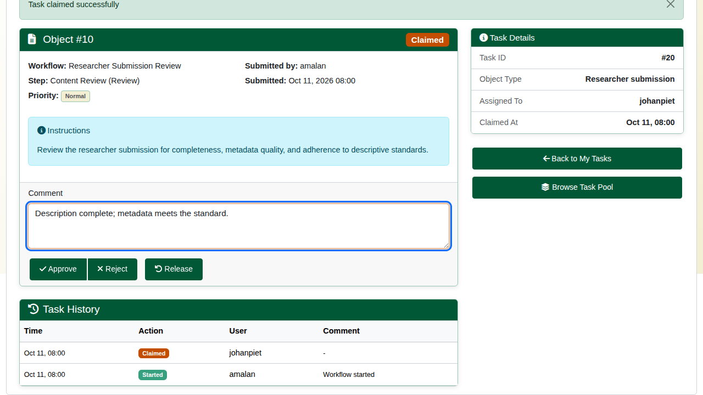

The second step, **Publication Approval**, appears in the pool. Claim and approve it the same way.

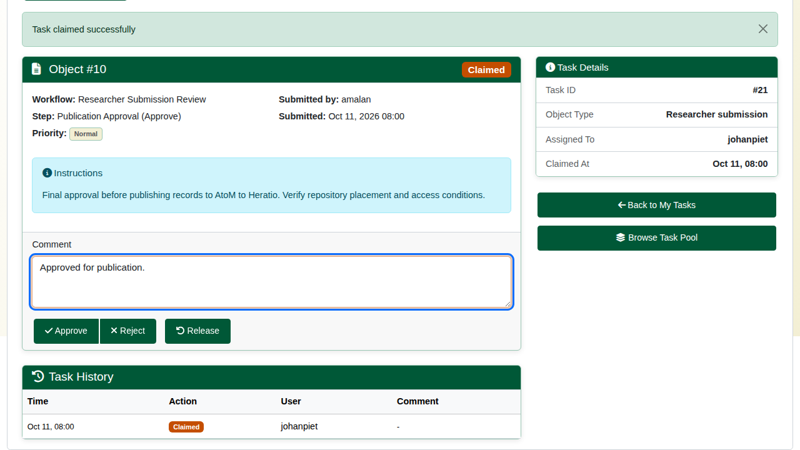

## 3. Publish (administrator)

The submission is now **approved**. On the submission, click **Publish to AtoM**. The confirmation page summarises what will be created, because publishing makes permanent records. Click **Publish Now**.

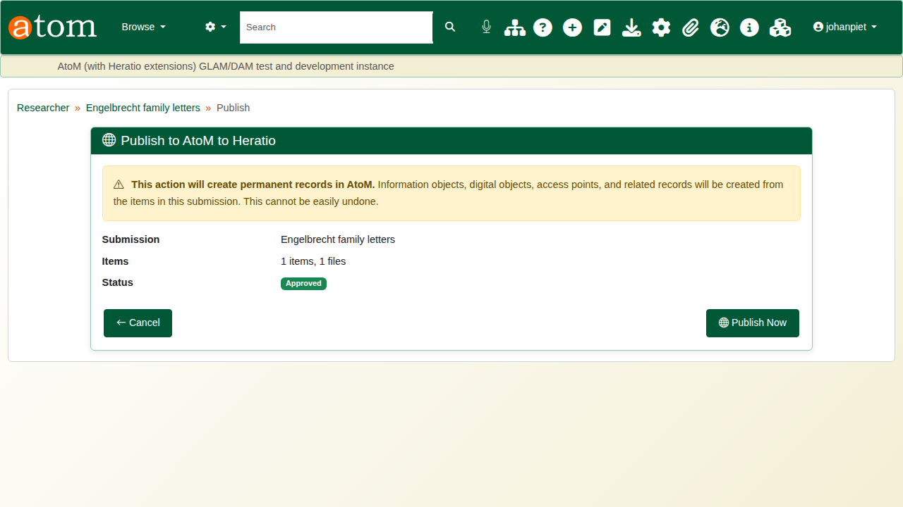

Publishing creates the archival descriptions in the chosen repository, with their dates and access points. Each attached file becomes a digital object with a reference image and a thumbnail. The new records are **published** and searchable straight away. Each item is created whole or not at all: if one fails, nothing half-made is left behind, and the error is listed.

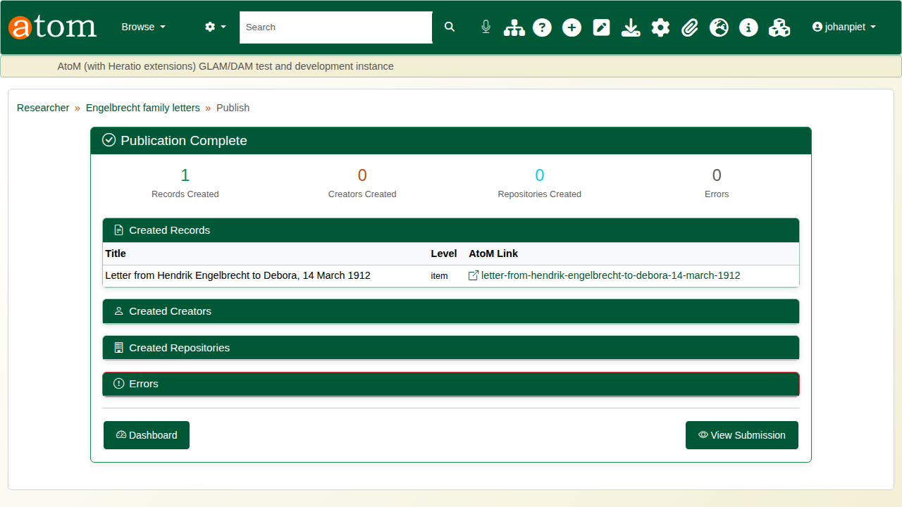

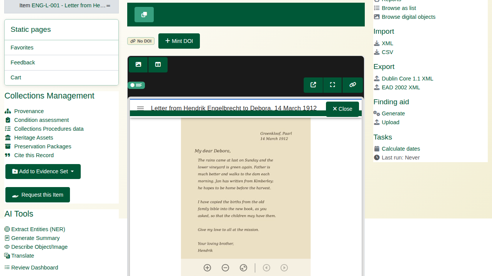

The researcher sees the submission as **published**, with its review history.

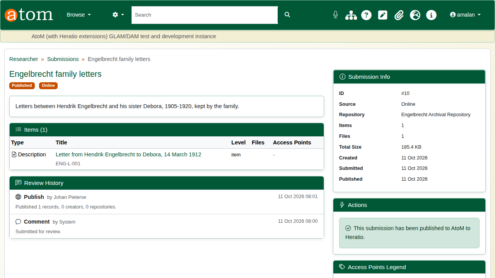

## Recap

1. Create a submission and choose the repository.
2. Describe each item; the dates are checked.
3. Attach the files.
4. Submit; staff approve it in two workflow steps.
5. An administrator publishes it into the catalogue.

Part 7 covers turning research into a manuscript for a journal.
