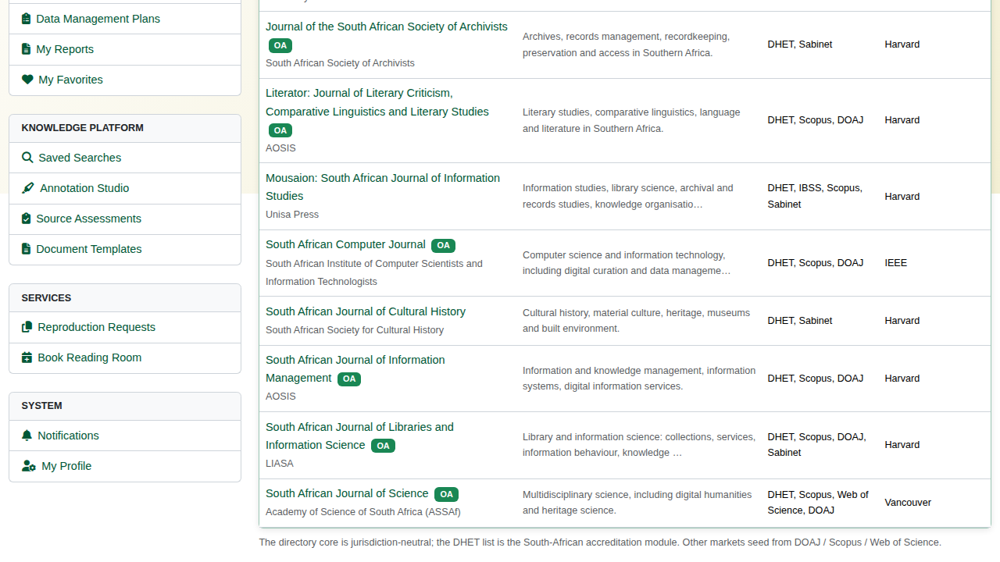
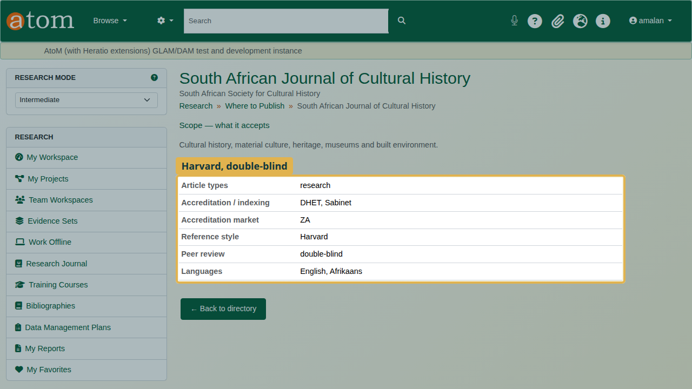
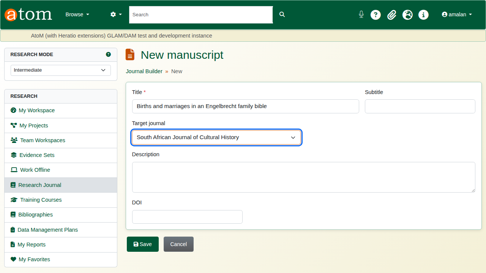
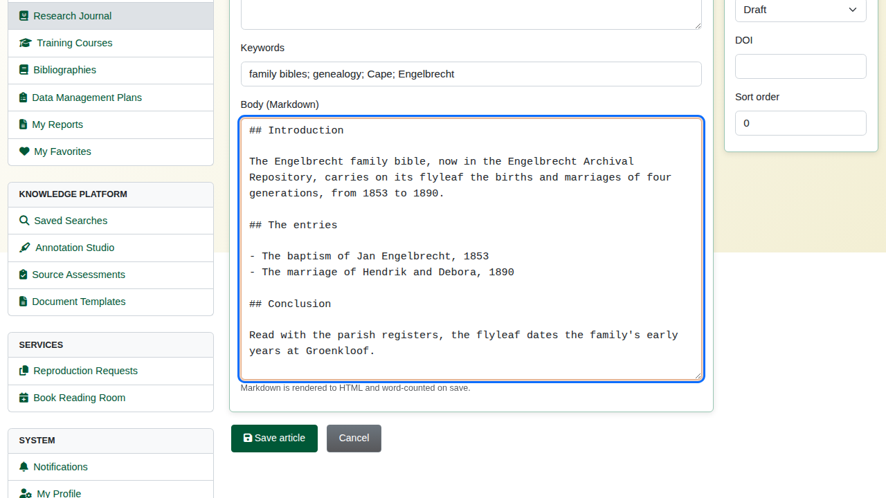
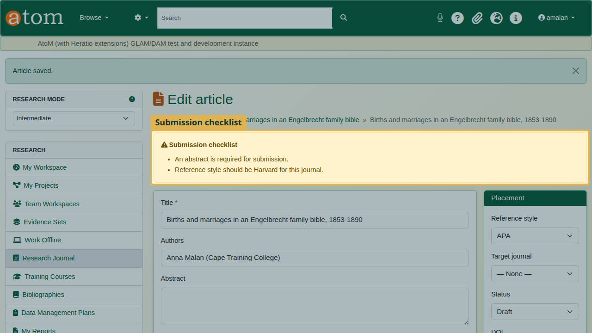
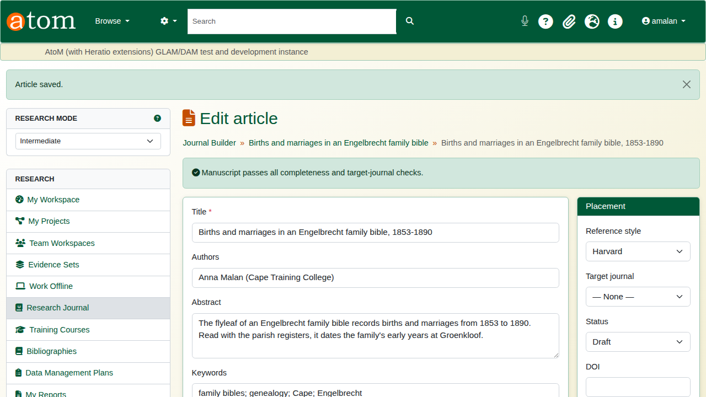
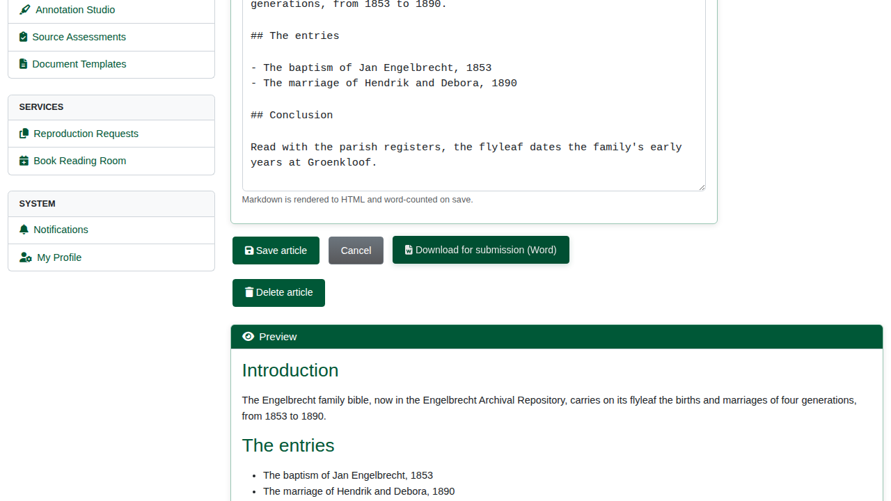
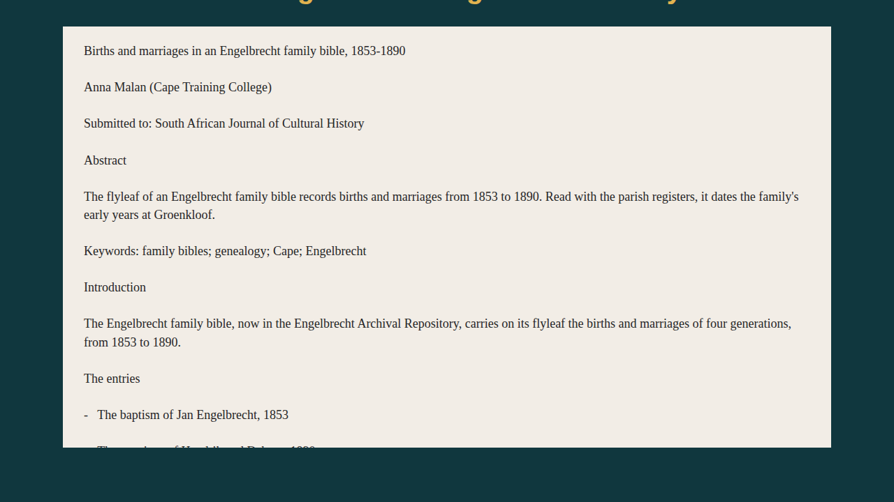

| Field | Value |
|---|---|
| Document title | Training: Research Portal, Part 7 - From Research to a Manuscript |
| Author | Dr Johan Pieterse |
| Owner | The Archive and Heritage Group (Pty) Ltd |
| Version | 1.0 |
| Status | Released |
| Date | 12 October 2026 |
| Prepared for | Researchers using the AHG extensions |
| Classification | Public |
| Reference | AHG-TRN-RES-07 |

: Document control

This guide goes with part 7, the last of the research portal training videos. The researcher chooses a journal to publish in and drafts her article in the manuscript workspace. She checks it against the journal's requirements, then downloads it as a Word document ready to submit. Allow about 15 minutes.

## Before you start

| What | Notes |
|---|---|
| An approved researcher account | See part 1. Manuscripts are private to their author. |
| The journal directory | Kept by the archive's administrators; researchers browse it and choose from it. |

: What you need before you start

## 1. Choose a journal

Open **Where to Publish** (`/research/target-journals`). The directory lists each journal's scope, where it is indexed or accredited, and the reference style it expects. Search by title, scope, publisher or indexing, or filter by market.

Open a journal to read its submission rules: article types, accreditation, reference style, peer review and languages.

## 2. Draft the manuscript

Open the **Journal Builder** (`/research/journal-builder`) and click **New manuscript**. Give it a title and choose its **Target journal**, then save.

On the manuscript, click **New manuscript article**. Enter the title, the authors, an abstract and keywords, then write the body in Markdown: `##` for headings, `-` for list items, a blank line between paragraphs.

## 3. The submission checklist

The deliberate mistake: leave the abstract empty and set the reference style to APA. On **Save article** the **Submission checklist** lists what stands between the manuscript and submission:

| Check | Example message |
|---|---|
| Completeness | An abstract is required for submission. (Also title, at least one author, and a body.) |
| Reference style | Reference style should be Harvard for this journal. |
| Word limit | Manuscript exceeds the journal's word limit, when the journal sets one. |

: What the checklist checks

The article is checked against its own target journal or, if it has none, against the manuscript's. Below the form, a preview shows the article as rendered.

Write the abstract, choose Harvard, and save again. The manuscript passes every check.

## 4. Download for submission

Click **Download for submission (Word)**. The document carries the title, the authors, the target journal, the abstract, the keywords and the article body with its headings and lists.

## Recap

1. Choose a journal from Where to Publish and note what it expects.
2. Create a manuscript aimed at it, and add the article.
3. Write the body in Markdown.
4. Fix what the submission checklist finds.
5. Download it for submission.

This completes the research portal series.
