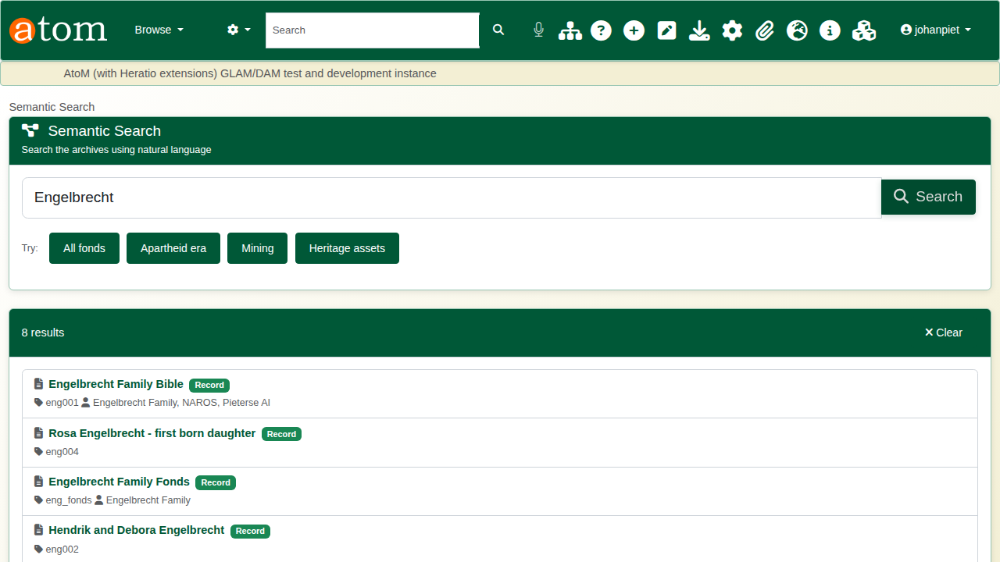
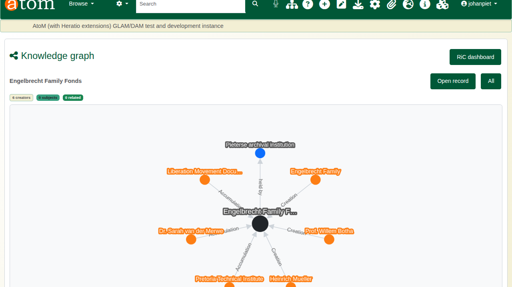
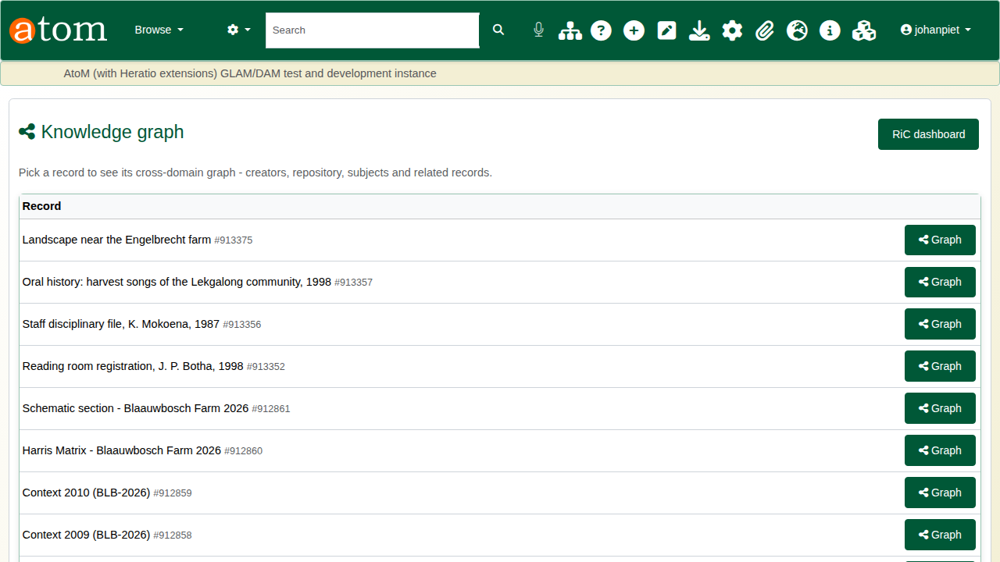
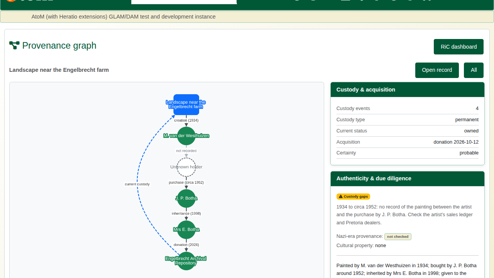
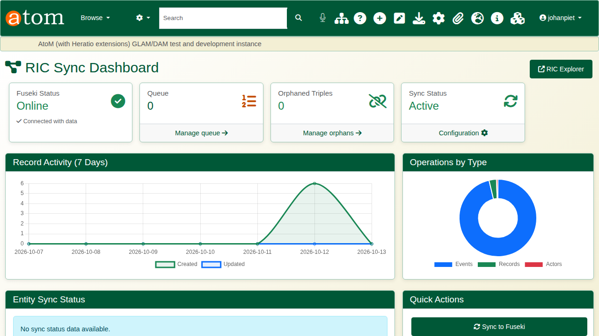

| Field | Value |
|---|---|
| Document title | Walkthrough: Records in Contexts and Graph Discovery |
| Author | Dr Johan Pieterse |
| Owner | The Archive and Heritage Group (Pty) Ltd |
| Version | 1.0 |
| Status | Released |
| Date | 13 October 2026 |
| Prepared for | Archivists, researchers and administrators using the AHG extensions |
| Classification | Public |
| Reference | AHG-TRN-RIC-01 |

: Document control

This guide goes with the Records in Contexts walkthrough video. You search the catalogue in plain words, open a record's knowledge graph, follow a painting's chain of custody in the provenance graph, and check the dashboard that keeps the graph in step with the catalogue. Allow about 10 minutes.

## Before you start

| What | Notes |
|---|---|
| An administrator account | The graph pages and the RiC dashboard are staff pages. |
| Records with creators and a holder | The example uses the Engelbrecht Family Fonds. |
| An object with provenance recorded | The painting from part 4 of the museum series. Every owner and date in its history is fictitious. |

: What you need before you start

## What Records in Contexts is

Records in Contexts (RiC) is the International Council on Archives' model for describing records as a network rather than a tree. The AHG extensions publish every description, creator and repository as linked data to a graph store, using the RiC ontology (RiC-O), so a connection can be followed in any direction: from a record to its creators, from a creator to everything they made, from a holder to everything it holds.

## 1. Semantic search

Open **Semantic Search** (`/ricSemanticSearch/index`). Type a question in plain words and click **Search**.

| Ask for | What comes back |
|---|---|
| A name, such as *Engelbrecht* | Records and authority records that match, across the whole collection |
| *all fonds*, *all series*, *all collections* | Descriptions at that level only |
| *records between 1930-1960* | Descriptions whose own dates overlap that period |

: What semantic search understands

## 2. The knowledge graph

Open the knowledge graph for a record (`/ricExplorer/knowledge-graph/<record id>`). The record sits in the centre. Around it:

| Colour | Node |
|---|---|
| Dark | The record itself |
| Orange | Creators and accumulators |
| Blue | The repository that holds it |
| Teal | Subjects |
| Green | Related records |

: Knowledge graph colours

Every line is labelled with its relationship: creation, accumulation, held by. Nodes can be dragged to make room.

**Open record** returns to the description. **All** lists every record that has a graph, each with a **Graph** button.

## 3. The provenance graph

Open the provenance graph for an object (`/ricExplorer/provenance/<record id>`). It draws the chain of custody recorded on the object's Provenance page, top to bottom in date order, with each transfer labelled by its type and date. The archive's current custody is the dashed blue line back to the object.

Where an event has no recorded seller, the graph shows an **Unknown holder** with a dashed outline, joined to the previous holder by a dashed **not recorded** line. For the painting, that is the gap between the artist in 1934 and the purchase by J. P. Botha around 1952.

Beside the graph, **Custody & acquisition** summarises the record and **Authenticity & due diligence** shows the gaps as they were recorded, the Nazi-era provenance check and the cultural property status.

## 4. Keeping the graph in step

Administrators open **RiC Tools > Dashboard** (`/admin/ric`).

| Panel | Shows |
|---|---|
| Fuseki Status | Whether the graph store is online and holds data |
| Queue | Changes waiting to be sent to the graph |
| Orphaned Triples | Graph entries whose record no longer exists in the catalogue |
| Record Activity | Records created and updated over the last seven days |
| Quick Actions | Sync to Fuseki, Run Integrity Check, Preview Cleanup |

: RiC dashboard panels

**Run Integrity Check** compares the graph with the catalogue and reports anything out of step; **Preview Cleanup** shows what would be removed before anything is.

## Recap

1. Search in plain words.
2. Open a record's knowledge graph to see who made and holds it.
3. Follow an object's custody in the provenance graph, gaps included.
4. Watch the dashboard to keep the graph and the catalogue in step.
